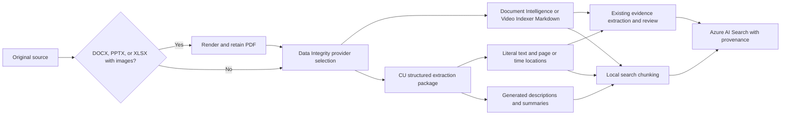

# Data Integrity: Content Understanding migration

Production document and audio routing was enabled on 28 October 2026, matching
Test, while video remains on Video Indexer. See the
Production execution record (operational record retained privately).
The earlier design and evaluation history below describes the original rollout.

The primary goal is better RAG retrieval from Azure AI Search: recover useful
text, tables, and visual or media descriptions, form useful retrieval chunks,
and return enough source context to ground answers. Provider compatibility is
an implementation prerequisite; adoption depends on measured retrieval gains.

Data Integrity can call Azure Content Understanding directly while Data Ingestion
continues to control chunking, embeddings, Search indexing, and evidence review.
Providers are selected independently for documents, audio, and video. The shipped
defaults retain Document Intelligence and Video Indexer. No deployed settings,
analyzers, resource defaults, or model deployments are changed by this work.

## Processing contract



CU uses GA API `2025-11-01` with explicit UTF-16 spans and `returnDetails`.
The [June 2026 preview evaluation](content-understanding-preview-evaluation.md)
records live extraction and Azure AI Search comparisons, signature compatibility
requirements, and the prerequisites for changing that version. The maintainer
decided on October 12, 2026 to stay with GA and defer preview adoption.
The version 1 package retains the raw response, usage, warnings, analyzer/API
identity, configuration hash, analyzed-byte SHA-256, literal blocks, generated
blocks, canonical quotation offsets, page regions, media phrase times and speakers,
and video key-frame timestamps. It accompanies the compatibility Markdown through
the ingestion API and evidence worker. Both artifacts must exist for a cache hit.

Document quotations are constructed from structured paragraphs, literal table
cells, uncovered OCR words, formulas/barcodes, and source annotations. Table markup
retains merged cells. Cross-page tables retain all contributing page/region
references. Generated figure descriptions, chart representations, summaries, and
custom analyzer fields are separate blocks. They receive an `AI-generated` label
and `contentOrigin: generated`; they never enter the evidence quotation source.

Before publishing a document package, Data Integrity validates the union of
retained literal UTF-16 spans against every content's source Markdown. Only
whitespace, known heading/page markers, recognized figure-link syntax, and
matching structured figure analysis may remain outside literal spans. Figure
alt text must have its own paragraph/OCR coverage; an enclosing figure span cannot
hide missing photo text. Figure spans may include a caption before the image link;
the caption still requires literal coverage, and only the matching figure's link
syntax is treated as formatting. Recognized `PageHeader`/`PageFooter` comments account only
for their wrapper syntax; their contents still require paragraph/OCR coverage,
including any figure alt text. Annotation spans locate the commented-on text and likewise
cannot stand in for its missing extraction. Unexplained text rejects publication
with the content index and UTF-16 offset, without logging source text. Unrecognized
Markdown formats fail this check until explicitly supported.

Validated document packages carry `markdownCoverageVersion: 1`. Older cached
document packages are rebuilt and checked from their saved CU operation; this does
not change the paid analysis identity or require another submission. Audio/video
retain their separate transcript contract.

Ingestion chunks use structured block/page boundaries and local token limits.
Oversized tables repeat headers where possible; an oversized row is split into
bounded text with its original table/region provenance. No service-assisted
semantic chunking or Azure AI Search skillset is introduced. Legacy Markdown is
split by page before syntax chunking; a trailing page separator no longer creates
a fictitious page.

Media evidence uses exact transcript text. Speaker labels and supplied recording
metadata are separate attribution context. Recording offsets are milliseconds,
not calendar dates. Canonical source spans used by the existing evidence algorithm
are preserved, with additional original-time citations and empty physical-page
lists in indexed media records. Speaker-name feedback must reference the same CU
analysis ID. Ingestion first resolves the current CU operation without speaker
names, using the source byte hash and CU configuration through the operation
journal. It reuses feedback only when the row's analysis ID matches that result;
old Video Indexer feedback and feedback from earlier source/configuration versions
prompt a fresh request with the current ID. Stale names and recording metadata
are omitted. Matching feedback is adapted from the saved raw response without
another paid CU analysis submission. A pending row for the current analysis
prevents another feedback request on retry. Resolving the operation streams and
hashes the staged source again, so CU media retries add Blob I/O even when a
Markdown artifact already exists.
Video phrases that cross segment boundaries retain their complete timing, and
identical repeated phrases are deduplicated. Silent segments are accepted.

Search adds filterable `sourceType`, `contentOrigin`, `extractionProvider`,
`analysisId`, `startTimeMs`, and `endTimeMs` fields while retaining existing index
settings. Detailed provenance stays in metadata. Consumers can filter generated
interpretations separately from extracted text and verified evidence.

Document figures and CU video key-frame files are downloaded through CU's
authenticated result-file API and retained in private Blob Storage under
`results/cu-assets/{accountHash}/{sourceHash}/{analysisId}/`. Each package asset
records its Blob URL/container/path, SHA-256, image type and byte size, source
block IDs, pages/regions, and key-frame time where applicable. Markdown links
use stable Blob URLs without SAS credentials; authorized consumers resolve
private access when displaying the image. The package, not an inline base64
payload, carries the references to Data Ingestion. Its Search chunk metadata
retains the related images so retrieved visual descriptions can lead to the
actual figure or frame.

CU figures with zero-length Markdown spans use their explicit `D(page,...)`
source coordinates to identify a page in the same document content. Their image
IDs keep asset links distinct even when several figures share an offset. These
figures retain their generated or artifact origin and do not cover literal text.

The current text embedding model embeds OCR, captions, generated descriptions,
and summaries. It does not embed image pixels. Image files are retained for
review or a future multimodal RAG consumer. Image links do not enter literal
quotation text. Job cleanup retains these shared assets. Per-operation asset
receipts let interrupted jobs reuse downloaded images; failed image retrieval
rejects package publication rather than silently publishing broken references.

All extracted text and generated description/summary chunks enter the general
Search index, including when evidence extraction is skipped or deferred. Each
chunk's `content` is the same text used to generate `content_vector`, so visual
details participate in keyword and vector retrieval. For example, a generated
description of front-left fender damage can make a photograph retrievable for
that query even when its literal caption only says “Exhibit C.” Its source page
and region identify the photograph, and its generated origin qualifies the
description when grounding a RAG answer. Evidence extraction is an additional
downstream consumer of the literal text.

## Office rendering before Data Integrity

The SharePoint and downloaded-website document workers render DOCX/PPTX and XLSX
workbooks containing embedded images using
headless LibreOffice before submitting the request to Data Integrity, including
when the selected provider is Document Intelligence. The original file stays in
SharePoint; the request keeps its original filename and carries a rendition
receipt with original/PDF hashes, renderer version, and retained PDF blob location.
CU verifies that it analyzed the recorded PDF bytes.

PDFs and renderer receipts are retained under `results/renditions/`; unchanged
source bytes and renderer version reuse the exact PDF. Job cleanup removes the
temporary source/PDF and job-owned extraction copies, retaining shared conversion
artifacts and renditions. These retained blobs follow the storage account's
existing access and lifecycle policies. Bump `OfficePdfRenderer.RendererVersion`
when font packages or conversion options change, so the rendition cache rebuilds.

The runtime image and CI install Writer, Impress, Calc, Liberation, Carlito, and Caladea
fonts. Local .NET tests require these packages as well. `OFFICE_PDF_RENDERER`
defaults to `soffice`. Each job uses an isolated temporary profile, a three-minute
process deadline, and a 200 MB source-size limit; conversion failure rejects the
job. LibreOffice layout can differ from Microsoft Office. Citation page numbers
refer to the retained PDF; inspect font substitution, comments, tracked changes,
speaker notes, and embedded media in representative Office fixtures before rollout.
Rendering does not guarantee extraction of hidden Office content.

## CSV and spreadsheet ingestion

SharePoint ingestion and downloaded website documents accept CSV and XLSX.
CSV is converted locally to Markdown tables in Data Integrity even when the
document provider is CU. No CSV-to-XLSX conversion, OCR call, or spreadsheet type
inference is needed. Cells retain leading zeros, date strings, formula-looking
text, quoted commas, escaped quotes, and multiline values. Generic column headings
keep the first source record intact for files with or without headers. Ragged
records are padded to the widest record, and markup is escaped. Input uses UTF-8
or BOM-marked Unicode and comma delimiters; blank records are skipped. The source
CSV remains the review artifact; the Markdown is a normalized representation.
Malformed input or a limit violation rejects ingestion rather than publishing a
partial table: 128 MB source, 20,000 records (including any source header), 200
columns, 4,000 characters per cell, and 8 million Markdown characters. CSV has no
physical page coordinates and rejects positional exclusions. Its Markdown uses
the existing local chunking, embedding, and Azure AI Search indexing path.

XLSX without embedded images retains the existing provider behavior: local
worksheet-to-Markdown extraction for the default Document Intelligence route,
or native spreadsheet analysis when CU is selected. XLSX with embedded images is
rendered to PDF before Data Integrity submission. The renderer inspects workbook
image relationships, including drawings and header/footer pictures. Only its
disposable rendering copy is adjusted: sheets become visible, saved print ranges
are cleared, worksheet pictures are enabled for printing, and landscape pages
fit the worksheet width with vertical pagination. The original workbook and its
hash remain unchanged. Citation pages refer to the retained PDF, not sheet numbers.

With CU selected, the PDF supplies literal photo OCR plus separate generated
visual descriptions, and available figure files flow through the existing private
Blob/image-reference contract into Search chunk metadata. Document Intelligence
continues to supply PDF OCR on the default route; retained figure references are
a CU feature. This does not add new embeddings for image pixels. Review large or
very wide sheets, floating images, header/footer pictures, and workbook layout in
the rollout corpus: PDF scaling and rendering can affect OCR quality. Linked remote
pictures are outside the embedded-image path.

Synthetic live validation on October 12, 2026 used a two-sheet XLSX with an
embedded text-bearing PNG on each sheet, one hidden sheet, and a saved print range
excluding a picture. The retained PDF contained both pictures and both sheets.
CU recovered `PHOTO EVIDENCE` and `Blue car stopped at noon` from each picture,
plus worksheet values. The package passed the Data Ingestion parser and local
chunking with original/PDF hash provenance. CU treated these text-bearing pictures
as text and returned no figure files; retained image references remain conditional
on CU returning figures. This fixture validates OCR coverage, not photograph
interpretation or retrieval gains.

## Configuration and recovery

Mounted appsettings supports these settings (the existing appsettings generator
preserves keys added to its generated file):

| Setting | Default or requirement |
| --- | --- |
| `INTEGRITY_DOCUMENT_PROVIDER` | `document-intelligence` or `content-understanding` |
| `INTEGRITY_AUDIO_PROVIDER` | `video-indexer` or `content-understanding` |
| `INTEGRITY_VIDEO_PROVIDER` | `video-indexer` or `content-understanding` |
| `CONTENT_UNDERSTANDING_ENDPOINT` | Required root HTTPS Foundry endpoint when CU is selected |
| `CONTENT_UNDERSTANDING_API_KEY` | Optional; otherwise Microsoft Entra `DefaultAzureCredential` |
| `CONTENT_UNDERSTANDING_DOCUMENT_ANALYZER` | `prebuilt-documentSearch` |
| `CONTENT_UNDERSTANDING_AUDIO_ANALYZER` | `prebuilt-audioSearch` |
| `CONTENT_UNDERSTANDING_VIDEO_ANALYZER` | `prebuilt-videoSearch` |
| `CONTENT_UNDERSTANDING_MODEL_DEPLOYMENTS` | Optional JSON **string** of model aliases to deployed names; required if resource defaults are unset |
| `CONTENT_UNDERSTANDING_PROCESSING_LOCATION` | `geography`; also accepts `dataZone` or `global` |
| `CONTENT_UNDERSTANDING_CONFIGURATION_VERSION` | `1`; increment when analyzer/model configuration changes |
| `CONTENT_UNDERSTANDING_MAX_DOCUMENT_PAGES` | `300`; may be lowered, but not raised above CU's 300-page asynchronous PDF limit |

For PDF inputs, Data Integrity counts pages locally before selecting a provider.
Documents above the configured limit use Document Intelligence
`prebuilt-layout` instead. Its Markdown receives explicit page breaks from the
service's page spans, so evidence extraction and search chunks retain the original
page numbers. This route has a separate conversion cache identity from CU and from
older Document Intelligence Markdown. It retains OCR text and tables but does not
produce CU figure descriptions or figure assets. A failed CU journal from an older
attempt does not block the new route. Encrypted PDFs that open without a user
password are losslessly unlocked with `qpdf` before Document Intelligence; the
page count must remain unchanged. PDFs requiring a password fail before analysis.
PDFs above Document Intelligence's 2,000-page limit also fail before analysis.
The runtime image installs `poppler-utils` and `qpdf` for these checks.

For the tested eastus2 Test resource, these explicit request mappings worked:

```json
{
  "CONTENT_UNDERSTANDING_ENDPOINT": "https://example-ai-test.services.ai.azure.com/",
  "CONTENT_UNDERSTANDING_MODEL_DEPLOYMENTS": "{\"prebuilt-analyzer-completion-mini\":\"gpt-5-mini-qa\",\"prebuilt-analyzer-embedding\":\"text-embedding-3-large\"}",
  "INTEGRITY_DOCUMENT_PROVIDER": "content-understanding",
  "INTEGRITY_AUDIO_PROVIDER": "content-understanding",
  "INTEGRITY_VIDEO_PROVIDER": "video-indexer"
}
```

Verify analyzer details, region availability, model alias mappings, capacity, and
the worker identity's CU and Blob permissions for each environment. Entra Blob
authentication must support read-only user-delegation SAS creation. Source URLs
are short-lived read-only URLs for immutable hashed Blob snapshots. Credentials
and source SAS URLs are not logged; authenticated CU polling only accepts the
configured endpoint and does not follow redirects.

The CU operation journal at `results/cu-operations/` is leased and persisted
before submission. Retry resumes a saved operation or reuses its successful raw
response rather than submitting paid work again. GETs retry transient failures;
POSTs do not automatically retry. Confirmed client rejection is recorded as failed;
HTTP 408 and server errors retain an uncertain submission outcome. Failed or uncertain submissions require journal
inspection before deliberately choosing a new configuration version. `force`
bypasses the Markdown lookup but does not resubmit a successfully journaled CU
analysis. There is no automatic provider fallback after a failed CU analysis.
Explicit positional exclusions, legacy high-resolution document requests, and
unsupported CU media formats (`webm`, `aiff`, `amr`) retain the existing provider.
Media detection checks both `Filename` and `FilePath`, choosing the first name
with a recognized audio/video extension. Provider selection, analyzer cache
identity, and ingestion speaker feedback use that same choice. A media path
therefore takes precedence over a non-media display filename, including CSV and
Office filenames; these requests skip document conversion. Unsupported CU media
extensions retain Video Indexer even when they appear only in `FilePath`.
Keep legacy credentials configured for these paths.

Source snapshots are created only after hashing the ETag-bound source and acquiring
the operation journal lease. The journal first records a `prepared` creation intent
with the original Blob location, byte hash, ETag, and random owner ID, then records
the snapshot ID. The owner ID is also snapshot metadata, so interrupted creation
can recover a storage snapshot whose ID was not saved. Every subsequent submission
and polling state preserves this receipt. A retry that resumes a paid operation
creates no additional snapshot, including when the retry stages identical bytes
under a new temporary Blob name.

Activity cleanup uses an independent deadline and deletes only the receipt's
snapshots after success, confirmed failure/cancellation, or before any submission
was attempted. It also runs if adaptation, image retention, or package publication
fails after CU succeeded. The receipt is cleared only after deletion; interrupted
cleanup remains discoverable through the journal's `cuSnapshotPending` metadata.
The Data Integrity API runs a reconciliation worker at startup and every five
minutes when a CU endpoint is configured. It leases pending journals, polls known
running operations with GET only, persists terminal responses, and deletes their
owned source snapshots. A missed HTTP retry therefore does not prevent cleanup.

Local polling timeouts, canceled HTTP requests, unknown operation statuses, and
uncertain POST outcomes do not prove that CU stopped reading the source. Their
snapshots remain while a known operation is running; submissions without an
operation URL require journal inspection before cleanup. Snapshots created by the
older implementation have no ownership receipt and are not automatically deleted
by this worker. Review those pre-upgrade snapshots separately before removal.
The worker needs Blob list/read/write/delete/lease permissions and CU result-read
access. Failed status checks or deletion attempts retain the receipt for another
pass; no blanket age-based policy deletes a potentially running operation's source.

## Validation and rollout gates

On October 12, 2026, GET preflight confirmed the three Search analyzers were
available with structured details on the Test eastus2 resource. Synthetic live
calls through the C# client/activity, Blob operation journal, and TypeScript
package parser succeeded for rendered two-page DOCX, rendered two-slide PPTX,
7.6-second WAV, and MP4. Both rendered documents retained two correct physical
pages and the audio transcript retained all three spoken phrases. Usage includes
document pages/audio or video hours and actual model tokens; raw results remain
in the ignored `.local/cu-migration-smoke/` evaluation directory.

A synthetic chart PDF and the saved MP4 operation also verified image retention:
one document figure and eight video key frames were downloaded, stored, and
passed through the package parser into chunk image metadata. Saved operation and
asset receipts reused these results without new analysis calls.

Validation passed 792 Data Ingestion tests, 168 File Operations tests (including
current/stale speaker feedback, media filename/path routing, snapshot recovery/cleanup,
Markdown coverage/cache checks, CSV parsing/routing,
and actual DOCX/PPTX/XLSX rendering), and 8 HTTP orchestration tests, plus lint, Release
publish, and Test/Production manifest rendering. Docker is unavailable in this
workspace; the complete image build remains a CI check.

Saved live DOCX, PPTX, chart PDF, and XLSX responses also passed Markdown coverage
validation with unchanged literal text and successful Data Ingestion parsing and
chunking. This replay required no new Azure analysis submissions.

A GA PDF ingestion failure on October 12, 2026 revealed a `PageHeader` comment
around a letterhead figure. CU succeeded, but coverage rejected the wrapper at
UTF-16 offset zero and the transformation returned HTTP 422 before Search indexing.
The corrected wrapper handling passed the saved two-page response with all 20
paragraphs, 20 quotation locations, and one retrieved JPEG figure. The original
source hash matched the retained operation journal; no new analysis was submitted.
Synthetic regressions verify colon and quoted header/footer forms, missing text,
malformed comments, Unicode offsets, and independently covered figure OCR. All
179 File Operations tests and Release publish passed. Re-ingestion requires the
fixed application to be deployed; local replay alone does not change job status.

An October 15, 2026 GA PDF failure exposed a zero-length figure span at the start
of page 68 and a figure caption preceding its image link on page 147. Replaying
the saved response with the corrected adapter and coverage validation succeeded
for all 156 pages: 3,599 blocks, 3,505 quotation locations, and 93 image references,
with no unbound images or duplicate block IDs. All 207 File Operations tests
passed. This replay did not publish results or submit another analysis; retry
ingestion after deployment with the same source bytes and CU configuration.

A live Azure Blob lifecycle check also verified reuse of one source snapshot,
retention while the journal remains polling, terminal deletion, and preservation
of the original Blob. Synthetic transport tests cover interrupted creation,
submission/polling cancellation, uncertain HTTP outcomes, terminal failure,
adapter failure after CU success, failed-delete recovery, and worker reconciliation
without another analysis POST.

**Video has an unresolved quality gate:** `prebuilt-videoSearch` omitted the first
spoken phrase in this short MP4 although `prebuilt-audioSearch` retained it from
the same source audio. Its segment omitted the opening interval. The adapter
also accepts the observed `KeyFrameTimesMs` capitalization difference. Video stays
on Video Indexer by default. Evaluate a custom detailed, unsegmented video analyzer
or a separately assessed complete-audio path before selecting CU video for legal
evidence. Missing transcript text cannot be repaired from a generated summary.

The package retains key-frame timestamps, downloaded image files, and raw asset
references. Original source media remains the full review artifact. CU's sampled visual analysis (roughly one frame/second,
scaled to 512×512) cannot establish completeness for transient events. Evaluate
multi-speaker attribution, speech/no-speech boundaries, low-quality audio,
transcript coverage, visual-only events, and citation timing independently.

Before changing production providers, compare 20–30 representative documents
against DI, including photographs, handwriting, merged/cross-page tables, and
Office layout cases. Measure recall@10, citation fidelity, completeness, usage
cost at the account's rates, and latency. Independently benchmark audio/video
against Video Indexer. The synthetic checks establish service compatibility,
not retrieval gains, cost savings, or evidence completeness. The earlier
[candidate-extraction benchmark](content-understanding-benchmark.md) stays archived.

Run the RAG comparison against separate Azure AI Search evaluation indexes using
the same source set, embedding deployment, index configuration, and query settings.
Use held-out queries with relevant source pages or media intervals identified in
advance. Compare text, vector, and hybrid retrieval (and semantic reranking when
the consuming application uses it). Include queries about visual-only details,
tables, and section context. Measure recall@10 and ranking quality such as nDCG@10,
then review whether retrieved context supports the generated answer and correct
citations. Track chunk count, indexing/embedding cost, index size, and query latency
alongside extraction cost. No retrieval-quality result is established by the
current synthetic smoke checks.

References: [prebuilt analyzers](https://learn.microsoft.com/en-us/azure/ai-services/content-understanding/concepts/prebuilt-analyzers),
[document elements](https://learn.microsoft.com/en-us/azure/ai-services/content-understanding/document/elements),
[model deployments](https://learn.microsoft.com/en-us/azure/ai-services/content-understanding/concepts/models-deployments),
[service limits](https://learn.microsoft.com/en-us/azure/ai-services/content-understanding/service-limits),
[video overview](https://learn.microsoft.com/en-us/azure/ai-services/content-understanding/video/overview).
