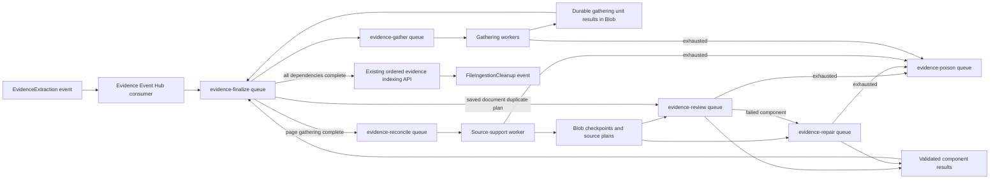

# Durable asynchronous evidence review

Thorough extraction uses separate Azure Storage Queues for gathering, source-support
reconciliation, review, and repair. Gathering workers save candidates for each
window and immediately submit reconciliation batches. The coordinator tracks
completion and indexes evidence only after every required component finishes.
Fast extraction uses a configurable model-call limit (120 seconds by default).
In queue mode, its windows also run independently through gathering and repair.

Fast jobs submit one `fast-window` task per source window to `evidence-gather`.
The coordinator makes no model calls and waits without consuming document attempts.
Each window has `EVIDENCE_FAST_WINDOW_MAX_ATTEMPTS` (default three total attempts).
An exhausted primary window moves to `evidence-repair`, where the independent
deployment receives its own three-attempt budget and the same fast prompts,
candidate cap, citation checks, and two-minute call limits. Completed windows
remain usable while a sibling retries. If repair exhausts, the coordinator fails
the job without publishing incomplete evidence. Standalone inline extraction
still processes its windows within the caller.

Missing terminal structured output gets one retry within the original invocation
deadline, then a distinct `EvidenceStructuredResponseError`. Refusal, incomplete
responses, content-filter stop reasons, and invalid text are classified separately; they are never accepted as
successful empty evidence. `modelResponseFailed` and invocation telemetry include
page/window, available provider response ID/status, refusal presence, incomplete
reason, and HTTP status. Source and model response text are not logged by these
diagnostics. HTTP 429 is recorded explicitly; durable retries honor `Retry-After`
when supplied, otherwise use the existing exponential backoff. Primary fast
model-client retries remain zero.

Test uses Claude Sonnet for fast-window fallback without changing the primary
gathering or thorough models:

```json
{
  "EVIDENCE_FAST_FALLBACK": "independent",
  "EVIDENCE_FAST_FALLBACK_DEPLOYMENT_NAME": "research-claude-sonnet-5-5",
  "EVIDENCE_FAST_FALLBACK_PROVIDER": "anthropic"
}
```

The fallback uses the Foundry Anthropic Messages endpoint, the same 120-second
call limit, and the same strict evidence and citation validation. A refusal or
filtered response remains a failure; changing providers does not guarantee
completion. For a separate Foundry resource, supply
`EVIDENCE_FAST_FALLBACK_ENDPOINT` and `EVIDENCE_FAST_FALLBACK_API_KEY`.



`evidence-finalize` is the document coordinator queue. Its first delivery plans
and submits the model units for each document window. In queue mode it makes no
gathering or source-review model calls. Later deliveries assemble completed
gathering passes, restore checkpoints, create dependent tasks, and consolidate results. It yields when
dependencies remain pending; the Event Hub consumer checkpoints after the durable
coordinator task is created instead of waiting for the entire extraction.

After assembling the document, the finalizer saves its complete canonicalization
candidate plan, including compact batch membership, and sends batches of at most 16 pairs to `evidence-review` with
component `canonicalization`. Each task includes only the records in its batch;
the full source is a shared, checksummed Blob artifact. Existing review worker
replicas and model permits bound model concurrency. Canonicalization uses its
existing identity prompt, source tools, and bounded response repairs; it does not
escalate to another reviewer through the repair queue.

Resumed finalizers reuse that plan instead of repeating document embeddings and
candidate planning or batch grouping. Batch identities remain stable even when siblings finish
out of order. Workers reuse validated per-pair checkpoints after a retry. The
finalizer validates returned assessments again, applies merges in source order,
and waits for all tasks before indexing. Unresolved pairs retain both records,
as in inline canonicalization. Budget stops and infrastructure failures do not
become successful merge results. Standalone repair/replay calls retain their
inline execution and explicit retrieval options.

`canonicalizationPlanStarted`, `canonicalizationPlanReady`, and
`canonicalizationQueueProgress` events expose planning and completed/pending
batch counts before evidence uploads begin. Deploy the same image and evidence
configuration to the finalizer and review workers: task identities include the
implementation fingerprint, and mixed versions reject each other's work. This
change does not remove the requirement to finish deduplication before uploading.

Duplicate retrieval, survivor eligibility, compact batch grouping, and merge application yield between
bounded computation steps, checking a 20 ms time slice. This lets health probes,
Blob lease renewals, and cancellation run during large document scans. The
synchronous repair APIs and asynchronous ingestion APIs execute the same steps,
preserving candidate ordering, vector neighbors, and merge guards. Pair left/right
orientation follows source offsets even when document array indexes run in the
opposite order; the stable pair ID alone sorts those indexes numerically.

If a sibling task stops a job while its finalizer is active, the finalizer still
runs terminal recovery: it recognizes committed indexing or publishes the failed
cleanup status. It persists this terminal phase before notifying, so a failed
notification retries without restarting extraction. Explicit spending stops
retain their existing behavior and do not publish cleanup.

Gathering has three components: deterministic planning, model units, and deterministic
assembly. The coordinator plans each window's four blind passes, persists separate
`gathering-unit` tasks in the gathering queue, and yields while they run. Planning
and assembly stay outside the model queue, so a completed page can enter source
review while later pages' model units remain queued. Each
unit owns one model invocation, deadline, and checkpoint. A slow independent unit
does not keep successful primary passes or unrelated source units in its delivery.
The default four gathering deliveries match the existing four model permits;
`EVIDENCE_GATHER_CONCURRENCY` can select a lower delivery count.

Planning uses Remark's Markdown AST and GFM table nodes, with parse5 for embedded
HTML headings and tables. Source windows prefer titled section boundaries.
Adjacent short sections are grouped intact when they fit the request budget;
oversized sections split at paragraph, sentence, or table-row boundaries, with
word/character boundaries as the final fallback. Each piece retains its original
page and character offsets, exact enclosing titles, table headers, and neighboring
source text. Overlap applies within split sections, without copying targets from
another physical page. No source text is summarized or filtered, and no candidate
count cap is introduced. A density unit estimates a sentence, paragraph, list
entry, code line, or table row; ordinary prose line wrapping and titles do not
consume additional units.

Primary passes default to 5,000 target characters / 48 density units; the slower
independent pass defaults to 1,500 / 16. These limits and the 150-character overlap
are appsettings. Structural parsing, source-offset calculation, context selection,
task IDs, checksums, and result assembly require no LLM calls. The models retain
responsibility for evidence meaning, atomicity, attribution, and support. Every
required unit must finish before the window's candidate snapshot is saved and
source reconciliation is queued. Candidate order and task IDs do not depend on
completion order. Existing exact-candidate deduplication runs before review.

Queue workers coalesce source-artifact downloads and reuse parsed source context
across units. The cache retains at most two artifacts of at most two million
source/metadata characters each; artifact keys include account, source, and run
identity. Large artifacts and failed downloads are not retained. The local
candidate capture/replay harness uses the same planner with direct model calls.
An inline failure stops further model admission and drains active calls and
checkpoint writes before returning the error.

Each thorough gathering invocation has a total deadline of three minutes by
default (`EVIDENCE_GATHER_TIMEOUT_MS`). Test appsettings selects `300000` (five
minutes). This one appsettings value sets both the complete gathering deadline
and the gathering model client's HTTP timeout; future timeout changes require
only an appsettings update and worker restart, without a code or image change.
The deadline starts after a model permit
is acquired and covers source-tool rounds, structured-response retries, and
provider calls. Gathering clients disable SDK retries; durable task attempts
own backoff and recovery. A late response cannot complete a pass or save its
result after the deadline. Successful sibling passes remain checkpointed.

If a planned unit still times out, it saves a recovery plan and yields to the
durable retry. The next attempt submits its two smaller children as independently
queued units; waiting for children does not consume model attempts. Successful
children survive retries. Recovery is bounded to two subdivision levels and a
minimum of 500 characters per child. Rate limits use durable backoff rather than
additional splitting. Standalone extraction without a stage store performs the
same bounded recovery within its call.

Outbox recovery no longer resends every already-queued notification each minute.
`EVIDENCE_TASK_REDISPATCH_MS` defaults to 900000 (15 minutes) for a successfully
sent notification whose task has not changed state. Initial send failures, normal
retry backoff, and dependency polls reset dispatch state and keep their existing
schedules. Queue visibility still recovers an interrupted delivery after 60
seconds. The longer redispatch interval limits duplicate notifications while a
large document's model units wait for capacity; it also bounds recovery of a lost
notification that Queue Storage cannot redeliver.

Ordinary wake-ups expire after this same redispatch interval. Pending manifests
remain durable, and recovery replaces expired notifications. Recovery groups
eligible units by account, source, and job, then sends one unit per group in
rotation, beginning with smaller groups. This prevents an entire large document's
recovered backlog from being placed ahead of other sources. Poison notifications
retain their separate 30-day lifetime.

`evidenceExtractor.gatheringTimedOut` reports the page, pass, batch, and deadline;
`evidenceExtractor.gatheringPartitionPlanned` reports the pass, source offset,
character count, and subdivision depth. Existing stage-save and restore events
identify completed segment checkpoints. `gatheringWorkPlanned` reports per-pass
unit counts and configured bounds; invocation telemetry includes the unit batch ID.
Timeout and delivery settings do not invalidate checkpoints. Workload limits,
source partitioning code, and the dependency lockfile participate in checkpoint
identity, so every worker must use the same image and gathering limits. An
in-progress run may need to gather again under the new identity after deployment.
See the offline gathering audit (operational record retained privately) for
coverage checks, request counts, and the remaining Test validation.

`evidence-reconcile` runs in a separate process with its own model permits. A slow
source batch cannot occupy a gathering window or gathering model slot. The source
worker starts downstream review/repair immediately, without waiting for all pages
to be gathered or for the coordinator to poll again. Saved plans are normalized
before both dispatch and persistence, so resumed coordination reuses the same
downstream task IDs rather than creating duplicate work.

The earlier queue implementation passed 967 service tests, including four real Azurite integration
tests, plus build, lint, and four deployment regressions. Regression tests cover eight queued windows with no coordinator model calls,
a failed gathering pass that does not block other windows, reuse of successful
passes, immediate source-task fan-out, duplicate delivery, and final consolidation
only after review completes. Real Azurite tests cover gathering queue delivery
and lease fencing. The subsequent [live queue benchmark](#live-benchmark-with-separate-gathering-and-source-queues)
completed in 38m13s against the 43m36s baseline.

## Task boundaries

Each source-support batch saves its accepted evidence and candidate lists for
support repair, classification, dates, and attribution. These lists become
independent tasks. Classification results can create a subsequent date task for
an event that remains undated. The parent can finish only after that dependency
also succeeds. Model prompts, citation validation, and final deduplication remain
part of the existing extraction implementation.

Source-support plans have a five-minute processing deadline. Each queued review
or repair task has its own five-minute processing deadline, starting after local
admission. Queue wait time is excluded. Nested operations within that task share
its deadline. A failed review can switch to the independent model on the repair
queue with a new task-attempt deadline; completed sibling tasks are reused.

The source/extraction job, gathering windows, and queued source batches retain the page-based retry
policy (initial attempt plus three retries per started group of twenty document
pages). Source batches retain the existing model-fallback logic within each
five-minute attempt; a timeout retries the source batch on its own queue. Waiting
on dependencies consumes neither the job budget nor the coordinator retry budget. Review/repair components
use `EVIDENCE_REVIEW_MAX_ATTEMPTS` (default **3 total attempts**, not three retries).
A failed review moves directly to repair when independent fallback is enabled;
the repair lane then has that component budget. Support-repair tasks start on the
independent model. Worker crashes consume a persisted attempt. Final indexing and
cleanup retain the original source-order fence and durable extraction job record.

## Storage and recovery

Queue messages contain only `{ "version": 1, "taskId": "<sha256>" }`. Source
Markdown and metadata are saved once per source/configuration in the private
`file-operations-evidence-tasks` Blob container. Task manifests contain candidate
payloads, source references, correlation IDs, retry state, and validated results.
Large document content never needs to fit inside a queue message.

A task ID hashes its immutable input, extraction fingerprint, job correlation,
and retry configuration. Changed source bytes, implementation, or model
configuration cannot reuse an old result. Workers verify the source/configuration
fingerprint before invoking models; the coordinator verifies the result checksum
and validates citations again before accepting it.

Storage Queues provide at-least-once delivery. A renewable 60-second blob lease
serializes each task's state changes; the queue visibility timeout is also renewed
every 20 seconds. Results are committed before queue-message deletion. Duplicate
messages for completed tasks are acknowledged without another model call. An old
review message cannot execute a task already transferred to repair. Lost blob
ownership prevents result commits and further guarded checkpoint writes.

Task manifests also act as a durable outbox: a recovery loop scans pending records
every 30 seconds and re-enqueues eligible tasks whose last dispatch is at least
`EVIDENCE_TASK_REDISPATCH_MS` old (15 minutes by default). Saving a manifest before sending, and saving dispatch state after
sending, permits duplicate notifications but closes the lost-handoff gap. Once
the manifest is durable, submission succeeds even if its initial queue send
fails; `EvidenceTaskDispatchDeferred` records that recovery is needed. This avoids
publishing a failure for an Event Hub event whose queued work can still run. Pending
coordinators become eligible again after 15 seconds; recovery polling can add up
to another 30 seconds before delivery.

Exhausted tasks retain a failed manifest and are sent to `evidence-poison`.
Failed poison sends are recovered; poison messages expire after 30 days. Failed finalization publishes the existing
failure cleanup event before marking its task terminal. Malformed/orphan queue
messages are preserved as `sources/<poison-id>.json` quarantine artifacts before
being acknowledged; ordinary poison messages refer to `tasks/<task-id>.json`.

The coordinator's daily cleanup removes terminal receipts older than 30 days and
unreferenced source/quarantine artifacts older than 30 days. Pending tasks and
sources referenced by retained tasks are preserved. New source references refresh
artifact metadata to fence concurrent orphan cleanup. Re-delivering a failed
manifest does not reset its retry budget; resubmit ingestion to create a new job.

### Checkpoint publication across a deadline

Timed reconciliation stages upload to unique private payload blobs and pass the
batch AbortSignal to the Blob SDK. Active-scope checks run before storage setup,
after setup, and after upload acknowledgement. Only acknowledged writes can
register a publication reference. When the work ends or times out, the scope first
closes that set, then publishes the latest acknowledged reference for each stage.
Reference writes are awaited before returning or releasing the task; they do not
start new model work and can add storage latency after the processing deadline.

A late upload can still reach storage if a server has accepted the request, but
it has no restorable reference and cannot overwrite a newer retry's checkpoint.
Successful earlier stages remain reusable when a sibling times out. The active
scope can read its own acknowledged staged progress; other attempts only read
published references and verify their payload checksums. Existing direct stage
records remain readable. Source/account cleanup and the existing 30-day pruning
also remove unreferenced payloads. A process crash before reference publication
may lose reuse of that attempt's work, but cannot expose unfinished checkpoints.

Regression coverage includes cooperative cancellation, ignored cancellation,
delayed initialization, late writes after a newer retry, earlier successful
progress, reference failures, and an actual Azurite upload whose acknowledgement
is held past the deadline. The 26m30s live benchmark below predates this checkpoint
publication change; its additional metadata I/O has not been live-benchmarked.

## Configuration and deployment

| Setting | Default | Purpose |
| --- | --- | --- |
| `EVIDENCE_REVIEW_EXECUTION_MODE` | `inline` | `queue` enables Event Hub handoff to the document coordinator. |
| `STORAGE_ACCOUNT_NAME` | Required | Storage account accessed through `DefaultAzureCredential`; the workload identity needs Blob, Queue, and Table Data Contributor roles. |
| `EVIDENCE_REVIEW_MAX_ATTEMPTS` | `3` | Persisted component attempt budget, from 1 through 20. |
| `EVIDENCE_QUEUE_CONCURRENCY` | `2`; coordinator `1` | Concurrent task deliveries for review/coordinator workers, from 1 through 16. Does not apply to gathering, source reconciliation, or repair workers. |
| `EVIDENCE_GATHER_CONCURRENCY` | `4` | Concurrent gathering deliveries per process, from 1 through 4. Unit deliveries each admit one model invocation; model capacity remains four. |
| `EVIDENCE_GATHER_TIMEOUT_MS` | `180000`; Test `300000` | Appsettings value for both the total deadline per admitted thorough gathering invocation (including source-tool rounds) and its model client's HTTP timeout. |
| `EVIDENCE_PROMPT_FORMAT` | `json` | Encodes source, candidate, and source-tool data as compact JSON. `toon` explicitly selects the official `@toon-format/toon` library for comparisons. Provider schemas, typed response validation, checkpoints, and API storage remain JSON. Changing this setting invalidates extraction checkpoints. |
| `EVIDENCE_SOURCE_LOOKUP_MODE` | `local` | `hybrid` enables on-demand lexical/vector source lookups with semantic ranking after ingestion records a complete partition-readiness checkpoint. |
| `EVIDENCE_SOURCE_SEMANTIC_CONFIGURATION` | `Primary` | Semantic configuration used by hybrid source lookups. |
| `EVIDENCE_SOURCE_MIN_RERANKER_SCORE` | `off` | Minimum semantic reranker score from 0 to 4; Test selects `2`. Missing scores remain eligible. Extracted hits containing an existing, source-validated citation on its cited page remain eligible below the cutoff. Scores select context, never authorize merges. Changing the value invalidates review identity while preserving raw scored-query and embedding caches. |
| `EVIDENCE_PROMPT_COMPACTION` | `off` | Set `on` in appsettings to use compact model inputs and reconciliation/date response contracts. Omits known defaults, adaptively pools exact passages and canonicalization records, and merges overlapping attribution/date neighborhoods while retaining primary quotations. Passage/record IDs are deterministic across batches and retries, scoped to account, source ID, and document content. Checkpoints and Search records retain their existing schemas. Changing this setting invalidates extraction checkpoints; use the same value across evidence roles. |
| `EVIDENCE_GATHER_PRIMARY_MAX_CHARS` | `5000` | Primary target-character budget, 500–5000. |
| `EVIDENCE_GATHER_PRIMARY_MAX_UNITS` | `48` | Primary structural density budget, 1–100. |
| `EVIDENCE_GATHER_INDEPENDENT_MAX_CHARS` | `1500` | Independent target-character budget, 500–5000. |
| `EVIDENCE_GATHER_INDEPENDENT_MAX_UNITS` | `16` | Independent structural density budget, 1–100. |
| `EVIDENCE_GATHER_OVERLAP_CHARS` | `150` | Maximum within-section overlap, 0 through one third of the smaller character budget. Short pieces use less overlap to guarantee progress. |
| `EVIDENCE_TASK_REDISPATCH_MS` | `900000` | Lost-notification redispatch interval and ordinary queue-message lifetime, 60000–86400000 ms; ordinary retries retain their own backoff. |
| `EVIDENCE_RECONCILIATION_CONCURRENCY` | `3` | Concurrent source-reconciliation deliveries and admitted batches per source process, from 1 through 3. Set to `2` to restore the benchmark capacity. |
| `EVIDENCE_REPAIR_CONCURRENCY` | `5` | Concurrent repair deliveries and admitted batches per repair process, from 1 through 5. At five, the repair process also has five model permits. Set to `4` to restore the benchmark capacity. |
| `EVIDENCE_RECONCILIATION_RESCUE_DEPLOYMENT_NAME` | Independent deployment | Final reviewer for unresolved support repairs and content-filter refusals. When this resolves to a distinct Anthropic deployment, queued gathering units also move to it after an explicit content-filter refusal; ordinary schema errors retain their bounded primary-model retries. Test uses `research-claude-sonnet-5-5`; Haiku remains the independent extraction model. The matching `EVIDENCE_RECONCILIATION_RESCUE_PROVIDER`, `_ENDPOINT`, `_API_KEY`, and `_MAX_OUTPUT_TOKENS` settings are optional. |
| `EVIDENCE_RECONCILIATION_TIMEOUT_MS` | `300000` | Processing deadline per source batch or queued component attempt. |
| `EVIDENCE_FAST_TIMEOUT_MS` | `120000` | Deadline per fast discovery/review invocation, also used by the model client. |
| `EVIDENCE_FAST_WINDOW_MAX_ATTEMPTS` | `3` | Total attempts for each fast window on gathering and again on repair; range 1–20. |
| `EVIDENCE_FAST_FALLBACK` | `independent` | `off` disables fast window failover. Uses the independent deployment or explicit `EVIDENCE_FAST_FALLBACK_*` model settings. |
| `EVIDENCE_FAST_FALLBACK_DEPLOYMENT_NAME` | Independent deployment | Test selects `research-claude-sonnet-5-5` for fast repair without changing thorough models. |
| `EVIDENCE_FAST_FALLBACK_PROVIDER` | Independent provider or inferred from deployment | Test explicitly selects `anthropic`; calls use the Foundry Anthropic Messages endpoint. |

The existing GitHub Actions AKS deployment renders five additional deployments
using the Data Ingestion image: `evidence-gather`, `evidence-reconcile`, `evidence-review`, `evidence-repair`, and
`evidence-finalize`. Gathering receives three concurrent
planning or model-unit tasks per process. Review receives two concurrent
tasks per process, source reconciliation receives three, repair receives five, and
the coordinator receives one. The AKS replica counts are six gathering, six
source reconciliation, three review, three repair, and one coordinator. This
provides up to 18 gathering, 18 reconciliation, 6 review, and 15 repair task
deliveries across the deployment. These are shared lane capacities across all
documents, not per-document reservations. The replica change does not alter
model prompts or the extraction checkpoint fingerprint.
Each of these four roles requests 80 mCPU per replica while retaining its
2-CPU limit and 768 MiB memory request. This allows the replicas to schedule
on the current AKS node pools; Test worker measurements before scaling were
roughly 74–126 mCPU per pod, and CPU limits still permit bursts.
The deployment waits
for these workers before activating ingestion consumers. `ACTIVATE=0` also scales
the new deployments to zero. The AKS ConfigMap selects `queue`; standalone
appsettings examples select `inline`. The AKS appsettings generator selects
`queue` so its generated file agrees with the worker deployments and ConfigMap.
Environment values override mounted appsettings.

Queues and the private task container are created idempotently at startup/use.
The configured credential must permit queue creation, send, receive, visibility
updates and delete, plus blob reads, writes and leases. This implementation uses
the existing storage connection-string approach. No new image repository is
required. Keep all evidence roles on the same application image and configuration.

An exhausted or terminally failed child task writes a durable stop marker for its
`accountId` + `sourceId` + `jobId` before acknowledging failure. Other queued
tasks for that job fail without starting model calls; active tasks abort their
model HTTP requests when the marker is observed. A terminal finalizer also writes
the marker before publishing failed cleanup. A new ingestion session has a new
`jobId` and is unaffected. Already processed provider requests can still incur
charges; cancellation prevents further attempts after the stop is observed.

For rollback, set the ConfigMap's execution mode to `inline` and restart the
Event Hub evidence consumer. Keep queue workers running until their existing tasks
drain. Turning off new queue submissions does not discard already queued work.

Separate processes provide independent model-permit pools. Source processes admit
three reconciliation batches, review processes admit two, and repair processes
admit five. Source and repair admission use their respective queue concurrency
settings. Repair has five model permits when configured for five tasks; lower
repair settings preserve the previous four model permits. Other processes retain
four model permits. Increasing review delivery concurrency beyond two primarily
prefetches work. Additional replicas provide additional capacity. Scale within provider
request/token quotas and AKS capacity.
Decoupling removes dependency waits from source reconciliation and isolates
retries; it does not make individual model calls faster. The local replay below measures reconciliation only; it does not establish an
end-to-end ingestion speedup. The recorded runs below predate the separate source
and gathering queues; the full-pipeline comparison is recorded below.

## Observability

All tasks carry `accountId`, `sourceId`, `jobId`, `taskId`, and, for components,
`batchId` and `componentId`. A deterministic operation ID derived from the job ID
is propagated through OpenTelemetry task spans, so separate queue deliveries can
be queried as one operation in Application Insights. Queue-specific cloud roles
identify gathering, reconciliation, review, repair, and finalization workers. Correlation IDs also appear in
structured console logs and extraction events.

`EvidenceTaskQueued`, `EvidenceTaskStarted`, `EvidenceTaskWaiting`,
`EvidenceTaskFailover`, `EvidenceTaskRetryScheduled`, `EvidenceTaskCompleted`, and
`EvidenceTaskFailed` describe task progress. `EvidenceExtractionReviewPending`
represents a coordinator pass waiting for dependencies, not an extraction failure.
Use latest task state per `taskId` when counting progress; delivery event counts
include retries and outbox redispatch. The ingestion overview dashboard includes
these states, including the `gather` lane. `evidenceExtractor.candidatesGathered`
records the candidate count per window; count distinct job/window pairs because
retries can repeat telemetry. Task progress is separate from completed extraction-window progress.

## Validation

Validation passed: 930 service tests (including two Azurite integration tests),
TypeScript build, lint, four deployment regression scenarios, and ten Grafana
deployment tests. Automated tests cover duplicate/concurrent delivery, handoff recovery, independent
failover, poison-send recovery, lease loss, source/configuration mismatch,
checkpoint reuse, dependent date tasks, and the no-indexing-before-review gate.
Deployment regression tests exercise both active and inactive environments without
Azure changes. This change does not run a live model benchmark or deploy resources.

Run `bun run build`, `bun run lint`, and `bun --bun run vitest run` from
`src/DataIngestionService`. Storage integration tests are opt-in via
`EVIDENCE_QUEUE_AZURITE_TESTS=1`; they use localhost only. Start Azurite with blob,
queue, and table ports `10070`, `10071`, and `10072`, `--skipApiVersionCheck`, and
`AZURITE_ACCOUNTS` set to account `evidencetest` with the base64 encoding of
`local-evidence-queue-test-key-only` as its test key. They never accept a cloud
storage connection string.

## Local 15-page replay — October 13, 2026

A local replay completed all **15 pages and 134 reconciliation batches** in
**42 minutes 42 seconds**. It reused 2,026 frozen candidates from the earlier
experiments. Source-support reconciliation finished in **30 minutes 32 seconds**;
review, repair, and consolidation required another **12 minutes 10 seconds**.

The production queue consumers ran in separate local coordinator, review, and
repair processes against Azurite, with the same Azure Test model deployments and
batch size as before. This baseline used two repair deliveries and two admitted
repair tasks; it predates the increase to four. The coordinator accepted programmatic operation callbacks
for local input, output validation, and completion; production startup continues
to use its normal operations. No cloud storage, Search indexing, deployment, or
live-case changes were performed.

- All 142 durable tasks completed: 21 review, 120 repair, and one coordinator.
- Output contained 2,057 records: 193 events, 879 facts, and 985 claims.
- All 5,266 output citations matched their exact source passages.
- No component processing timeout or exhausted task occurred. Two review tasks
  moved to the repair queue, and two model invocations failed but were recovered.
- Source plans were restored during consolidation; discovery was not repeated.
- Usage was 6,725,136 input tokens (2,830,304 cached), 761,897 output tokens, and
  664 model responses. Aggregate in-process model-permit wait was 0.01 seconds;
  durable queue waiting is a separate measurement.

This was a reconciliation replay: discovery, conversion, embeddings, indexing,
and live telemetry delivery were excluded. Exact citations do not substitute for
a human assessment of semantic completeness. Earlier incomplete/stopped runs
are not completed latency baselines, so no percentage speedup is claimed. The
repair backlog and 12-minute tail make an additional repair worker a useful next
capacity experiment. Private artifacts are retained under
`.local/async-queue-live15-2026-10-13/`, including code/input manifests, outputs,
telemetry, checkpoints, the local storage state, and a detailed report.

### Replay with repair concurrency four

A second local replay on October 13, 2026 used
`EVIDENCE_REPAIR_CONCURRENCY=4` for both queue delivery and processing admission.
The input, 2,026 frozen candidates, batch size, model deployments, deadlines,
source/review concurrency, and per-process model permits matched the baseline.
Fresh Azurite storage prevented reuse of completed tasks or reconciliation plans.
Startup assertions checked the effective limits, and telemetry observed four
simultaneous repair tasks.

| Metric | Repair concurrency 2 | Repair concurrency 4 |
| --- | --- | --- |
| Total reconciliation | 42m 42s | 29m 35s |
| Source-support plans completed | 30m 32s | 28m 42s |
| Review/repair and consolidation tail | 12m 10s | 53s |
| Completed pages / batches | 15 / 134 | 15 / 134 |
| Evidence records | 2,057 | 2,096 |
| Verified exact citations | 5,266 | 5,249 |
| Processing timeouts / exhausted tasks | 0 / 0 | 0 / 0 |

Observed reconciliation time fell by **13m 7s (30.7%)**, and the tail fell by
**92.8%**. All 141 durable tasks completed: 23 review, 117 repair, and one
coordinator. Both review-to-repair failovers recovered. Output contained 211
events, 896 facts, and 989 claims, with source identity, exact citations, thorough
mode, and evidence text/metadata checks passing. Usage was 6,587,730 input tokens
(2,772,273 cached), 726,729 output tokens, and 662 model responses.

This is one completed run per configuration. Provider load, cache state, and
model outputs vary; the repair change cannot be credited with all variation in
source timing. Different record counts do not establish better recall or semantic
accuracy. Discovery, conversion, embeddings, and indexing remain excluded.
The result supports retaining four repair slots; source processing now accounts
for most elapsed time. The workers and emulator were stopped after completion,
and no live-case or deployment changes were made. Private manifests, outputs,
telemetry, storage state, and comparison reports are retained under
`.local/async-queue-repair4-live15-2026-10-13/`.

### Complete evidence pipeline with medium gathering

The October 13, 2026 local run started from the same 15-page source with fresh
checkpoints and candidates. Primary gathering used `tasks-gpt-6.0-luna` with
`EVIDENCE_PRIMARY_REASONING=medium`. Reconciliation remained on
`recon-test-gpt-6-luna` at `xhigh`; independent gathering/review remained on
`research-gpt-6.1-sol` at `low`. Repair concurrency stayed four. The run included
the omitted-empty-list recovery and evidence retrieval-field projection changes.

| Metric | Result |
| --- | --- |
| Complete local evidence pipeline | 43m 36s |
| All candidate gathering finished (elapsed milestone) | 34m 28s |
| All source-support plans finished (elapsed milestone) | 43m 15s |
| Remaining review/repair and consolidation | 21s |
| Fresh candidates / completed batches | 2,007 / 133 |
| Completed pages | 15 / 15 |
| Final evidence | 1,983 records: 194 events, 803 facts, 986 claims |
| Exact citations validated | 4,698 |
| Processing timeouts / exhausted tasks | 1 recovered / 0 |

All 111 durable tasks completed: 44 review, 66 repair, and one coordinator. Both
review-to-repair failovers recovered. A source-support timeout on batch `14:0:2`
recovered on retry. Source identity, citation offsets, evidence text/metadata,
and retrieval-field projection checks passed. All 60 gathering invocations
completed: fifteen each for primary events, primary facts, primary claims, and
the independent inventory.

In this historical run, gathering fed candidates into reconciliation and overlapped
it across pages, but both stages shared coordinator scheduling and model permits. The milestone times
are therefore not additive phase durations. Source reconciliation accumulated
942.9 seconds of model-permit waiting across its 151 invocations; this is summed
waiting across concurrent calls, not additional elapsed time. Review and repair
have separate processes and had essentially no model-permit waiting. The subsequently implemented
gathering and source queues separate these workers; the subsequent benchmark
below measures the resulting pipeline on this document.

This run exercised gathering through validated local output. Document conversion,
embeddings, Search writes, deployed ingestion, and live-case changes were excluded
by the chosen scope. It is not directly comparable to the 29m35s replay that
excluded gathering, nor a controlled high-versus-medium quality or speed test.
All local workers and the emulator stopped successfully. Private source/code
manifests, captured candidates, outputs, timing/usage reports, and storage state
are retained in `.local/evidence-e2e-medium-live15-2026-10-13/`.

## Live benchmark with separate gathering and source queues

On October 13, 2026, a fresh full evidence run against the same 15-page source
completed successfully using the dedicated gathering and source workers. Luna
gathering remained at medium, independent gathering/review at low, reconciliation
at xhigh, and fixed batches at 16. Observed peak task concurrency was gathering
3, reconciliation 2, review 2, repair 4, and coordinator 1. Model permits remained
four per process. Source content and model settings matched the earlier full run;
all frozen application and harness hashes were verified afterward.

| Metric | Earlier full pipeline | Separate gathering/source queues |
| --- | --- | --- |
| All gathering completed (elapsed milestone) | 34m28s | **18m04s** |
| Full evidence pipeline | 43m36s | **38m13s** |
| Candidates / batches | 2,007 / 133 | 2,080 / 137 |
| Validated evidence records | 1,983 | 2,148 |
| Events / facts / claims | 194 / 803 / 986 | 176 / 899 / 1,073 |
| Exact source citations checked | 4,698 | 5,164 |
| Reconciliation timeouts / exhausted tasks | 1 / 0 | 0 / 0 |
| Review-to-repair failovers | 2 | 1 |

Gathering finished **47.5% sooner**, saving 16m23s. Total runtime fell **12.3%**,
saving 5m23s despite a slightly larger candidate set. All 60 gathering passes
completed, with no gathering model calls in the coordinator. The source plans
finished at 37m59s; the remaining review and consolidation took about 14 seconds.
Source reconciliation became the limiting phase after gathering finished.

One source-model invocation failure recovered, and the date-review task sent to
repair completed successfully. All 271 durable tasks completed. Final source
identity, exact citations, evidence text/metadata consistency, and retrieval-field
projection checks passed. The run used 5,934,086 input tokens, including 2,098,431
cached input tokens, and 1,252,445 output tokens across 719 model responses.

This is one live comparison of both new queues against the earlier shared
coordinator. Generated evidence, cache usage, and provider latency vary; record
counts and exact citation checks do not establish semantic completeness. The run
covered fresh gathering through validated local output, excluding conversion,
embeddings, Azure AI Search writes, and deployment. All five workers, the controller,
and Azurite stopped. Private artifacts are retained in
`.local/evidence-gather-queue-live15-2026-10-13/`, including `comparison.json`,
`summary.json`, `result.json`, candidate snapshots, logs, and frozen manifests.

### Concurrency settings after the benchmark

The next configuration raises source-reconciliation delivery/admission from two
to three and repair delivery/admission from four to five. Repair model permits
also rise from four to five so the extra admitted task can execute. Gathering
stays at three windows and review stays at two tasks. These settings are included
in the worker deployments and Test/Production appsettings examples.

The end-to-end target is **less than two minutes per source page**: under 30
minutes for this 15-page document. The measured 38m13s evidence-only baseline is
about 2m33s per page. The subsequent live run at concurrency 3/5 completed the local evidence pipeline
in 26m30s, averaging 1m46s per page; see the result below. The eventual ingestion target
also needs conversion, embeddings, indexing, and queue wait time accounted for.
The comparison retained the same source, medium gathering, batch size,
five-minute reconciliation deadlines, and citation checks.

The 3/5 configuration passed 982 service tests, including real Azurite queue tests
and shared model-permit checks, plus build, lint, and four deployment regressions.

### Live benchmark with reconciliation three and repair five

The October 13, 2026 local run completed in **26m30s**, averaging **1m46s per page**
for the same 15-page document. This meets the under-two-minutes-per-page target
for the evidence pipeline in this run. Total time fell **30.7%** from the 38m13s
2/4 baseline, saving 11m43s. The test used fresh gathering at medium reasoning,
source reconciliation at xhigh, the same independent model, fixed batches of 16,
and unchanged five-minute reconciliation deadlines.

| Metric | Source 2 / repair 4 | Source 3 / repair 5 |
| --- | --- | --- |
| Full evidence pipeline | 38m13s | **26m30s** |
| Average per page | 2m33s | **1m46s** |
| All gathering completed (elapsed milestone) | 18m04s | 20m21s |
| All source-support plans completed (elapsed milestone) | 37m59s | 26m13s |
| Remaining review/consolidation | 14s | 17s |
| Candidates / batches | 2,080 / 137 | 1,953 / 130 |
| Evidence records | 2,148 | 1,993 |
| Events / facts / claims | 176 / 899 / 1,073 | 180 / 863 / 950 |
| Exact source citations checked | 5,164 | 4,731 |
| Timeouts / exhausted tasks | 0 / 0 | 0 / 0 |
| Review-to-repair failovers | 1 | 1 |

Telemetry observed three gathering tasks, three source tasks, two review tasks,
and five repair tasks active concurrently in their respective processes. Repair
had five model permits, with four in the other roles. All 60 gathering passes
and all 264 durable tasks completed. The date-review failover for batch
`5:0:5` recovered in repair; no model invocation failed. Source identity, exact
citations, evidence-text consistency, and retrieval-field projection checks passed.
Application and harness hashes were unchanged throughout the run.

Gathering was 2m16s slower while the total pipeline finished 11m43s sooner,
consistent with source reconciliation having constrained the preceding run.
This is one comparison, with 6.1% fewer candidates and 5.1% fewer batches;
provider latency, cache use, and generated outputs vary. Counts and exact citations
do not prove equivalent semantic completeness. Token usage was 5,997,337 input
(including 2,110,704 cached input), 1,239,407 output, and 330,696 reasoning tokens,
across 745 model responses.

The target is met for **local evidence processing**, not yet verified for complete
production ingestion. Conversion, embeddings, Azure AI Search indexing, and their
queue waits were excluded. Those stages would need to fit within the remaining
3m30s to keep this particular document below 30 minutes end to end. No deployment
or Search writes occurred. All workers, the controller, and Azurite stopped.
Private artifacts are in `.local/evidence-concurrency35-live15-2026-10-13/`,
including `comparison.json`, `summary.json`, validated `result.json`, snapshots,
logs, and source/code manifests.
