# Evidence extraction

For a per-session dollar limit shared across retries and workers, see [evidence token spending limits](evidence-cost-budget.md).

For Search lookups over untagged source partitions, indexed-evidence review,
resumable local repair proposals, and measured deduplication prompt reductions,
see the Search lookup evaluation (operational record retained privately).

For the queue-based thorough workflow and its independent task deadlines, see [durable asynchronous review](evidence-async-review.md). The inline workflow remains available.

For evidence-specific Search fields, existing-record migration, and answering-system integration, see [evidence and RAG retrieval](evidence-rag-integration.md).

See the [classification change record](#implementation-and-validation-record-10-october-2026)
for the latest implementation and offline results, and
[references and acknowledgements](#references-and-acknowledgements) for the
research and review contributions behind the design.

Scope decision (October 12, 2026): [Content Understanding migration](content-understanding-migration.md)
belongs to Data Integrity. Evidence Extraction retains its existing candidate,
review, and canonicalization pipeline. When Data Integrity selects CU, this
pipeline receives only literal extracted text, with quotations mapped back to
physical pages or media timestamps. Generated summaries and visual descriptions
are indexed separately for retrieval and cannot supply evidence quotations.
The [prepared Content Understanding benchmark](content-understanding-benchmark.md)
is retained as an archived evaluation; its live comparison was not run.

## Code organization

`EvidenceExtractor` remains the entry point for ingestion, canonicalization, and
queued review tasks. It owns configuration and window gathering; its collaborators
share the same model invocation, telemetry, and checkpoint services.

All modules below are in `src/DataIngestionService/src/processors/evidence/`:

| Module | Responsibility |
| --- | --- |
| `evidenceExtractor.ts` | Configure extraction, gather windows, dispatch queued work, and assemble final results. |
| `evidenceReviewCoordinator.ts` | Plan source support review, coordinate components, and manage repair/failover. |
| `evidenceDecisionReview.ts` | Prepare candidate/context inputs, validate individual decisions, and resume partial batches. |
| `evidenceEnrichmentReview.ts` | Resolve event dates and claim attribution after source support review. |
| `evidenceCanonicalizationReview.ts` | Retrieve duplicate candidates, review pairs, checkpoint decisions, and apply merge guards. |
| `evidenceStructuredInvocation.ts` | Invoke providers with structured output, source tools, concurrency limits, deadlines, and usage telemetry. |
| `evidenceExtractionSchemas.ts` | Define candidate, response, and checkpoint contracts, including provider request variants. |
| `evidenceDocumentFactory.ts`, `evidenceExtractionDates.ts` | Build indexed documents and normalize extracted date parts. |
| `evidenceExtractionValidation.ts` | Verify literal citations, saved evidence, and exact duplicate candidates. |
| `evidenceStageCheckpoints.ts` | Validate stage input/output hashes and guard checkpoint reads and writes. |
| `evidenceImplementationFingerprint.ts` | Fingerprint implementation files and dependencies for checkpoint compatibility. |

The existing exports from `evidenceExtractor.ts` remain available to callers.
Changes to any of these modules invalidate earlier implementation fingerprints;
queued tasks and saved decisions must still pass the existing identity checks.
Add future extraction modules to the fingerprint list when they affect results
or checkpoint reuse.

## Extraction modes

Ingestion accepts the optional input `evidenceExtractionMode`: `auto` (the
default), `fast`, or `thorough`. Both the gateway and internal ingestion API
validate it, and it is preserved in the saved ingestion input and evidence job.

| Automatic selection | Behavior |
| --- | --- |
| Case listed under a root record with `type: "SHARED_RESOURCES"`, or legacy account details with `isSharedResource: true` | Skip evidence extraction; retain ordinary chunk ingestion. |
| Owner's `billingCode: "S1"` | Fast extraction for Silver Level 1. |
| Owner's `billingCode: "D"` | Fast extraction for Demo. |
| Owner's `billingCode: "G1"` | Original thorough extraction for Gold Level 1. |
| Missing or unknown owner billing code | Preserve thorough extraction. |

The policy reads `casesAccounts` in the Cosmos `accounts` container's root
partition (`00000000-0000-0000-0000-000000000000`), matching the ingestion
`accountId` to the nested membership. A membership with a billing code identifies
the case owner; members without one do not influence the mode. Conflicting owner
billing codes fail the lookup rather than choosing a member's tier. Shared
resource classification takes precedence in automatic mode. Explicit `fast` or
`thorough` bypasses automatic selection, including the shared-resource default.
Cosmos failures remain retryable failures rather than silently changing modes.
For a capped session, a configured document-size cost preflight may route
thorough mode to fast before extraction begins. An explicit
`evidenceBudgetOverride: true` on the authenticated ingestion request bypasses
both this routing and the hard dollar cap.

Request thorough extraction on demand by submitting a new ingestion request:

```json
{
  "accountId": "CASE_ACCOUNT_ID",
  "identifier": "SHAREPOINT_FILE_IDENTIFIER",
  "isFolder": false,
  "evidenceExtractionMode": "thorough"
}
```

Send this to `POST /v1/file-operations/ingestion`. Omitting the new parameter,
or supplying `"auto"`, selects from Cosmos. The internal
`POST /internal/data-ingestion/ingest` endpoint accepts the same parameter.
Use a new request for an on-demand upgrade; changing the mode of an existing
job ID violates the saved-input identity check.

The worker saves its resolved mode before extracting. Broker retries retain
that selection even if billing changes. Fast and thorough checkpoints have
different fingerprints, so a fast result cannot satisfy a thorough run.
Resolved mode is recorded in evidence metadata and the filterable Azure AI
Search field `evidenceExtractionMode`. Existing indexes acquire this additive
field through the normal index-schema update path.

### Retry budgets and reconciliation deadlines

Evidence worker jobs allow three retries per started group of 20 source pages,
in addition to the initial attempt:
`maxAttempts = 1 + 3 * max(1, ceil(pageCount / 20))`.
Both fast and thorough jobs use this policy. The page count comes from the
complete extracted source, including its page boundaries, before model calls.

| Source pages | Retries | Total attempts |
| --- | ---: | ---: |
| 1–20 | 3 | 4 |
| 21–40 | 6 | 7 |
| 100 | 15 | 16 |
| 101–120 | 18 | 19 |

The worker saves the page count, policy, maximum attempts, and attempt counter
in its leased job record. Restarts and broker redelivery do not replenish an
existing job's budget. Each retry restores valid windows, stages, and saved
extraction output rather than repeating completed model work. Retry delays
increase from 5 to 10, 20, and 40 seconds, then stay at 60 seconds.

Until the source can be loaded, one page group is allowed (four attempts by
default), including failures during source retrieval or billing lookup.
Existing jobs without a saved policy get one persisted bootstrap allowance
when their historical attempt count already exceeds that limit, so they can
establish their actual document size. That allowance is not renewed on restart.
Waiting for another worker's lease does not consume attempts. Completion-marker
replays can still finish result cleanup without rerunning extraction.

After exhaustion, the worker stores the failed event and publishes failure
cleanup while retaining source blobs and extraction checkpoints. Resubmit the
ingestion request for a new job budget; replaying an exhausted job ID alone
does not reset its persisted attempt count. Policy changes apply to newly
initialized jobs; established budgets retain their saved policy.

Each thorough reconciliation batch waits for admission before its five-minute
deadline starts. Two parent batches can be active across all sources and windows
in a worker process. Once admitted, the deadline is shared by its
model calls, model-permit wait, repairs, fallback reviews, and any nested
classification/date/attribution work. A fallback does not start another
five-minute period. Expiry aborts the active invocation, fails that batch, and
prevents late responses from saving new results. Previously saved progress
remains reusable on the next job attempt. Concurrent batches have independent
deadlines. This is a per-batch limit; a whole document can take longer.
Fast discovery and review each use `EVIDENCE_FAST_TIMEOUT_MS`

| Appsetting / environment variable | Default |
| --- | ---: |
| `EVIDENCE_RETRY_PAGE_GROUP_SIZE` | `20` |
| `EVIDENCE_RETRIES_PER_PAGE_GROUP` | `3` |
| `EVIDENCE_RECONCILIATION_TIMEOUT_MS` | `300000` |
| `EVIDENCE_GATHER_TIMEOUT_MS` | `180000` |
| `EVIDENCE_FAST_TIMEOUT_MS` | `120000` |
| `EVIDENCE_PRIMARY_MAX_OUTPUT_TOKENS` | Unset; set `16384` for the tested router mix |
| `EVIDENCE_RECONCILIATION_MAX_OUTPUT_TOKENS` | Unset; set `16384` for the tested router mix |

These settings must be positive integers; the timeout must also fit Node's
timer range. Test and Production appsettings examples include the defaults.

Thorough gathering uses a total deadline per admitted invocation and disables
SDK retries. A deterministic Markdown/HTML planner groups short titled sections
and splits oversized sections before inference. Each model unit has its own queue
task and checkpoint; successful units survive a sibling timeout. Independent
gathering uses smaller input limits than primary gathering. Source coverage,
offsets, enclosing headings, and table headers remain available to every piece.
See the [queue workflow](evidence-async-review.md)
for recovery limits and telemetry.

`EVIDENCE_PROMPT_COMPACTION=on` opts into compact model payloads through the existing
appsettings loader; its default is `off`. Reconciliation uses explicit keep,
correct, replace, unsupported, and unresolved actions. Corrections contain only
`field` and `value`, then expand into the existing validated application schema.
Unknown dates omit empty response fields without assigning dates or losing
relative timing. Wrong types and invalid changes are rejected rather than defaulted.

Input compaction preserves exact quotations and their page/location bindings.
It measures encoded tokens including decoding instructions before selecting
reference tables. Overlapping context can share a passage while primary quotes
stay explicit. New passage and record IDs derive from canonical object data and
the account, source ID, and exact document revision, independent of batch position
or retry. Object keys and dictionaries have deterministic order; evidence arrays
and source strings retain their order and text. Stable IDs help repeated prompts
match, but provider caching still requires matching prefixes. They do not assert
that two evidence items should be merged.

`EVIDENCE_PROMPT_FORMAT=json` (the default) sends source/context, candidate data,
and source-tool results to evidence models as compact JSON. Explicit `toon`
selects lossless TOON notation through the official `@toon-format/toon` 4.4.0
library. Both formats preserve strings, fields, page numbers, and offsets; no
evidence is summarized during encoding. Provider tool schemas and final structured
responses retain JSON and existing validation. Checkpoints and external APIs also retain
their formats. Format changes invalidate extraction checkpoints. Token savings
depend on the data shape and must be measured; TOON does not guarantee lower latency.
`EvidenceExtractionRetryBudgetResolved` reports the resolved page count and
maximum attempts; later extraction events include those values.
`EvidenceExtractionJobAttemptFailed` reports attempt/budget exhaustion, and
`evidenceExtractor.reconciliationTimedOut` identifies the page, batch, model,
and deadline. The timeout is an execution limit and is not part of the source
checkpoint identity, so adjusting it can reuse valid saved progress.

Validation on October 13 passed build, lint, and all 895 service tests,
including page-group boundaries, persisted exhaustion across restart-like
processing calls, legacy bootstrap, successful last attempts, and result
cleanup after completion. Simulated-time tests cover a shared repair/fallback
deadline, independent concurrent batches, late provider responses, and delayed
semaphore acquisition. No live 100-page evaluation or deployment was performed
for this policy change.

### Thorough reconciliation components

Each thorough batch first reviews source support and validates its candidate
decisions. It then dispatches the required follow-up components concurrently:
support repair, classification, event dates, and claim attribution. Each owns
its candidate results; they are consolidated only after every required component
has succeeded. Consolidation validates citations and evidence fields and joins
the results in a stable order, without another model-generated rewrite.

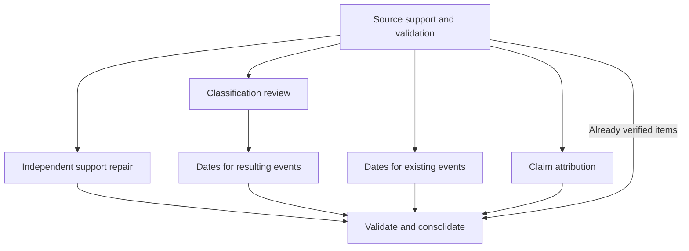

Only required components run. Existing undated events can receive date review
while classification examines other candidates. Events retained or produced by
classification receive their date review after classification completes; an item
reclassified as a fact or claim does not receive event dates. Support repair can
also perform its own dependent date review. Every review retains the source
context, source-reading tools, and evidence validation rules.

Source support, classification, date resolution, and attribution use the
configured reconciliation model. With
`EVIDENCE_RECONCILIATION_FALLBACK=independent`, an unavailable reviewer or a
component that exhausts its response repairs sends only that component to the
independent model. Proposed rejections, cleared supported fields, and other
source-support exceptions already requiring an independent opinion go directly
to that model. A substantive date conflict also receives independent source
review. A valid unknown date or claimant is an outcome, not a component failure.

Completed components save source- and input-validated checkpoints. Incomplete
components retain their valid individual decision checkpoints, with primary and
failover decisions kept separately. If source support succeeded through failover,
the chosen reviewer is remembered so a retry restores that progress without
repeating the failed primary call. If both reviewers fail a component, running
siblings can finish and checkpoint, but the parent cannot publish partial evidence.
The next worker attempt restores successful work and resumes what remains.

All component work, including failover and dependent reviews, shares the parent
batch's five-minute deadline. Expiry stops the batch; it does not grant failover a
fresh deadline. The inline path permits two active parent batches;
waiting for admission consumes neither the five-minute deadline nor a model
permit. Nested reviews share their parent's admission and deadline, so they cannot
deadlock by waiting for another parent slot. A failed or timed-out parent releases
its slot to the oldest waiting batch. Complete batch checkpoints are restored
before admission and do not occupy a parent slot.

All admitted batches and components share a process-wide model limit. In the
[durable queue path](evidence-async-review.md#configuration-and-deployment), source
reconciliation admits three batches and repair admits five, configured through
`EVIDENCE_RECONCILIATION_CONCURRENCY` and `EVIDENCE_REPAIR_CONCURRENCY`. Review
retains two admissions. Model permits remain four except in repair, which has
five at its default capacity. Fixed candidate batches remain at 16.
Fast mode retains its separate path
and configurable call limits (120 seconds by default). Existing candidate batch sizes and settings still apply;
this change partitions review responsibilities inside those batches.

App Insights emits `evidenceExtractor.reconciliationComponentStarted`,
`reconciliationComponentCompleted`, `reconciliationComponentFailover`, and
`reconciliationComponentFailed` (all with the same `evidenceExtractor.` prefix).
They include `parentBatchId`, `componentId`, component name, page, account, source,
and the enclosing extraction correlation. Completion reports duration and whether
a complete component checkpoint was restored; failover reports both deployments.
Model-call batch IDs include the component and reviewer attempt.
`evidenceExtractor.reconciliationConsolidated` reports the parent batch and final
event/fact/claim counts after its components succeed.

`evidenceExtractor.reconciliationBatchAdmission` reports `queued`, `admitted`,
and `released` states with the batch ID, page, active/waiting parent counts,
`maxActiveBatches`, and `admissionWaitMs`. Admission wait is reported separately
from `agentInvocationCompleted.queueWaitMs`, which measures contention for model
permits after admission. These events retain the extraction's existing correlation.

Concurrent execution removes unnecessary waits between these responsibilities.
It does not guarantee a proportional reduction in document runtime: source
review, dependent date work, model latency, and the shared concurrency limit still
matter. Compare the same frozen candidates under controlled scheduling settings
to measure elapsed time, token usage, and source-reviewed output before claiming
a live-document speedup.

Validation on October 13 passed build, lint, and all 907 service tests. Component
tests cover concurrent execution, the shared four-request limit, dependency
ordering, isolated failover, independent review of proposed rejections, checkpoint
recovery after both reviewers fail, and late responses after the shared deadline.
This change has not been deployed. The live evaluation below measures component
scheduling against a control generated from the same implementation.

#### Live scheduling comparison — October 13, 2026

Live Azure Test models processed the same saved 15-page source used in the fast
evaluation. Four-pass discovery ran once, taking **21m 47s** to produce **2,026
candidates**. Both reconciliation arms replayed those frozen candidates in 134
fixed-size batches, with identical models, prompts, validation, failover, four
shared model invocation permits and five-minute parent batch deadlines. The
control changed only follow-up component dispatch to sequential execution;
window and batch concurrency remained enabled. It is not the original
implementation with its different specialist routing.

Both arms exhausted their initial attempt plus three retries. The times below
include all attempts and checkpoint recovery, but exclude discovery and retry
gaps. They measure time spent before failure, not successful completion latency.

| Metric | Concurrent components | Sequential control |
| --- | ---: | ---: |
| Completed pages / 15 | 4 | 8 |
| Unique completed batches / 134 | 51 | 82 |
| Active time across four attempts | 32m 26s | 42m 45s |
| Model responses with reported usage | 385 | 505 |
| Input tokens | 3,617,203 | 5,021,314 |
| Cached input share | 44.1% | 62.9% |
| Output tokens, including reasoning | 439,424 | 556,572 |
| Batch deadlines exceeded | 26 | 20 |
| Successful component failovers | 0 | 1 |

Telemetry confirmed three follow-up components active within one concurrent
batch versus one in the control. Both arms nevertheless reached **12 active
parent batches competing for four model invocation permits**. Queueing consumes
the same five-minute budget as execution and repairs. For example, the first
concurrent attempt's six attribution invocations averaged about 80 seconds
waiting for a permit and 12 seconds executing. Source repair and dependent
reviews also contributed substantial time.

The control demonstrated isolated date-component failover from Luna to Sol
without restarting its sibling components. Parent deadline expiry remained
terminal and did not grant failover a new five-minute period. Valid completed
pages, batches and components were restored on subsequent attempts; neither
arm published an incomplete final package.

**This evaluation does not demonstrate a speedup.** There was one run per arm,
with stochastic model responses, and the control ran second with more cached
input. Neither arm produced a complete output for final citation or semantic
quality comparison. Failed or aborted requests may have unreported token usage.
Semantic canonicalization, embeddings and Search indexing were excluded; adding
discovery and replay timings does not reproduce normal pipeline overlap.

The next scheduling change to evaluate is a global limit per worker on active
parent batches, with admission waiting before their five-minute clocks start.
This would leave capacity for concurrent follow-ups and failover while retaining
the shared provider limit. Recheck with the same frozen candidates before
claiming improved completion time. No runtime tuning was applied during this
experiment. Private source, checkpoints, manifests, attempt telemetry and the
full comparison are retained in
`.local/thorough-components-live15-2026-10-13/`.

### Fast path

Fast mode visits every nonempty source window and uses at most one combined
discovery invocation and one source-support review invocation for each window.
It reviews at most 20 candidates per window, prioritizing explicit accommodations,
obligations, actionable recommendations, material measurements and key
occurrences. Discovery checks numbered/bulleted items and keeps independently
actionable recommendations separate within that budget. It omits candidates
with invalid schemas, unverifiable citations, dates still invalid after review,
or unsupported/uncertain review decisions. Omitted candidates are counted in
telemetry. It does not perform quotation-regeneration passes, independent
inventory passes, specialist escalation, date enrichment, event-structure
annotation, or model-based canonicalization. Exact source anchors, strict
schema checks, deterministic classification, and deterministic deduplication
remain in effect.

The existing review invocation may clear unsupported optional `who`, `where`,
`why`, taxonomy `facets`, or entire date groups (`whenStarted`, `whenEnded`,
`asOf`). It may also
restore the entire, already validated primary quotation as the assertion text.
For repeated exact quotations, a cited heading can identify the section, or
the same review may select an application-provided occurrence ID with its
surrounding source context. Each ID expands only to verified text for that
candidate and citation field. Missing/rewritten quotations, unselected ambiguity,
and invalid IDs still fail citation validation; the first match is never assumed.
These adjustments preserve an otherwise supported item without adding another
model call. They cannot invent replacement text, dates or people or change its
kind/claimant/subject/reporter. The reviewer must judge the
remaining assertion and metadata supported; unclear core propositions still
get omitted. The application validates the complete adjusted record and its
citations again before saving it. Quote validity alone is not semantic proof.
Optional participant labels must also appear in the supplied source context
(ignoring case, punctuation and spacing). Labels that cannot be verified are
removed; if that label remains in the assertion itself, the candidate is omitted.
This deliberately conservative presence check can leave aliases unpopulated.
It does not prove a person's role or relationship, which still needs review.

Fast invocations use no source-reading agent tools, a configurable deadline
(`EVIDENCE_FAST_TIMEOUT_MS`, default `120000` milliseconds), no
model-client retries, and a bounded graph step count. Provider failures,
truncation, malformed response envelopes, and storage failures still fail the
attempt; they are not converted into successful empty evidence. Completed
windows and discovery/review stages can be restored on the worker's normal
retry. There is no fixed whole-document completion-time guarantee.

In queue mode, each fast window runs as its own gathering task; the document
coordinator waits without model calls. Primary window attempts default to three,
then that window alone moves to repair on the independent deployment. Repair
uses the fast prompts, 20-candidate cap, and exact source validation, with its own
three attempts. Missing output gets one bounded invocation retry; invalid text,
refusal, and incomplete responses remain failures. Exhausted repair fails the
job rather than publishing incomplete evidence. See the
[queue recovery configuration](evidence-async-review.md#configuration-and-deployment).

The fast model uses `EVIDENCE_FAST_DEPLOYMENT_NAME`, falling back to the primary
deployment (`tasks-gpt-6.0-luna` by default). Optional `EVIDENCE_FAST_PROVIDER`,
`EVIDENCE_FAST_ENDPOINT`, and `EVIDENCE_FAST_API_KEY` follow the existing model
configuration rules and use the shared LLM credentials when unset.
`EVIDENCE_FAST_REASONING` defaults to `low`, independently of the thorough
model's reasoning setting. `EVIDENCE_FAST_MAX_OUTPUT_TOKENS` defaults to 8192.
No new appsettings are required when the existing primary deployment is used.
The timeout controls both the model client and invocation cancellation. Each
discovery and review call receives its own deadline; it is not a whole-document
limit. Existing images with hardcoded 60-second limits need an application
deployment to honor this setting.

`EvidenceExtractionModeSelected` records the resolved mode with account, source,
job and attempt identity. A first automatic attempt can start with mode `auto`
before selection; completion/failure carries the resolved mode when available.
`EvidenceExtractionSkipped` replaces the completion event for a skipped case.
Skipped cases finish cleanup without an `EVIDENCE_EXTRACTION` completion notice.
`evidenceExtractor.documentStarted` supplies the total window count before the
first window completes. `fastCandidateOmitted`, `fastCandidateAdjusted`, and
`fastWindowReviewed` record omissions, the fields cleared/source wording restored,
citation selection, removed participant counts, and window counts. Extractor
events include the mode. Changes to the fast review
contract participate in the checkpoint fingerprint.

Initial validation on October 13, 2026 used three synthetic pages against the
Test deployment: six model invocations, 14 evidence documents, 21.8 seconds,
and all emitted source spans verified against the input. This is a small
compatibility check, not a recall evaluation or a large-document benchmark.

#### Full 15-page fast evaluation (October 13, 2026)

The first full fast run used the existing 15-page `evidence-live.md` source,
SHA-256 `40802378298f95662a4a89b0f6a81bbe043033e59353b68cd6fcc41340fd34e7`,
with frozen current code and empty local checkpoints. It called the live Azure
Test `tasks-gpt-6.0-luna` deployment with the default low reasoning, 8,192-token
output limit, 60-second invocation deadline, and three active windows. All 15
windows completed on the first attempt, with no failed calls or retries.

| Measure | Fast, October 13 | Recorded thorough MVP gate, October 11 |
| --- | ---: | ---: |
| Active extraction time | 161.8 seconds (2m 42s) | 42.04 minutes |
| Model invocations | 30 | 839 |
| Final evidence records | 120 | 1,773 |
| Events / static facts / claims | 19 / 63 / 38 | 190 / 714 / 869 |
| Verified source citations | 140 | 4,377 |
| Output tokens, including reasoning | 50,450 | 1,278,218 |

The observed runtime is about 15.6 times shorter than that historical run. The
thorough total includes a targeted recovery invocation and used its earlier
configuration. Its detailed artifacts are absent from this workspace, so this
comparison uses documented totals, not a fresh controlled A/B test or a
rechecked baseline source manifest. Record counts are not a recall score; the
thorough outputs also contained known duplicate and interpretation issues.

Fast discovered 136 candidates, rejected six during citation/date validation,
and reviewed the remaining 130. Ten more were omitted after source-support
review, leaving 120 records. Only page 7 reached the 20-candidate review limit.
Every final citation resolved to its exact source offset, evidence text matched
its metadata, and every record retained the source hash and `fast` mode. Input
usage was 126,856 tokens, including 49,260 cached tokens. No model tools were
called. Extraction made no Search writes or SharePoint submissions and kept
telemetry local; this evaluated extraction rather than the end-to-end pipeline.

Source checks found useful retained material: the major cognitive scores, all
18 achievement-table rows, the distinction between narrative academic opinion
and measured results, the IEP recommendation, the timed parent sessions, and
diagnostic uncertainty. Deterministic classification corrected two narrative
results to claims. However, the quality review also found:

- Testing-time accommodations and explicit written-expression support were
  missing. The reviewer rejected otherwise supported recommendations because
  discovery added unsupported participants; fast mode discarded each entire
  candidate instead of clearing those optional fields.
- The four reading interventions survived in a supporting quotation attached
  to a bundled recommendation, but lacked separate structured assertions.
  The secure/successful home recommendation and refreshments/game alternatives
  were absent.
- One accepted claim changed family history from the reason for parental
  concern into a cause of the learning struggles. Exact quotation validation
  did not detect this change in meaning.
- Two follow-up actions inherited the incident's month even though their own
  dates were not separately specified. Those dates require source review.
- 31 of 38 claims retained an unknown claimant; no final record had citations
  spanning multiple pages.

The run establishes fast completion and citation integrity, with material
coverage and interpretation limitations. It does not establish quality parity
with thorough extraction. These findings motivated the bounded review changes
and follow-up evaluations below.

Private artifacts are in `.local/fast-evidence-live15-2026-10-13/`: frozen source
and code, `run.mjs`, original `attempt-1.json`, `result.json`, `audit.json`,
`evidence-review.csv`, and stage/window checkpoints. The audit separates static
facts from events, which also carry a `fact` tag; no additional model calls were
made to correct that reporting aggregation. Application code and deployment
settings were unchanged by this evaluation.

#### Fast review follow-up (October 13, 2026)

The revised fast path preserves supported assertions by clearing unsupported
optional metadata in its existing review, checks participant labels against
the supplied source, and resolves repeated exact quotations using a cited
heading or a reviewed occurrence ID. Discovery now emphasizes individual
recommendations, optional alternatives, causal/date scope, and contiguous
quotations. Incorrect optional taxonomy facets can be cleared without changing
the evidence kind. Thorough extraction and the fast call/time/token limits
remain as described above.

All four full-document evaluations used the same source hash and live Azure
Test deployment. Each revision started with frozen code and empty checkpoints.
The final revision needed one checkpoint recovery; the failed attempt is
included in the totals rather than replaced with a successful rerun.

| Measure | Initial fast | Metadata revision | Citation/participant revision | Final revision |
| --- | ---: | ---: | ---: | ---: |
| Active extraction seconds | 161.8 | 201.8 | 199.8 | 279.6 |
| Attempts | 1 | 1 | 1 | 2 |
| Model invocations | 30 | 30 | 30 | 31 |
| Final evidence records | 120 | 190 | 161 | 186 |
| Events / static facts / claims | 19 / 63 / 38 | 30 / 97 / 63 | 22 / 68 / 71 | 25 / 77 / 84 |
| Verified source citations | 140 | 228 | 184 | 219 |
| Output tokens, including reasoning | 50,450 | 71,288 | 71,089 | 80,779 |

The final first attempt stopped after 209.9 seconds when page 14's discovery
hit the 60-second deadline. The other 14 windows were saved. A second attempt
with the same frozen code restored those windows and completed the remaining
discovery and review in 69.7 seconds. There were 30 successful responses and
one timed-out invocation. Total active extraction took 4m 40s; elapsed wall time
including the manual resume gap was 5m 12s. Token totals cover responses with
reported usage, excluding any unreported usage from the timed-out request.
This verifies checkpoint recovery, not uninterrupted latency or a completion
time guarantee. No Search writes, SharePoint submissions, or deployment occurred.

The final output retained the plan's time-and-a-half accommodation, the
recommendation to remove test-time constraints, explicit written-expression
support, and the secure/successful home recommendation. The four reading
interventions became separate optional assertions. All 16 cognitive-table
scores and 18 achievement-table rows were retained, as were the IEP, timed
parent sessions, and diagnostic uncertainty. The later removal and legal-action
records left their dates unknown. All 219 citations matched their source offsets;
source identity, mode, and rendered metadata checks passed.

Remaining limitations are material:

- The refreshments/game alternatives were still absent. Some other examples
  remained bundled, and the 20-candidate cap was reached on pages 10 and 14.
- On page 10, discovery mislabeled assessment results and interpretations as
  events. Review rejected 17 candidates for that classification error; fast
  review cannot change their evidence kind. That page retained only three
  records, illustrating that improved recommendation coverage does not imply
  improved coverage everywhere.
- The family-history paraphrase stopped asserting a direct cause but still
  described an association with the learning struggles. Its causal scope
  remains a review concern; exact citations do not settle the interpretation.
- Some source-wording restorations are short fragments or a heading and need
  their citation context. 69 of 84 claims retained an unknown claimant. The
  source-presence guard can omit valid aliases as well as invented names.

Across the final attempt and recovery, 210 candidates were generated and 206
reviewed. There were 24 omissions: three invalid quotations, three unverified
participant labels remaining in assertion text, one over-budget candidate,
and the 17 classification rejections. These are run diagnostics, not a
human-adjudicated recall score. The historical thorough comparison above was
not rerun, and fast/thorough quality parity has not been established.

The final six-case live review regression passed: it preserved a supported
complaint without a borrowed date, removed an invented participant while
retaining a recommendation, rejected a contradicted approval, rejected a
hypothetical delivery as an event, rejected a measurement assigned to the wrong
subject, and preserved uncertainty. Earlier revisions scored 6/6, 5/6, 4/6,
and 6/6; their failures are retained. They exposed an accepted invented optional
participant and later safe omissions of supported items, motivating the source
guard. These reused diagnostic cases are not a blind accuracy evaluation.
The final code also passed build, lint, and all 858 service tests.

Private artifacts preserve each full run in
`.local/fast-evidence-live15-2026-10-13/`,
`.local/fast-evidence-live15-revised-2026-10-13/`,
`.local/fast-evidence-live15-final-2026-10-13/` (the citation/participant revision),
and `.local/fast-evidence-live15-validated-2026-10-13/` (the final revision).
The last directory contains both original attempts, frozen source/code,
checkpoints, the recovery runner, aggregate `audit.json`, `evidence-review.csv`,
and the final six-case regression. Its `result.json` records the successful
recovery attempt; use `audit.json` for aggregate time, calls, and token usage.

### Thorough path

Uploaded documents in thorough mode receive four passes for
every nonempty window:
primary events, primary static facts, primary claims, and an independent combined
inventory of all three. The independent pass receives source text only, never
the primary answers. Every source page is scheduled regardless of relevance.

The primary deployment is `tasks-gpt-6.0-luna`. The independent deployment is
`research-gpt-6.1-sol`. Source-support reconciliation uses the independent
deployment by default, or a separately configured reconciliation deployment.
Azure GPT deployments use OpenAI-compatible Responses endpoints. Azure Claude
deployments use the Anthropic Messages API, with the same agent tools and
structured evidence schemas.

## Process and data flow

The ingestion processor extracts evidence from uploaded documents only. It also
prepares ordinary search chunks from the same document; both sets of documents
are indexed together after evidence extraction succeeds.

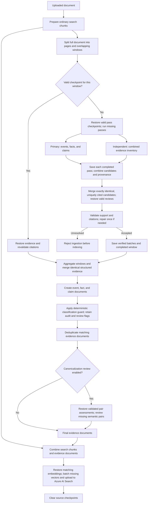

The four passes for a window use separate agent invocations, and the independent
pass cannot see the primary answers. Up to three windows run at once within a
shared four-invocation limit. Model, schema, or checkpoint storage failures also
reject ingestion before indexing. A successful window can be restored on retry
if a later window or Search indexing fails. Canonicalization review is optional;
if its review still fails after a smaller-batch retry, the affected records are
kept.

### Avoiding repeated model work

Before thorough reconciliation, candidates share a review only when their kind,
complete structured fields, feedback, and exact citations match. Object key order
is ignored; wording, array order, dates, speakers, qualifiers, and citation
differences remain separate. Every extraction provenance entry is retained.
Candidates with unresolved or ambiguous citations still receive separate reviews.
This keeps all four independent discovery passes and the existing reviewers.

Document-level canonicalization saves each valid model assessment separately in
the existing private checkpoint store. A restart restores only assessments whose
source, implementation, model settings, pair input, and saved output hashes match.
Schema validation and the current material-detail and survivor guards run again
before any merge. Distinct and uncertain decisions are reusable too. Invalid or
missing pairs are reviewed again; valid siblings are retained. Storage failures
stop new batches and repairs immediately. Active reviews, recursive repairs,
checkpoint reads, and saves settle before the error is returned, preserving
completed work without overlapping a retry.

Indexing normalizes embedding inputs exactly as before, reuses exact text within
an account and source, and sends missing inputs in requests of at most 16 records,
with at most four batches active per cache instance, including concurrent callers.
Each record has at most 8,000 tokens; oversized records follow the existing split
path. Storage reads use groups of 16; each active batch writes at most 16 vectors.
Each 25-record indexing chunk completes before the next starts, avoiding the
previous simultaneous embedding request for every record in the document.
Completed embedding batches survive a later provider or indexing failure.
If a provider request or cache upload fails, no new provider batches start and
every admitted request and upload settles before indexing
returns the error and releases the account/source operation. A queued removal
therefore cannot clear checkpoints before a late upload recreates them.

Embedding cache keys include the endpoint, deployment, model, API version,
dimensions, preprocessing version, and optional `EVIDENCE_EMBEDDING_CACHE_EPOCH`.
Change that epoch when replacing a model behind an unchanged deployment name.
The existing `text-embedding-3-large` model and its 3,072 dimensions are retained;
the explicit dimension also removes the schema-probe embedding request. Cached
records contain input hashes and validated vectors, without another copy of input
text. The API uses its existing checkpoint store, so source/account deletion and
the 30-day abandoned-work pruning also cover these records. Evidence completion
clears the source's checkpoints. Callers without a checkpoint store have bounded
in-memory reuse only. Batching reduces HTTP requests; cached or duplicate inputs
also avoid embedding token charges.

Document-level duplicate reviews in queue mode run on the existing review
workers using a saved, stable candidate plan. See
[durable asynchronous evidence review](evidence-async-review.md) for the handoff
and resume behavior. Concurrency reduces waiting time, not the number of model
tokens in a fresh review; plan and decision reuse avoid repeated work on resumes.

`evidenceExtractor.candidatesDeduplicatedBeforeReview` reports candidate and
reused counts. Existing `evidenceExtractor.stageRestored` events identify saved
canonicalization pairs. `evidence.embeddings.resolved` reports input, unique,
cache-hit, generated, request, and oversized counts; it includes no source text.
Existing `aoai.embeddings.tokens` events retain per-request usage and input count.

Offline validation on 2026-10-16 used the frozen 15-page thorough capture with
source SHA-256 `40802378298f95662a4a89b0f6a81bbe043033e59353b68cd6fcc41340fd34e7`.
Exact deduplication reduced 2,026 candidates to 2,024, preserved every distinct
structured assertion and provenance entry, and left the 134 fixed review batches
unchanged. Its benefit on that capture was small. Mocked indexing of 26 records
reduced embedding requests from 26 to three (16/9/1 inputs), then required zero
additional requests on replay; content, citations, order, and evidence Search IDs
matched. Canonicalization restart tests reproduced the entire original result
without another model call and reviewed only invalid pairs on partial recovery.
These checks validate reuse and request counts, not a new live latency or recall
benchmark. No model downgrade or discovery-pass reduction is introduced.

Accepted items become evidence documents; duplicate records can be merged.
Each document's `pageContent` is readable search text, while its metadata
retains structured fields and exact source locations:

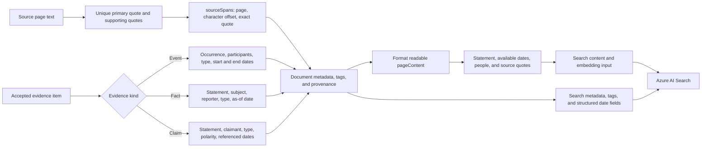

## Configuration

Set these in the mounted appsettings file for both Test and Production:

```json
{
  "EVIDENCE_PRIMARY_DEPLOYMENT_NAME": "tasks-gpt-6.0-luna",
  "EVIDENCE_PRIMARY_REASONING": "high",
  "EVIDENCE_INDEPENDENT_DEPLOYMENT_NAME": "research-gpt-6.1-sol",
  "EVIDENCE_INDEPENDENT_REASONING": "low"
}
```

Both roles inherit `AZURE_OPENAI_LLM_ENDPOINT` and `AZURE_OPENAI_LLM_API_KEY`.
GPT reasoning uses the role's `REASONING` setting first, then the legacy
`AZURE_OPENAI_REASONING` setting if supplied. Without either setting, the primary
defaults to `high` and the independent model to `low`. The independent setting
also controls source-support reconciliation unless a separate reconciliation
role is configured. The examples explicitly set both
roles, so a shared `AZURE_OPENAI_REASONING: medium` does not override them.
Lower independent reasoning is intended to reduce ingestion time; measure
latency and evidence recall before treating that improvement as established.
The Production template now explicitly sets primary gathering to `medium`
reasoning, up from `low`. Its independent lane remains `low`. Test settings
already request primary `high`; that higher setting remains available for
evaluations. This template change takes effect when applied to the mounted
appsettings configuration.
GPT endpoints are rewritten
to `/openai/v1/`; the deployment name is the request's `model`, and Responses
is enabled. Token telemetry records the actual deployment and stage, without
relying on the legacy `AZURE_OPENAI_MODEL` label.

To use the two deployed Claude models instead, set:

```json
{
  "EVIDENCE_PRIMARY_DEPLOYMENT_NAME": "tasks-claude-haiku-5-5",
  "EVIDENCE_INDEPENDENT_DEPLOYMENT_NAME": "research-claude-sonnet-5-5"
}
```

Deployment names with a `claude` segment select the Anthropic client
automatically. Its base URL is the configured endpoint's host plus `/anthropic`;
the SDK calls
`/anthropic/v1/messages`, sends the deployment name as `model`, and uses the
resource key as `x-api-key`. Configure a Foundry endpoint for your own environment. Claude requests use a 16,384
token output limit and do not inherit OpenAI reasoning or verbosity settings.
For a deployment with a different name, set `EVIDENCE_PRIMARY_PROVIDER` or
`EVIDENCE_INDEPENDENT_PROVIDER` to `anthropic`. Set either to `openai` to select
the OpenAI client explicitly.

### Foundry Mistral reconciliation

The experimental `Recon-Test-Mistral-Large-3` deployment can review GPT
candidates without changing the extraction deployments:

```json
{
  "EVIDENCE_RECONCILIATION_DEPLOYMENT_NAME": "Recon-Test-Mistral-Large-3",
  "EVIDENCE_RECONCILIATION_PROVIDER": "mistral",
  "EVIDENCE_RECONCILIATION_MAX_OUTPUT_TOKENS": "8192",
  "EVIDENCE_RECONCILIATION_REQUEST_INTERVAL_MS": "0"
}
```

Deployment names with a `mistral` segment select this route automatically.
The client uses the configured resource host with `/openai/v1/` and Chat
Completions, passes the deployment name as `model`, and requests native JSON
Schema output. GPT reasoning, verbosity, and service-tier settings are omitted.
Assistant-message names are removed from tool rounds because this Foundry
deployment rejects that optional OpenAI field. Tool IDs, contents, and exact
source quotations are preserved. Every returned decision still passes the
same complete schema and citation validation. An output stopped by the token
limit fails the job.

`MAX_OUTPUT_TOKENS` must be a positive integer and defaults to 8192 for Mistral.
`REQUEST_INTERVAL_MS` must be a nonnegative integer and defaults to zero; it
spaces HTTP request starts for a single model client, including tool rounds and
SDK retries. It does not coordinate rate limits across worker replicas. Choose
limits using the deployment's actual quota. The first local Test trial found
a 20,000-token/minute and 20-request/minute quota and used a 4096-token output
limit, one active invocation, and a 45-second request interval. Elapsed time
under those settings includes intentional waiting and cannot establish the
model's unrestricted speed. This trial does not change the deployed Test or
Production model settings.

### Foundry DeepSeek reconciliation

`Recon-Test-DeepSeek-V4-Pro` uses the same `/openai/v1/` resource base URL
through `ChatOpenAI` with Chat Completions and native JSON Schema output.
Set `EVIDENCE_RECONCILIATION_PROVIDER` to `deepseek`, or use a deployment name
containing a `deepseek` segment. The client omits GPT reasoning, verbosity, and
service-tier settings. The same optional `MAX_OUTPUT_TOKENS` (default 8192) and
`REQUEST_INTERVAL_MS` (default zero) settings apply to its role. Every decision
still passes the full schema, decision-consistency, and citation checks.

```json
{
  "EVIDENCE_RECONCILIATION_DEPLOYMENT_NAME": "Recon-Test-DeepSeek-V4-Pro",
  "EVIDENCE_RECONCILIATION_PROVIDER": "deepseek",
  "EVIDENCE_RECONCILIATION_MAX_OUTPUT_TOKENS": "4096",
  "EVIDENCE_RECONCILIATION_REQUEST_INTERVAL_MS": "32000"
}
```

For an isolated trial on captured candidates, use `--reconciliationModel deepseek`
and `--concurrency 1`, with a private settings copy. The Test deployment has a
20,000-token/minute and 20-request/minute quota. Request pacing should be chosen
for actual batch sizes and tool rounds; it is not a quota guarantee across
multiple processes.

The 2026-10-09 trial's small routing probe accepted JSON Schema output. A real
16-candidate preflight repeatedly failed decision-consistency validation: the
model attempted to discard a supported duplicate with empty replacement arrays,
and rejected material fields supported by quotes on another page. The second
attempt repeated those failures after explicit prompt clarification. The full
four-page trial was not started, and this deployment is not recommended as the
default reconciler on this evidence. The observations concern one batch, not
general model quality. No deployed Test or Production settings were changed.

Claude's constrained decoder accepts the individual event, fact, and claim
schemas after unsupported JSON Schema constraints are moved into descriptions
and unknown date parts are represented by empty strings. Those three primary
passes use native structured output and are still checked by Zod after parsing.
The combined independent-extraction and reconciliation schemas exceed Foundry's
compiled grammar limit even after the same conversion.
The full-schema LangChain tool strategy also fails on these Azure Claude
deployments because the endpoint rejects forced `tool_choice` values `tool` and
`any` (HTTP 400).
For the two larger passes, the agent returns a small native JSON envelope
containing the detailed response as a JSON string. The service parses that
string against the complete Zod schema before accepting evidence. Empty or
missing date parts are treated as unknown. Malformed responses receive one
repair attempt with the previous response and validation errors; another
invalid response fails the document job. A response stopped by the output
token limit fails with a specific error.

Optional overrides use the same role prefix: `EVIDENCE_PRIMARY_ENDPOINT`,
`EVIDENCE_PRIMARY_API_KEY`, `EVIDENCE_PRIMARY_REASONING`, or the corresponding
`EVIDENCE_INDEPENDENT_*`, `EVIDENCE_RECONCILIATION_*`, and
`EVIDENCE_RECONCILIATION_FALLBACK_*` names. `REASONING` applies to GPT only; use a value
supported by that GPT deployment. An endpoint override on another resource
needs that resource's key.

`EVIDENCE_RECONCILIATION_FALLBACK=independent` retains the previous behavior:
the independent extraction model reviews unresolved candidates and failed
components. Set it to `configured` and supply
`EVIDENCE_RECONCILIATION_FALLBACK_DEPLOYMENT_NAME` to use a separate review
model. This lets Test use the Cost router for first-pass reconciliation, the
Balanced router for review fallback, and Claude Haiku for independent gathering.
Set each router role's `ENDPOINT` to its Foundry project URL. Queued review tasks
record the selected reviewer so a fallback task uses the configured review
model. A change to any of these model settings changes the checkpoint
fingerprint; incomplete work may need fresh model calls after rollout.

For a Foundry project model-router deployment, set the role's `ENDPOINT` to
`https://<resource>.services.ai.azure.com/api/projects/<project-name>` (or
the same URL ending in `/openai/v1/`) and set its `DEPLOYMENT_NAME` to the router
alias. The model keeps LangChain's Responses API; account-level Responses routes
can reject router calls even when the project route accepts them. A capped
source also needs verified pricing for every eligible routed model and the
router fee before using this deployment.

To try Luna for source-support review while retaining Sol's independent
extraction, add these optional settings:

```json
{
  "EVIDENCE_RECONCILIATION_DEPLOYMENT_NAME": "recon-test-gpt-6-luna",
  "EVIDENCE_RECONCILIATION_REASONING": "xhigh",
  "EVIDENCE_RECONCILIATION_FALLBACK": "independent"
}
```

The separate Azure Test reconciliation deployment is on the same Foundry
resource (`example-ai-test`), so the existing endpoint and
resource key apply. In a local replay, select `--reconciliationModel luna
--reconciliationDeployment recon-test-gpt-6-luna` to retain Luna `xhigh` reasoning
while overriding its deployment name. The optional deployment flag also works
with `configured` or `sol` model selection. Test trials use private settings
copies and do not change the deployed reconciler.

The October 9 four-page replay reviewed 371 previously validated GPT records
in 115.5 seconds and returned 365 records. Reconciliation and canonicalization
used 52,466 output tokens, including 31,011 reasoning tokens, with no rejected
candidates or citation repairs. Inspection found supported testing-session
dates cleared from an event and several named claimants replaced with `Unknown`.
This is a successful routing and validation trial; semantic quality still needs
review before selecting Luna as the default reconciler. The input was already
validated evidence, so its time and tokens cannot be compared directly with a
full extraction run or used to establish raw-candidate recall.

A fresh four-page extraction with the same Luna reconciler subsequently failed
after 189.4 seconds: several citations remained unresolved after repair,
primarily intervention bullets repeated under the discussed and agreed sections.
The failed attempt recorded 90,980 output tokens, of which 53,214 were for
reconciliation, and produced no final evidence set. These partial measurements
cannot establish completed-run cost or speed savings. Retain Sol as the default
reconciler while evaluating citation disambiguation on the saved raw candidates.

The separate role can also set its own provider, endpoint, and API key. When no
reconciliation setting is present, the extractor reuses the independent model
client. A configured reconciliation model is included in checkpoint identity,
so windows reviewed by another model are not silently restored.

`EVIDENCE_RECONCILIATION_FALLBACK` defaults to `off`. With `independent`, a
different independent deployment reviews only exceptions: unresolved items
after Luna's repair pass, proposed rejections with valid citations, and proposed
clearing of known date or attribution fields. A separate focused date operation
handles supported events that still have neither a start nor an end date after reconciliation.
A partial date on either endpoint counts as a date; placeholders such as
`Unknown`, `n/a` and empty strings count as missing. Facts and claims do not
trigger this fallback merely because their dates are missing.

For event date recovery, the independent model receives the reviewed occurrence,
participants, exact citations, nearby source text and selected date passages.
Its small native schema returns only dates, their relationship to the occurrence,
uncertainty, an explanation and supporting quotations. It cannot rewrite the
event, change its classification, or discard it. `point`, `duration`, `bounded`
and `approximate` distinguish actual occurrence dates from uncertainty bounds.
Unknown dates retain the supported event. A substantive source conflict goes
through general exception review; ordinary uncertainty does not trigger that path.
Invalid date decisions receive one targeted retry, then fail the document if
unresolved. Valid neighboring decisions survive that retry and job recovery.

`eventDateResolution` preserves the outcome and citations in event metadata.
For `bounded` results, actual start/end dates stay unknown; `pageContent` instead
includes “Earliest possible occurrence”, “Latest possible occurrence” and the
uncertainty qualifier. Approximate dates retain their qualifier. Duplicate review
protects these distinctions. Numeric/calendar validation and exact citations do
not establish every semantic date relationship; source review remains necessary.
Document, signature, assessment and neighboring-event dates cannot be borrowed
without a source-supported link. Only undated event outputs receive date review.

An unknown calendar date can still retain cited relative timing, such as “three
to four months” or “the last few weeks of school.” These decisions keep every
start/end date part empty. The relation may be `unknown`, `duration`, or
`approximate`; a duration or approximate relation requires the source wording
in `qualifier`, and any qualifier requires a supporting quotation. Searchable
text labels it “Relative timing (calendar date unknown)”. Relative wording
alone cannot establish a year, point date, or uncertainty bounds. At final
indexing, occurrences without a calendar date or bounded occurrence date are
reclassified as cited `undatedOccurrence` facts or attributed claims. The date
resolution and citations remain in metadata; the fact has no `event` tag.
If primary and fallback date reviewers each return invalid or incomplete
decisions after their retries, valid peers keep their decisions and each
remaining cited occurrence is retained with an
unverified date. Its metadata explains that automatic date review did not
produce a valid decision. An entry whose original citation cannot be verified
is omitted individually and emits `candidateRejected` with reason
`date-unresolved-invalid-citation`. Model or storage failures still retry or
fail normally; they are not treated as evidence that a date is unknown.
The same final-rescue rule applies to source-support and classification review:
after independent repair and Sonnet rescue, unresolved entries are omitted
individually with a reason in `candidateRejected`, while validated peers remain.
An attribution decision that remains invalid retains the cited claim with an
unknown claimant; an invalid original citation omits that claim. Provider,
storage, and budget errors remain job-level failures or waits.

### Reusable source context and review decisions

The document context index is built lazily from original source passages. It
records headings, date/attribution cues, page numbers, offsets and exact text.
It ranks passages locally; it neither generates a document summary nor assigns
speakers or dates. Missing claimant/reporter context is supplied to general
review, while focused date review receives date passages. Context already in
the ordinary review window is not repeated. Authors, quoted speakers and reporters
must still be distinguished through cited source relationships.

`search_source_context` retrieves short passages; `read_source_page` supplies
additional context. They share a six-operation budget per invocation. Empty
search results describe that lookup only and never prove document-wide absence.
Initial blind extraction passes do not receive other extractors' decisions.
The per-document lookup cache is bounded and isolated to that document instance.
Redis and embeddings are not required for this implementation.

Response rows that pass schema, decision, citation and calendar checks are
checkpointed before subsequent exception/date work. Unresolved rows and invalid
citations or dates are not cached as completed decisions, so later retries can
obtain a fresh answer.
Recovery revalidates their schema and their source/configuration identity, then
requests only missing rows. Full evidence/citation validation still occurs before
indexing. Decision records use the existing private Blob checkpoint store and
its cleanup lifecycle; there is no new app setting. A source, candidate, model,
or implementation change invalidates incompatible saved work.

Before rejecting an item with a nonmatching primary quote, the reviewer receives
exact source fragments when its quotation or unfinished sentence crosses the
target boundary. Such proposed rejections go to the configured independent
reviewer, which may repair the primary anchor and add the adjacent passage as a
supporting citation. Text continuity is a review hint, never automatic evidence
acceptance. Complete unrelated sentences on neighboring pages retain their
normal rejection path.

Approved events containing habitual, hypothetical or recommendation wording
receive independent classification review before date lookup. Wording is a
routing hint: an actual meeting or recorded statement may still be an event.
The reviewer preserves supported content as an event, fact or attributed claim.
Only retained events without dates proceed to the focused date resolver. This
review uses the same strict schemas, citation validation and resumable decisions;
it cannot recurse into another classification review. With fallback disabled,
the ordinary reviewer still receives these context and classification hints.

Extraction, general review and focused date recovery share an explicit temporal
link rule. A date must be linked to the occurrence by source wording; a shared
topic, nearby header or participation in the same matter is insufficient.
For example, examination dates do not date consent to an evaluation or notice
of its purpose. Consent could have preceded the examination sessions. Both
endpoints of uncertainty bounds need support; a one-sided "before" relationship
does not establish a closed interval. Explicitly stated session bounds, partial
dates and relative durations remain available. This is a model instruction,
not a deterministic semantic guarantee; exact citations and valid calendar
parts alone cannot establish the temporal relationship.

### Claim attribution and bounded review failures

Each source window now supplies a small set of exact identity passages (for
example, an author, examiner or sender header). These are selected separately
from descriptive passages so frequent subject words cannot crowd them out.
They remain source evidence: the extractor must establish the relevant embedded
report, statement and speaker. A file may contain several authors; a parent's
or witness's statement must not become the examiner's merely because the
examiner wrote the report.

`Unknown`, `Report author`, `Document author`, `Assessment author`, and similar
generic claimant labels all receive attribution instructions and context during
extraction/review. When a supported claim still has a generic label, identity
passages are available, and independent fallback is enabled, a compact
`claim-attribution` pass may change only the claimant and add supporting
citations. The response contains the candidate ID, outcome, claimant, explanation
and quotations. It cannot rewrite, reclassify, reject or merge the claim.

A resolved claimant must have their source name in an exact, unambiguous
supporting quotation. The model must also establish the name's relationship to
the statement. An unknown outcome preserves the original claim, label and
validated citations; unused diagnostic quotations are discarded. This avoids
failing an unchanged claim because an optional search quotation is ambiguous.
Invalid resolved rows receive one targeted retry, while valid neighboring rows
are checkpointed. API failures or responses that remain invalid still fail the
document. No new app setting is required; focused attribution uses
`EVIDENCE_RECONCILIATION_FALLBACK=independent`.

OpenAI decision reviews use LangChain's tool strategy with `handleError: false`.
Malformed structured output reaches application validation immediately instead
of being retried inside LangChain until the agent-step limit. Captured arguments
are considered only for the expected structured-output tool. Every recovered
row still passes the full schema, decision and citation checks. Valid rows are
retained; malformed rows go through the configured fallback.

If general reconciliation reaches the agent-step limit or returns multiple
structured outputs, only the remaining candidates go to independent review.
The independent reviewer cannot recursively fall back to itself. With fallback
disabled, exhausted review fails normally. API/transport errors retain their
failure behavior. Source-tool budgets and the 24-step outer limit remain active.

A missing terminal structured object receives one retry inside that invocation
with a fresh agent and source-read budget. This shares the retry limit with the
existing missing-tool-output retry; the two failures cannot compound retries.
Completed extraction passes and stage checkpoints remain intact. Malformed
payloads and output truncation still fail validation rather than entering this
transient retry. `missingStructuredResponseRetry` telemetry records the attempt.

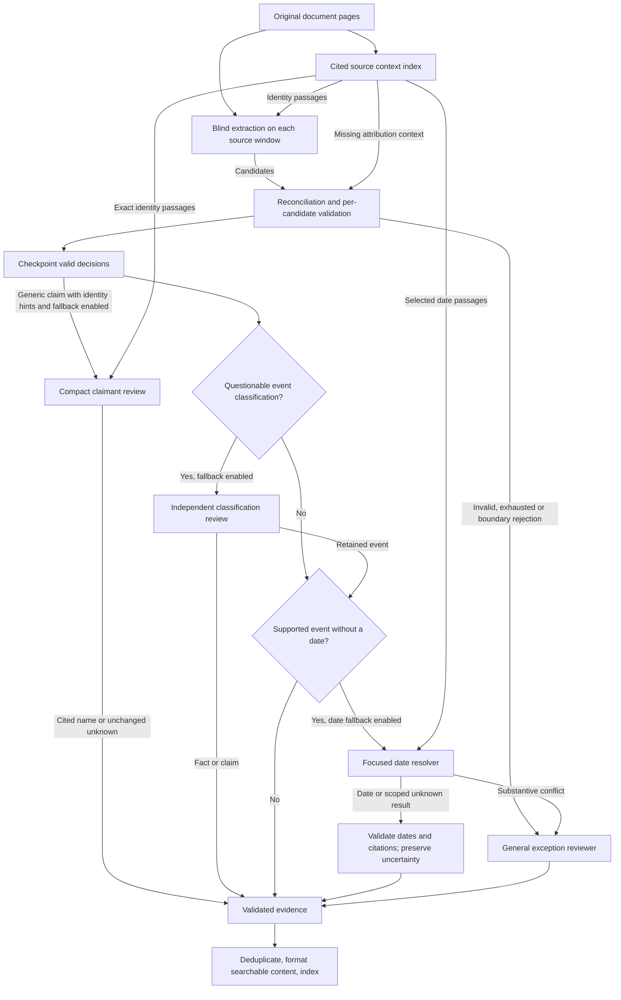

Telemetry separates `event-date-resolution` tokens from general
`reconciliation-fallback`. `documentContextSelected` reports selected characters
and lookup reuse, `reviewDecisionsValidated` reports valid/invalid/reused rows,
and model usage includes `contextSearchCalls` as well as `pageReadCalls`.
`claimAttributionReviewed` reports resolved/unknown outcomes;
`structuredReviewRecovered` and `reviewLoopEscalated` describe malformed-output
recovery and exhausted review. Attribution tokens have their own
`claim-attribution` stage, and the local runner reports these counters.
`boundaryReviewRequested`, `eventClassificationReviewRequested` and
`eventClassificationReviewed` report the additional review routes and resulting
evidence kinds. Their model calls are included in `reconciliation-fallback`.
Cost comparisons must include every stage, failed attempt and cache charge.
These optimizations have regression coverage. The historical replay measurements
below predate the routing fixes; the latest full evaluation is reported separately
under “Routing evaluation on the full live document”.

The live runner reports `eventDateFallbackRequests`, `eventDatesRecovered`,
`eventDateBoundsResolved` (the uncertainty-bound subset of recovered dates), and
`eventsRetainedUndatedAfterFallback`. These count candidate requests and output
records before deduplication, not unique final records. Date recovery uses the
existing `EVIDENCE_RECONCILIATION_FALLBACK=independent` setting; with `off`, there
is no additional model call. No extra appsetting is required.

The live 15-page date-fallback evaluation replayed the same 1,300 raw candidates
as the preceding Luna run, without repeating blind extraction. Final dated
events rose from 49 to 86, while undated events fell from 89 to 50. Sol received
100 date-recovery requests and produced 44 dated event outputs before
deduplication; 53 outputs remained undated. The final set contained 1,182 records
(136 events, 489 facts, 557 claims), with all technical checks passing and all
three examination dates represented. Potential duplicate pairs with overlapping
citations fell from 234 to 200. Some recovered dates are bounded testing intervals
rather than exact occurrence dates; the use of start/end fields for these bounds
still requires semantic review.

Two Luna review batches reached the agent-step limit. Checkpoint recovery
completed the document without rerunning saved work. Total review and
canonicalization usage across attempts was 284,730 output tokens, including
109,744 reasoning tokens, in 697.2 seconds. Sol fallback used 33,866 output tokens
for date recovery and other exceptions combined. These are replay measurements,
not full-ingestion cost or latency. The date fallback improved date coverage in
this run, but unknown claimants increased from 140 to 160; it does not address
the existing attribution gap or establish overall quality parity with Sol.

Using OpenAI's published Standard short-context prices as an estimate, that
live replay costs approximately $3.07: $0.36 for Luna and $2.71 for Sol fallback,
including retries and cache writes. Output accounts for $0.46, while input
processing accounts for $2.61. The earlier full Bun test's Sol review and
canonicalization estimates to $5.05, a historical review-stage reduction of
39.2%. Adding the recorded extraction stages reused by the latest replay gives
a reconstructed pipeline estimate of $4.53, compared with $6.54 for that earlier
full Sol run. This combined estimate is not a fresh full-run measurement or a
claim of equivalent quality.

Rates retrieved October 9, 2026, in USD per million tokens:

| Published model | Ordinary input | Cached reads | Cache writes | Output |
|---|---:|---:|---:|---:|
| gpt-6-luna | $0.10 | $0.01 | $0.125 | $0.50 |
| gpt-6.1-sol | $2.00 | $0.10 | $2.50 | $10.00 |

Published `gpt-6-luna` prices are used as a proxy for the Azure deployments
containing `gpt-6.0-luna`; that exact model name is absent from the pricing table.
These estimates apply OpenAI rates to Azure usage as requested, not Azure
invoice amounts. Every recorded call is below the 272K input-token threshold
for long-context rates. Cache reads and writes are subsets of input tokens:
ordinary input equals total input minus cached reads minus writes. Charge each
category once at its rate, and include reasoning in output without adding it
again. Regional processing, priority tiers, embeddings, search, storage and
infrastructure are excluded.
Sources: [OpenAI pricing](https://developers.openai.com/api/docs/pricing) and
[prompt-cache billing](https://developers.openai.com/api/docs/guides/prompt-caching).

It receives the original item
when reviewing a proposed destructive correction, and the most recent corrected
item for an unresolved citation. Exceptions are batched, use the independent
model's reasoning setting, and must pass the same semantic review and citation
validation. Fallback failure still fails the document; there is no fallback loop
or unconditional acceptance. Its token usage is recorded under
`reconciliation-fallback`. This reduces reliance on Sol for routine review while
retaining it for cases where Luna could discard supported evidence. It does not
detect every possible semantic error in an accepted item.
Invalid response rows, missing IDs, duplicate IDs and inconsistent decisions
send only their affected candidates to the fallback. Foreign IDs are ignored
and counted; they can never introduce evidence. When LangChain rejects a whole
provider response, captured terminal JSON can recover valid neighboring rows;
every recovered row still passes the complete application schema and decision
checks. Unparseable responses affect all candidates still awaiting a decision.
Truncation, API and transport failures retain their failure behavior. Without a
fallback, invalid decisions fail the document. No partial result is indexed.
Malformed compact corrections send the original affected candidate to the
configured fallback. Without a fallback, they receive one repair attempt and
still fail the document if invalid. Validation is never bypassed.

An October 9 test of the focused date/context changes replayed 64 saved
candidates with the complete 15-page source available. All structural and
citation checks passed in 145 seconds, producing 54 records: 24 events, 18 facts,
and 12 claims. Eleven events had date information, including ten uncertainty
bounds; thirteen remained undated. The live runner now counts bounds as date
information and checks approximate and bounded dates in `pageContent`.

A separate comparison used identical inputs for 23 date lookups and eight
historical citation, attribution, or rejection problems. Each variant ran with
concurrency one; blind extraction and canonicalization were skipped.

| Fallback path | Output tokens | Estimated cost | Seconds | Completion |
|---|---:|---:|---:|---|
| Previous Sol general review | 8,781 | $0.9418 | 187.3 | 31/31 candidates |
| Focused dates and current review, Sol | 8,416 | $0.6410 | 163.2 | 31/31 candidates |
| Focused dates and current review, Sonnet | 18,373 | $1.0783 | 168.5 | 30/31; one tool-loop failure |

Prices use the published Standard rates above and Sonnet 5.5's published
$2 input/$10 output per million tokens. Failed calls are included; separate
checkpoint-reuse checks are excluded from this comparison. There were no
provider cache hits. Overall estimated cost fell 31.9% with the optimized Sol
path, while output tokens fell only 4.2%. Most savings came from input: focused
Sol date review used 117,148 input tokens versus 246,260 previously, reducing
date-review cost from $0.6820 to $0.3555. All eight saved Sol date batches replayed
with identical results and zero model calls.

These results favor retaining Sol as fallback but do not establish unchanged
evidence quality. Sonnet assigned two date bounds without a source link and
missed a more specific testing-session range. It also hit the 24-step limit
while reviewing one unknown claimant; the semaphore was released and the case
failed rather than yielding empty evidence. All native date-schema batches
succeeded. The date-only pass preserved one habitual statement that Luna had
misclassified as an event; the previous general Sol review changed it to a
claim. Both independent reviewers recovered one item using a page-boundary
fragment that Luna had rejected. These findings led to the classification routing
and boundary repair changes evaluated on the full document below.

Private artifacts, including exact inputs, outputs, costs and review CSVs, are
under `.local/evidence-optimization-test-2026-10-09/`. The README records the
method and limitations. The 280-test suite, build and lint passed. This small
sample from one source does not measure full-document recall or behavior on
100+ pages.

After adding citation resolution, a replay of 178 saved raw candidates completed
in 133.8 seconds with 168 records, three repair attempts and 41,020 output tokens.
It also showed that Luna could reject a valid target-page bullet as being only
on a neighboring page, so successful citation validation alone is insufficient.
A subsequent focused replay with independent fallback reviewed 32 candidates
in 39.8 seconds, returned 27 records and retained the three affected page-2
bullets. Luna used 8,412 output tokens, and Sol reviewed four exceptions using
280 output tokens. The runner initially omitted the fallback stage from its
replay assertion; the saved result was revalidated locally after correcting that
assertion, without another model call. These are small candidate replays, not
full-document quality or cost benchmarks. Sol remains the blind independent
extractor; this option reduces its reconciliation workload.

The subsequent four-page pipeline completed in stages after failures exposed an
invalid citation-choice ID and a malformed compact correction. Both paths now
retain the affected candidate for repair or independent fallback. Fresh
extraction snapshots covered all four pages: 379 candidates produced 380 final
records (111 events, 91 facts, 178 claims), with zero unresolved citations or
rejections. The successful review took 206.2 seconds and used 91,041 output
tokens, including reasoning. Sol handled 40 candidate reviews across nine
fallback batches, using 8,253 output tokens, compared with 55,302 for the earlier
bulk Sol review. Extraction candidates differed between those runs.

Across failed attempts, capture recovery and successful review, the experiment
used 277,760 output tokens in 623.5 seconds of model-run time. The earlier
successful four-page Sol pipeline used 131,694 output tokens in 365.3 seconds.
Total Sol output fell from 77,558 to 39,171, while total output increased. These
measurements show reduced Sol dependency; they do not establish lower dollar
cost or faster ingestion. A clean run and deployment-specific prices are needed
for that comparison.

Automated quality checks found 84 overlapping-citation similar pairs versus 145
previously; these are potential duplicates requiring review. All three
examination dates remained represented as dated events. Unknown claimants fell
from 62 of 163 claims to 31 of 178, but claims naming the examiner fell from 31
to 18. Citation validation and these counts do not establish semantic quality.
The test covers the first four pages; longer-document behavior remains to be
evaluated.

The subsequent 15-page live test used the same source hash as the earlier full
GPT benchmarks and completed through checkpoint recovery. It returned 1,188
records (138 events, 516 facts, 534 claims), with all citation and structural
checks passing. The run exposed missing structured extraction output and
repeated reconciliation candidate-accounting failures; the latter now route
to the configured independent fallback. One local recovery invocation used
an isolated telemetry instance, so its page-12 review and canonicalization
usage was not captured. Recorded output across attempts is therefore a lower
bound of 550,051 tokens, compared with 544,363 in the earlier full Bun run;
recorded Sol output is a lower bound of 89,512 versus 292,011. Model-run time
across attempts was 1,096.7 seconds, excluding time spent fixing the runner.
This is not a clean runtime or cost benchmark.

Against that earlier full Bun result, potential duplicate pairs with overlapping
citations fell from 356 to 234, but unknown claimants increased from 66 of 543
claims to 140 of 534. Claims naming the examiner fell from 265 to 185, and dated
events fell from 83 to 49; all three examination dates remained represented.
Among the 1,300 raw candidates, primary Luna produced 394 claims with 224 unknown
claimants and six naming the examiner; independent Sol produced 212 claims with
21 unknown claimants and 170 naming the examiner. These diagnostics do not
isolate model effects from stochastic extraction or implementation changes.
Retain Sol as the default reconciler while improving attribution and reviewing
potential omissions; valid citations and fewer duplicates do not establish
equivalent usefulness or completeness.

GPT verbosity is left at the provider default when `AZURE_OPENAI_VERBOSITY` is
unset. The local Test settings and appsettings examples omit it. For a controlled
benchmark, `--verbosity default` removes any setting loaded from the selected
appsettings file and records `verbosity: null` in the result.

For a controlled Azure priority-tier trial with GPT reconciliation, set
`EVIDENCE_RECONCILIATION_SERVICE_TIER` to `priority`. This setting affects only
the reconciliation client. Each LLM call records the tier returned by the
provider as `serviceTier` in token-usage telemetry; the returned tier must be
checked because a successful request can still report `default`. The live
runner accepts `--reconciliationTier priority` and fails its priority check if
any reconciliation call reports a tier other than `priority` or `fast`.
In the 2026-10-09 Azure Test trial, all 43 reconciliation calls returned
`default` despite requesting `priority`. The partial replay ended after three
windows when one page-2 candidate remained unresolved, so it supplies no full
latency or quality comparison for priority processing.

Without a primary override, the legacy `AZURE_OPENAI_API_DEPLOYMENT_NAME` is
honored, falling back to `tasks-gpt-6.0-luna`. Without an independent override,
`research-gpt-6.1-sol` is used; failures never silently fall back to the primary.
The example appsettings files configure both explicitly. Updating an example
file does not change an existing Key Vault secret or running pod.
For AKS, regenerate and upload the complete Test and Production secrets with
the private appsettings generator. Test sets
`EVIDENCE_CANONICALIZATION_MODE=review`; Production sets it to `off`. Leave
`AZURE_OPENAI_VERBOSITY` unset to use the provider default. The ingestion API
loads its mounted settings at startup, so its pods need a rollout with the new
image before these settings affect extraction. Existing legacy model settings
can remain in place because the evidence-specific deployment names take
precedence.

## Experimental specialist skills

`EVIDENCE_SPECIALIST_MODE=skills` enables two bounded review specialists; the
default is `off`. The implementation uses Deep Agents **1.14.2** skill and
filesystem middleware inside the existing LangChain `createAgent` calls.
Application code selects the task and schedules all pages. There is no additional
LLM supervisor, automatic delegation or recursive subagent creation.

| Procedure | Integration | Model |
| --- | --- | --- |
| `claim-attribution` | Focused claimant review; inspect author, reporting witness and alleged speaker. | Existing independent/fallback deployment. |
| `evidence-identity` | Existing canonicalization batches; compare occurrence identity and retained propositions. | Existing reconciliation deployment. |

The versioned `SKILL.md` files and optional examples live under
`src/DataIngestionService/src/processors/evidence/skills/`. Mandatory procedure
text is loaded explicitly into the selected review's system prompt. Deep Agents
discovers only that specialist's skill; its `read_file` tool can read that skill's
directory. Examples load on demand. Source access continues through
`read_source_page` and `search_source_context`, with the existing per-invocation
budget. The middleware exposes no shell, write, planning or delegation tools.

In skill mode, a reporting-clause cue can route an already named claimant to
focused attribution review when independent fallback is enabled. The cue is only
a review lead. The model must provide exact supporting quotations before changing
the claimant; an unknown outcome preserves the existing record. Attribution
cannot rewrite the statement or merge records. Canonicalization still obeys the
application's allowed-survivor and merge guards.

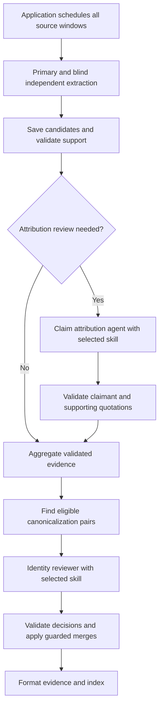

The same schemas, application retries, semaphore and token telemetry remain in
use. Middleware error wrappers are unwrapped so structured-output recovery and
loop handling continue to work. `specialistProcedureLoaded` records the skill
name, version and content hash. Specialist mode and hashes of instructions and
examples participate in checkpoint identity. `bun run build` copies skill assets
into `dist`; the container includes those compiled assets. The direct
`langsmith@0.9.0` dependency satisfies Deep Agents' declared peer range; existing
LangChain transitive versions remain separately locked where required.

### Small comparison using saved candidates

The benchmark accepts a frozen JSON fixture with source path/hash and bounded
attribution or identity tasks. It defaults to offline validation. An explicit
`--live --settings FILE` compares `off` and `skills` with identical task inputs
and model settings, alternating execution order. It saves each task result and
reuses saved results on rerun; source, skill, implementation, dependency and
configuration fingerprints prevent mixing different runs. Failed results are
preserved and require an explicitly selected new output directory for retry.

```bash
cd src/DataIngestionService
bun run benchmark:evidence-specialists --input /path/to/fixture.json --output /path/to/plan
bun run benchmark:evidence-specialists --live --input /path/to/fixture.json --settings /path/to/private-settings.json --output /path/to/run
```

The October 10 pilot reused four NTSB claims and four eligible evidence pairs.
No document extraction or embedding calls were repeated. Both variants completed
with five model calls each. The skill variant attributed the controller-instruction
claim to the engineer reporting it and added the reporting passage; the baseline
retained `Yard controller`. All four identity verdicts and survivors agreed.

| Measure | Existing reviewers | Skill specialists |
| --- | ---: | ---: |
| Attribution output tokens | 472 | 1,154 |
| Identity output tokens | 512 | 434 |
| Total output tokens | 984 | 1,588 |
| Sum of task elapsed time | 16.89 s | 23.20 s |

This supports further attribution evaluation, but does not demonstrate a cost
reduction or improved extraction recall. The fixed-task replay also excludes the
extra review volume the new routing cue could cause in full ingestion. The
selection includes previously inspected NTSB examples and has no human gold
labels; it is now a development replay. Enfield remains a subsequent validation
candidate. Results and review materials are under
`.local/evidence-specialist-pilot-2026-10-10/`. The default remains `off` pending
broader review.

### Fifteen-page comparison using saved evidence

The October 10 larger comparison scanned all 590 saved claims from the 15-page
development report, reviewed the 40 claims matching attribution routing in both
modes, and compared all 511 eligible identity pairs from the same 1,486 records
before canonicalization. Attribution used Sol at low reasoning; identity used
Luna at xhigh reasoning, with identical model configuration in both variants.
Attribution and identity were isolated comparisons on frozen inputs. Extraction,
general reconciliation, dates and embeddings were not repeated.

| Measure | Existing reviewers | Skill reviewers |
| --- | ---: | ---: |
| Input tokens | 418,721 | 528,085 |
| Output tokens, including reasoning | 47,378 | 39,047 |
| Model calls, including retries | 47 | 59 |
| Sum of task elapsed time | 126.45 s | 163.60 s |
| Changed claimants | 0 | 0 |
| Identity pairs reviewed | 511 | 511 |
| Applied merges | 252 | 254 |
| Final records | 1,234 | 1,232 |

Skills used 17.6% fewer output tokens, 26.1% more input tokens and 29.4% more
elapsed time. One skill sub-batch left eight pairs unreviewed after its normal
retry. An explicit retry repeated a disallowed survivor choice; a subsequent
singleton retry completed the eight pairs while reusing 503 successful
decisions. All failed attempts and recovery calls are included above. This
recovery was performed by the benchmark, not added to ingestion.

Both attribution variants retained the same unknown claimants, with no source-
supported names to add. Identity verdicts differed for 33 pairs, or 66 decisions
including survivor choices. Source inspection found both improvements and
regressions: skills fixed some tag-based separations and invented distinctions
in baseline explanations, but also retained clear paraphrases and confused
additional quotation text with extracted statement content. Both modes handled
supported enrichment inconsistently. An allowed-survivor response can still
omit a statement detail; quotation retention alone does not prove semantic
retention.

The technical audit passed 13,913 quotation checks and verified preservation of
original claim fields, citations, surviving statements, and cluster citations
and specific tags. This is not a semantic quality score. Full evidence outputs,
usage summaries, 511 pair comparisons, 66 differing decisions, attribution
comparisons and diagnostic AI source findings are saved under
`.local/evidence-specialists-full15-2026-10-10/`. Human review fields remain
blank. The document is a development source, so these results do not establish
extraction recall or performance on an independent large document.

The default remains `off`. The next comparison should resolve the policy for
supported enrichment versus separate atomic propositions, distinguish statement
fields from source context, and validate/repair invalid survivors per pair. A
prompt-only control on frozen difficult cases can then measure whether skill
middleware adds value beyond the procedure text.

### Identity procedure version 2 and individual repair

The follow-up implements a revised identity procedure and compares it with and
without skill middleware. `assertion` contains the extracted statement and its
structured fields; `evidenceContext` contains supporting passages. Instructions
permit supported specificity about one atomic assertion when the selected
survivor retains all detail, while keeping independent propositions separate.
All supplied supporting citations are represented with their original indexes,
subject to existing excerpt length limits. The old first-three-supporting-quotes
cap could omit a continuation needed to understand a classification.

`evidenceIdentityReview.ts` validates decisions individually. Missing, repeated,
malformed or contradictory rows receive one retry per affected pair, with the
exact allowed-survivor or protocol error. Valid decisions are not sent again.
Foreign IDs are ignored and counted. A transport or undecodable batch failure
can still split once into smaller batches; unresolved pairs retain both records.
`failedPairIds` identifies them, and `failedBatches` counts original batches with
any unresolved pair. All successful decisions are returned in source pair order.
The detailed native response schema remains in use; recovering raw output for
row validation does not switch this stage to OpenAI tool strategy.

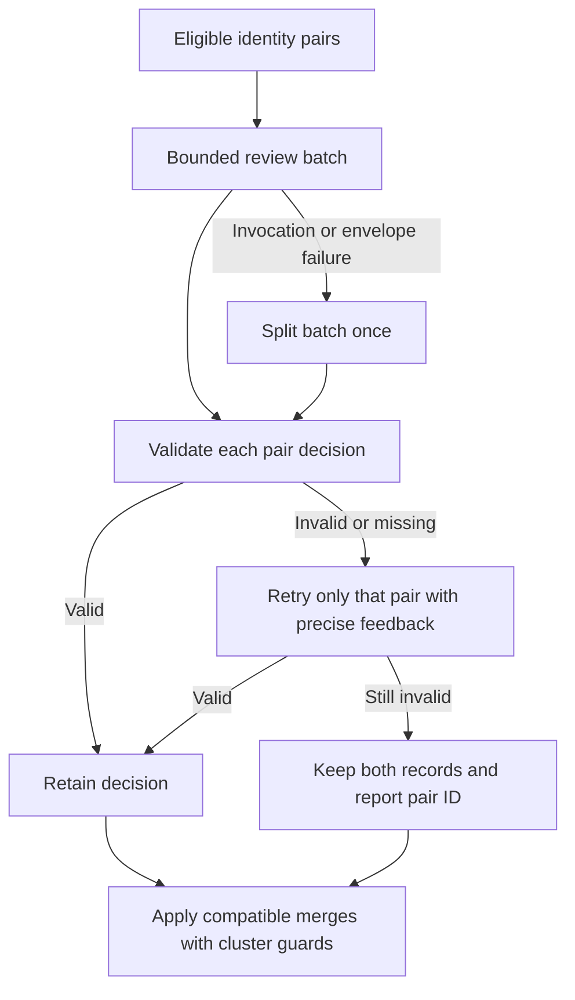

The October 10 comparison used 87 frozen development pairs: 66 previous
disagreements, 20 agreed controls and the recurring failure case. Fourteen
source-based expectations were written before the live comparison. A separate
set of 16 pairs was constructed directly from Enfield's six-page PDF text layer;
its supplied AI answer key was not used in these requests. All labels here are
provisional AI source judgments, not human-adjudicated accuracy measurements.

| Development replay | Old baseline | Revised instructions | Revised with skills |
| --- | ---: | ---: | ---: |
| Matches on 14 provisional checks | 8 | 10 | 10 |
| Output tokens, including reasoning | 8,535 | 5,317 | 5,690 |
| Input tokens | 62,276 | 64,406 | 72,368 |
| Sum of block elapsed time | 52.45 s | 32.32 s | 36.27 s |
| OpenAI reference cost estimate | $0.012052 | $0.010709 | $0.011891 |

Every variant made six calls using the same Luna deployment at xhigh reasoning.
Skills reduced output by 33.3% against baseline, but the estimated total saving
was 1.3% after input and cache-write charges. Revised instructions alone were
cheaper with the same provisional-check count. Both revised variants still
approved a survivor that omitted an assessment-range detail; protocol checks
do not establish semantic coverage.

On Enfield's 16 constructed checks, baseline matched 16 and both revised variants
matched 15. Both merged an atomic lesson-range statement into a compound
statement also describing lesson completion. This remains a regression under
the atomicity policy. These are reviewer tests, not an Enfield extraction or a
measurement of extraction recall. The benchmark's post-call pair-order
assertion failed for Enfield after two case wordings changed retrieval order;
offline audit confirmed identical actual ordering and complete pair membership
across all three variants without repeating calls. Raw results are preserved.

Results, provisional expectations, independent-review CSVs, frozen code and
reference pricing assumptions are in
`.local/evidence-identity-refinement-2026-10-10/`. Build, lint and 643 tests passed.
The default remains `off`; skills stays available for further evaluation.
The next focus is semantic survivor coverage and atomic-versus-compound cases.
No model, reasoning, environment deployment or indexing configuration changed.

Correction to the earlier source inspection: the continuation for pair
`623:644` existed in stored evidence but was omitted from the old review request.
It was an input-construction defect, not sufficient evidence of a model-only
context-reading failure. The revised request includes that continuation.

Credit: LangChain supplies the [Deep Agents skills](https://docs.langchain.com/oss/javascript/deepagents/skills)
and [subagent](https://docs.langchain.com/oss/javascript/deepagents/subagents)
designs. The maintainer proposed applying them to this pipeline. The project
procedures adapt the existing evidence validation requirements; the NTSB supplied
the source report used for this diagnostic replay.

### Identity procedure version 4: statement retention

The reviewer now returns three checks instead of selecting a survivor: `relation`
(`same_assertion`, `independent_assertions`, or `uncertain`),
`leftOnlyDetails`, and `rightOnlyDetails`. The two inventories contain short,
exact excerpts from each assertion's `what` whose meaning is absent from the
other assertion. Source quotations remain context, rather than replacement
statement content. Additional range classifications, qualifiers and outcomes
must appear in the inventory when the other statement omits them.

Validation checks that every excerpt occurs in the corresponding statement.
Code derives a duplicate only for `same_assertion`, selecting an allowed survivor
whose opposite-side detail inventory is empty. If both sides qualify, the first
allowed side wins deterministically. A left survivor therefore requires empty
`rightOnlyDetails`, and a right survivor requires empty `leftOnlyDetails`.
Independent or uncertain relations, added clauses, or no qualifying survivor
keep both records without a repair call. Missing or malformed inventories receive
the existing bounded per-pair repair. Decisions retain their inventories and
explanations for audit. The application does not rewrite the surviving statement.

A separate deterministic guard detects an atomic statement that is a literal
prefix of another statement followed by an additive/adversative conjunction,
semicolon, or new sentence. It preserves both records, even if the reviewer
incorrectly reports equivalence and empty inventories. The guard runs both in
decision validation and again against the current records when applying merges.
Identical compound records and numeric specificity without an added clause can
still merge after review. This is deliberately conservative: ambiguous additive
wording may retain a redundant record. It is not a general proposition parser,
and paraphrased compound statements still depend on semantic review.

Cluster application also checks that every member has a direct approval to keep
the actual surviving statement. A prior merge can change the representative of
a pair; an approval in the opposite direction does not establish that this new
representative retains its details. This supplements complete-link compatibility.

`evidence-identity` is version 4. The same procedure applies when skill mode is
off; skill mode adds its versioned instructions and optional examples. Existing
implementation/skill fingerprints invalidate incompatible checkpoints.

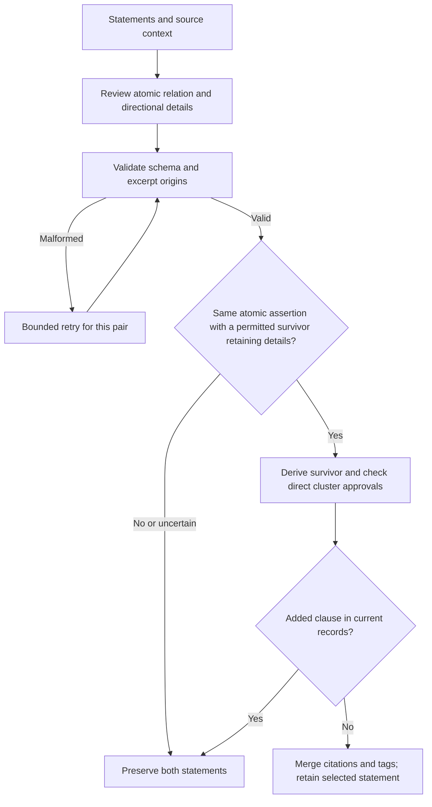

These checks make loss reported by the reviewer enforceable in code. They do
not prove that its detail inventories are complete or that its semantic judgment
is correct. Human adjudication and independent-document evaluation remain
necessary to measure accuracy. Regression cases cover omitted classifications,
independent outcomes, forged merge approvals, malformed inventories, and valid
score/percentile enrichment, including calls through the agent and semaphore.

#### October 11 retention and verbosity comparison

The live comparison reused 87 frozen development pairs and 16 constructed
Enfield pairs. Thirty previously declared provisional AI expectations were
scored; this is a diagnostic reviewer benchmark, not human-adjudicated accuracy
or a fresh 15-page extraction. All variants used skills and
`recon-test-gpt-6-luna` at `xhigh` reasoning. Default verbosity omitted the
parameter; high explicitly set it. Model configuration was checked separately.

| Reviewer | Provisional matches | Output tokens including reasoning | Input tokens | Sum of block time | OpenAI reference cost |
| --- | ---: | ---: | ---: | ---: | ---: |
| Baseline v2, default verbosity | 27 / 30 | 7,445 | 81,329 | 48.85 s | $0.01366 |
| Baseline v2, high verbosity | 29 / 30 | 9,753 | 81,329 | 59.62 s | $0.01481 |
| Retention v4, default verbosity | 28 / 30 | 6,785 | 87,614 | 42.10 s | $0.01409 |
| Retention v4, high verbosity | 28 / 30 | 7,717 | 87,614 | 47.49 s | $0.01455 |

Both v4 variants preserved the average-range detail and the separate Enfield
lesson-range assertion. Both baseline variants still approved the Enfield
atomic-to-compound merge. Baseline high matched more expectations overall, but
that remaining error would remove an atomic record. The two remaining v4 errors
in each variant retained duplicates because the model treated equivalent wording
as unique detail. All 16 Enfield expectations matched with v4. This comparison
does not establish a general quality ranking from the aggregate score alone.

Default v4 used 8.9% fewer output tokens than default baseline; its estimated
total cost was 3.2% higher because input increased, including two individual
repair calls. High verbosity added 13.7% output versus default v4 with the same
provisional-check count. Leave verbosity unset. The prices are the saved OpenAI
reference assumptions from October 10, including reported cache reads/writes,
not an Azure billing measurement. Timing is descriptive: runs were not repeated,
cache state varied, and the initial Enfield/baseline runs overlapped in time.

An intermediate v3 experiment is also retained. Requiring a model-selected
verdict and survivor alongside its detail inventories produced contradictory
directions and unnecessary retries. V4 removes those redundant output fields;
code derives the outcome from the inventories and atomic relation.

The final cluster-direction guard was added after the v4 live review snapshot.
Saved decisions were replayed through the final application code without model
calls. Every removed member had a direct approval for its actual survivor;
statements remained original and all surviving source citations validated.
This replay exercises application of the same frozen subset, not full-document
deduplication. Build, lint and 661 tests passed on the final implementation.

Artifacts are in `.local/evidence-identity-retention-2026-10-11/`:
`README.md`, `final-audit.json`, `comparison-final.csv`,
`enfield/comparison-final.csv`, and `application-audit.json`. Frozen code,
inputs, provisional labels, raw responses, retries, usage and manifests are
retained, including the intermediate result. Human review columns remain blank.

#### Full document replay after the retention comparison

The October 11 follow-up used the identical 1,486 saved records and all 511
eligible pairs in one production `canonicalizeDocuments` call. It used Luna
at `xhigh`, v4 skills and default verbosity. Extraction, attribution, embeddings
and indexing were not repeated. The implementation and inputs were frozen.

| Identity review only | Earlier skills, including recovery | Current v4, including diagnostic recovery |
| --- | ---: | ---: |
| Retained records | 1,232 | 1,263 |
| Applied merges | 254 | 223 |
| Existing provisional checks | 7 / 14 | 11 / 14 |
| Output tokens including reasoning | 35,917 | 38,918 |
| Input tokens | 460,762 | 451,385 |
| Sum of attempt time | 100.300 s | 67.864 s |
| OpenAI reference estimate | $0.075145 | $0.075622 |

Output increased 8.4% and reference total cost increased 0.6%; attempt time fell
32.3%. These are historical single runs, not controlled throughput estimates.
The initial attempt accepted 510/511 pairs. One malformed, quotation-wrapped
detail required an additional isolated diagnostic call beyond the production
retry limit. The other 510 decisions were reused, all costs are included, and
the original failure remains in the saved result. Both sides of that pair remain
in separate final clusters.

All final source citations, unchanged surviving statements, structured fields,
cluster citation/tag unions and direct survivor approvals passed their checks.
However, targeted AI source inspection of 30 high-risk merges found **seven
atomic assertions absorbed into compound statements**, all previously retained
separately by the earlier skills run. Examples include a scaled-score mean
absorbed into a statement also giving the standard-score mean, and a Social
Skills interpretation absorbed into one also interpreting Problem Behavior.
Other cases combine separate coping actions, reading interventions or cognitive
capabilities. One additional case needs policy review; 22 showed no material loss
in this inspection. This was a selected diagnostic sample, not a human-reviewed
error-rate estimate.

The model sometimes identifies the additional propositions in its inventories
but still assigns `same_assertion`. The literal containment guard does not cover
changed wording or reordered clauses. The words survive in the broader record,
but the separate atomic evidence unit is lost. Thus the better small-checklist
score and larger output record count do not justify promoting the procedure.
The three original-checklist misses retain duplicates; they are separate from
these newly discovered atomicity regressions.

Keep skills experimental. The next gate must distinguish additional independent
actions, capabilities, measures and properties from compatible specificity of
one assertion, while retaining score/percentile/classification controls. Save
these new cases before tuning and evaluate them before another paid full run.

Artifacts: `.local/evidence-identity-full15-2026-10-11/README.md`,
`pair-comparison.csv`, `merge-review.csv`, `high-risk-human-review.csv`,
`quality-findings.json`, `new-regression-cases.json`, `evidence.json`, and
`audit.json`. Human-review columns are blank. No production code or environment
settings changed during this replay; the service build passed.

### Identity procedure version 5: conservative enrichment gate

The follow-up adds an application check for the failure seen above: a reviewer
can list additional independent propositions and still return `same_assertion`.
The new [atomicity module](../src/DataIngestionService/src/processors/evidence/evidenceAtomicity.ts)
allows only a limited set of reported modifiers through a merge. Recognized
modifiers include existing named participants or reporting prefixes, and—for
`assessmentResult` facts—scores, percentiles, age equivalents and range
classifications. Unrecognized additions retain both records. Separate actions,
capabilities, instrument composition and interpretations of different measures
are explicitly distinguished in the prompt and the v5 identity skill.

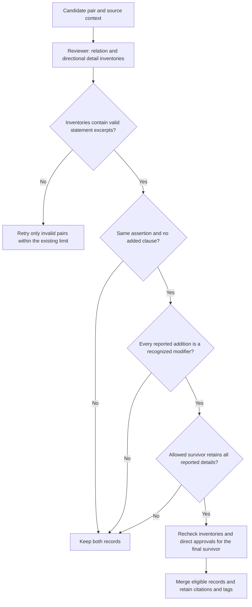

The gate runs with or without skill middleware. It checks the inventories both
when deriving a review decision and when applying merges. A substantive
disagreement keeps both records without retrying to erase the difference.
Legacy three-field approvals without the inventories cannot authorize a merge;
saved assessments must be revalidated through the current reviewer validator.
The implementation fingerprint includes the new module to invalidate stale
retry-cache entries.

A separate normalization fix accepts balanced display quotes around a detail
only when the inner text occurs in the corresponding statement. Literal quotes
already present in that statement are preserved. Changed wording and invented
excerpts remain invalid.

#### Focused validation on October 11

The seven diagnosed atomicity failures and the existing 14 provisional controls
were frozen before running the updated reviewer. These are development cases
with AI judgments, not human-adjudicated or held-out accuracy measurements.

| Check | Saved v4 assessments with v5 code, no model calls | Focused live v5 reviewer |
| --- | ---: | ---: |
| Known atomicity failures protected | 7 / 7 | 7 / 7 |
| Existing provisional controls matched | 10 / 14 | 11 / 14 |
| Pairs processed | 511 | 21 |
| Model calls | 0 | 2 |

The offline replay applies the gates to all previous assessments: merges fall
from 223 to 162, retaining 1,324 rather than 1,263 records. All seven affected
atomic records remain standalone after cluster application. This measures the
cost of conservatism in retained records; it is not proof that every blocked
merge was harmful.

The focused live run used `recon-test-gpt-6-luna`, `xhigh`, default verbosity
and identity skill v5. All 21 pairs were accepted without retries, with eight
merges. It took 8.964 seconds, using 19,094 input and **1,433 output tokens**.
Telemetry reported zero cache-read tokens and 19,088 cache-write tokens. Using
the saved OpenAI reference rates gives approximately **$0.0031**, not an Azure
invoice. No extraction, attribution, embeddings or indexing was repeated.

The model correctly identified independent assertions in six of the seven
failure cases. In the remaining case it still returned `same_assertion` for a
no-disorder assertion plus adequate social skills; the code gate blocked the
merge. All seven atomic records remained standalone. Source offsets, surviving
statements and structured fields, citation/tag unions and direct survivor
approvals passed the offline and live artifact checks.

The three live control misses retained duplicates: an expanded instrument name,
an unnecessary `overall` difference, and a repeated measure/score described as
new detail. These need better handling of equivalent names and wording, without
allowing additional propositions through. The gate depends on the completeness
of the model's inventories; it cannot detect every omitted or misleadingly
shortened difference. Its modifier vocabulary is deliberately narrow and
English-oriented. Keep skill mode experimental and resolve these focused cases
before another full paid replay.

The service build and lint passed, and all **698 tests across 38 files** passed.
Regression tests cover the seven patterns in both directions, application-time
checks, valid score/percentile/classification enrichment, quotation wrappers and
agent invocation. Private artifacts are in
`.local/evidence-atomicity-gate-2026-10-11/`: `README.md`, `audit.json`,
`pair-comparison.csv`, `result.json`, `offline-audit.json`,
`offline-evidence.json`, frozen inputs, implementation snapshot and invocation
records. Human-review columns remain blank.

### Identity procedure version 8: equivalent wording and omitted inventories

The next refinement reread the three retained-duplicate controls against their
verified source offsets before changing code. It adds narrow equivalence checks:

- A proper name with an explicit cited abbreviation can explain an expanded
  instrument name. The same primary passage is required. The detail may quote
  the full definition or just its full-name portion; unsupported definitions and
  conflicting expansions remain blocked.
- `overall` and `overall standard score` can be redundant when both assertions
  name the same single index, standard score and percentile, and the same primary
  passage explicitly describes that overall result. Different indices, subtests,
  multiple scores or missing source support do not qualify.
- A named score phrase already present verbatim in both assessment assertions,
  including parentheses, is not absent from either. This requires one score per
  statement, the same subject and reporter, and shared source support. Additional
  percentiles or classifications remain material.

Original excerpts are validated **before** applying these checks. Code-derived
`equivalentDetails` records which reported differences were excluded, while
`what`, citations and structured fields remain unchanged. Application repeats
the checks instead of trusting a forwarded approval.

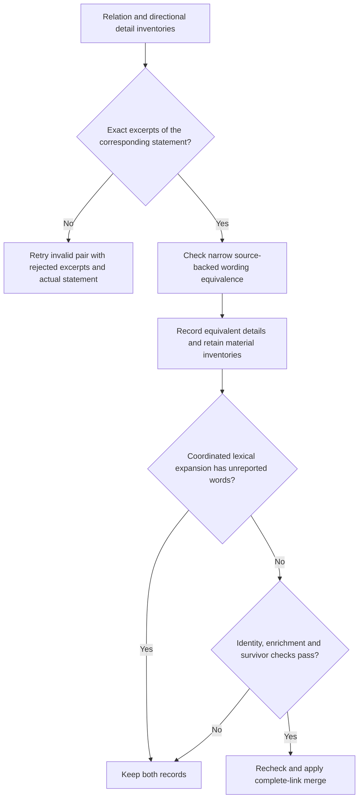

The omitted-inventory guard detects coordinated lexical expansions, including
insertions and reordered clauses that the prefix check misses. It requires the
shorter statement's substantive words to occur in the longer one and an added
coordination boundary. It then checks for additional words absent from the
reported inventories. It does not parse all semantic paraphrases. Fault
injection on the seven real failure pairs, forcing `same_assertion` with empty
inventories, protects **4/7**; the three paraphrased cases still depend on the
reviewer reporting their differences. All seven remain protected with their
actual live assessments. This limitation is separate from the seven synthetic
omission patterns covered by unit tests.

#### Validation and reuse on October 11

| Review | Known atomicity cases | Existing controls | Accepted pairs |
| --- | ---: | ---: | ---: |
| Focused v6 | 7 / 7 | 12 / 14 | 21 / 21 |
| Focused v7 | 7 / 7 | 14 / 14 | 21 / 21 |
| Full saved-document v7 | 7 / 7 | 12 / 14 | 509 / 511 |
| v8 revalidation plus isolated recovery | 7 / 7 | 14 / 14 | 511 / 511 |

The full run exposed alternative inventory phrasing for two controls and two
invalid reviews that copied source-quotation content into assertion inventories.
The final changes cover those phrasing forms and make retry feedback identify
the rejected excerpts and the complete allowed statement. All **509 valid model
assessments were reused and revalidated**. Only the two invalid pairs were sent
again, together with the new feedback; one call recovered both. The original
failure artifact remains available. This is a combined diagnostic replay, not
a fresh full invocation of v8 or evidence that v8 never exhausts its retry limit.

The combined result applies 182 merges to the original 1,486 records, retaining
**1,304 records**. All seven affected atomic records remain standalone after
global cluster application. Source offsets, surviving statements and structured
fields, citation/tag unions and direct final-survivor approvals passed checks.
Full review plus recovery used **36,048 output tokens**, 470,657 input tokens and
45 calls, with 60.682 seconds summed across the attempts. Telemetry reported
5,458 cache-read and 465,064 cache-write tokens. The saved OpenAI reference-rate
estimate is **$0.076225**, not an Azure invoice. The earlier v4 full replay used
38,918 output tokens and cost $0.075622 under the same reference rates: output
fell 7.4%, while increased input made total estimated cost slightly higher.

A different-document check used 16 source-reviewed NTSB pairs after v7 was
frozen: eight duplicates and eight distinct-assertion cases. It matched **15/16**,
protected all eight distinct cases and retained one duplicate involving a CAROL
website-name expansion. v8 revalidation of those saved outputs leaves the
verdicts unchanged; no NTSB-specific rule was added. This used 1,884 output tokens,
two calls including one retry, and 11.830 seconds. The NTSB material was already
used elsewhere in the project. These are provisional AI labels on a different
document, not a new human-adjudicated holdout or an extraction-recall estimate.

Build, lint and **733 tests across 38 files** passed. Luna, `xhigh`, default
verbosity and deployment settings are unchanged. No extraction, attribution,
embeddings, indexing or deployment was performed. Keep skill mode experimental;
the remaining paraphrase/empty-inventory gap and the retained NTSB duplicate need
review. The final merge-review file exposes all 182 applied merges, including
18 not approved in the earlier v4 run, for inspection before further rollout.

Artifacts: `.local/evidence-identity-final-2026-10-11/README.md`, `audit.json`,
`pair-comparison.csv`, `merge-review.csv`, `evidence.json`, original/revalidated
assessments and frozen snapshots. Earlier attempts remain in
`.local/evidence-identity-wording-2026-10-11/`,
`.local/evidence-identity-wording-v7-2026-10-11/`,
`.local/evidence-identity-full15-v7-2026-10-11/` and
`.local/evidence-identity-ntsb-v7-2026-10-11/`.

### Fresh full extraction with the MVP implementation (11 October)

A fresh GPT run used the unchanged 15 populated pages (source SHA-256
`40802378298f95662a4a89b0f6a81bbe043033e59353b68cd6fcc41340fd34e7`).
Primary Luna `high`, independent/fallback Sol `low`, reconciliation Luna `xhigh`,
default verbosity, four concurrent requests, event annotations and canonicalization
review matched the previous full runs. Identity skill v8, attribution skill v1
and the accumulated implementation changes were enabled for this run. It began
with an empty checkpoint directory and no saved candidates. This compares the
current implementation with prior full extractions; it does not isolate the
effect of skills or any single change.

Page 10's primary event extraction returned no structured object, stopping the
first attempt after nine windows had completed. Recovery reused those nine
windows and three successful page-10 stages with the same frozen source, code
and settings. The following totals include **both attempts**, as do the latest
historical baseline's totals. The older event-structure baseline completed in
one attempt. Active time excludes restart gaps; current start-to-finish time was
33.89 minutes, including the approximately 30-second recovery gap.

| Measure | Prior event-structure full | Prior date/dedup full | Fresh MVP full |
| --- | ---: | ---: | ---: |
| Active minutes | 27.93 | 31.21 | 33.39 |
| Model calls | 556 | 694 | 684 |
| Output tokens, including reasoning | 880,231 | 941,915 | 984,146 |
| Output cost estimate | $3.0031 | $3.1586 | $3.2100 |
| Total model cost estimate | $7.3170 | $7.8356 | $7.8158 |
| Events / facts / claims | 172 / 556 / 623 | 162 / 567 / 509 | 179 / 616 / 624 |
| Total evidence records | 1,351 | 1,238 | 1,419 |
| Dated events, including bounds | 68 | 109 | 122 |
| Undated events without a resolution record | 82 | 0 | 0 |
| Primary quote character coverage | 94.84% | 94.96% | 94.19% |
| Potential duplicate pairs | 351 | 259 | 357 |
| Generic claimant labels | 46 | 36 | 51 |

The same archived OpenAI reference rates were applied to all three outputs;
these are comparison estimates, not Azure invoice amounts. Current output tokens
increased 4.5% and active time increased 7.0% against the latest full baseline,
while estimated total cost fell 0.3%. Reasoning is included in output tokens.
There were 2,304,918 cache-read input tokens. Sol reconciliation fallback accounted
for approximately $4.72 of the $7.82 total; the identity review used 31,272 output
tokens and approximately $0.0604. These full-run costs must not be compared with
the earlier identity-only replay costs as though both included extraction.

All 15 windows completed. All 3,585 source spans resolved exactly; event-role,
trigger, mention-link and source-identity checks passed. Canonicalization reviewed
389 pairs, retried 11 individual invalid pair decisions, applied 137 merges and
left no failed batches. Mechanical merge checks preserved citations, tags,
provenance, survivor fields and direct final-survivor approvals. The code, runner
and dependency snapshot hashes remained unchanged during extraction and recovery.

Codex's source review found useful separate assertions preserved: relaxation,
reassurance and confidence-building actions; social skills versus no developmental
disorder; the two score-system means; assessment purpose versus composition; and
the two score-interpretation rules. Both conflicting Written Language percentiles
and all three explicit examination dates remain represented. These are AI
observations, not human-adjudicated quality scores.

The review also found remaining limitations:

- Reading interventions and part of the verbal-capability interpretation were
  already bundled before canonicalization, leaving missing standalone assertions.
- The high-average academic-ability impression still appears as both a claim
  and an assessment-result fact. Generic instrument facts also appear as claims.
- One sampled applied merge drops the explicit relationship target “with others”
  from the retained statement, although the full quotation remains. Empty model
  difference inventories still leave a gap in the statement-preservation checks.
- Another sampled merge retains potentially stronger causal wording about family
  history than the source establishes; this requires semantic review.
- Potential duplicates increased. The 51 `Unknown` claimant labels mostly concern
  school-plan statements, passive family-history reports and an unattributed parent
  strengths quotation. Some uncertainty is appropriate; this count is not an
  attribution-error rate.

Potential duplicate counts use same-kind, same-primary-page records with
overlapping primary quotations and token-set Dice similarity of at least 0.85.
They are review leads. Quote coverage measures cited characters, not assertion
recall. More records and passing technical checks do not establish better quality.
The new run supports an MVP benchmark with known limitations, rather than a claim
of overall quality improvement or exhaustive extraction. No production settings
or deployment changed.

#### Review correction and follow-up priorities

Structured-review recoveries increased **97 → 101 (4.1%)**, counting both
attempts of the October 10 date/dedup reference. The earlier summary's 69 counted
only its successful second attempt and overstated the reliability regression.
Both full runs still required checkpoint recovery; the missing extraction-stage
structured object remains an operational issue separate from recovered reviews.

The 181 additional records comprise 70 additional pre-canonicalization records
and 111 fewer merges (248 → 137). Because extraction produced different
candidates, this arithmetic does not establish whether the retained records are
useful distinctions or duplicates. Event annotation coverage declined: explicit
triggers stayed at 149 while events increased 162 → 179 (92.0% → 83.2%); events
with roles fell 144 → 143 (88.9% → 79.9%). Missing roles concentrate in
communications and agreements. Passing citation/index checks does not measure
semantic annotation completeness.

The review priorities are, in order: preserve assertion details during merges;
classify narrative interpretations using source context while retaining recorded
scores as facts; check source enumerations for separate recommendations and
capabilities; review supported event roles and triggers; and retry missing
structured responses inside the failed stage with a bounded budget and intact
completed work. The merge contract is directional: **the retained assertion must
preserve every material detail of the removed assertion**, including recipients,
relationship targets, conditions and qualifications. A partial record can merge
into a fuller version of the same fact; separate actions remain separate.
Strict two-way entailment is not required.

Freeze newly discovered failures and compare identical candidates before another
full extraction. Synthetic development analogues are in
`test/fixtures/evidence-quality-regressions.json`; exact private examples and
before/current snapshots are in `.local/evidence-review-followup-2026-10-11/`.
These are provisional source-inspection labels, not human-adjudicated gold.
The October 10 date/dedup run remains the stronger quality comparison reference.

The first follow-up implemented the directional phrase guard, source-context
classification v2, source-enumeration and annotation guidance, and a bounded
missing-response retry. Identity procedure v9 adds explicit detail and causal
scope instructions. Revalidating the identical 389 saved assessments on 1,556
records changes two decisions: the relationship-target pair retains the fuller
statement, while another target-losing merge remains separate. Applied merges
are 136 versus 137; retained records are 1,420 versus 1,419. The missed academic
impression is corrected to an attributed opinion.

Six synthetic fixed-candidate live cases pass **4/6 before and 6/6 after**.
Earlier review kept reading recommendations and verbal capabilities bundled;
revised review produces separate records. The grader accepts self-reading with
adult/alone qualifications in one record or as two separately supported records,
while requiring the other interventions independently. Two exact private live
identity cases now remain separate: the relationship target survives, although
spurious model wording inventories prevent consolidation, and the causal pair
is uncertain. The phrase guard is conservative and does not prove semantic
entailment across all paraphrases. These development checks support targeted
fixes, not a general quality score. Build, lint and 747 tests passed before the
subsequent fresh full extraction.

#### Follow-up full extraction and remaining failures

The unchanged 15-page source completed with frozen revised code in **42.23
minutes**, using 836 model calls and 1,247,706 output tokens. It retained **1,794
records** (187 events, 702 facts, 905 claims), reviewing 948 canonicalization
pairs and applying 162 merges. All 4,389 source spans, role references, unchanged
survivor fields, citation/provenance unions and direct final-survivor approvals
passed integrity checks. There were no failed pipeline stages or canonicalization
batches. The missing-response retry was not exercised in this run; bounded
failure-injection tests cover its behavior.

| Measure | October 10 date/dedup | Previous October 11 MVP | Revised full |
| --- | ---: | ---: | ---: |
| Evidence records | 1,238 | 1,419 | 1,794 |
| Explicit event triggers | 149 / 162 | 149 / 179 | 182 / 187 |
| Events with roles | 144 / 162 | 143 / 179 | 165 / 187 |
| Potential duplicate pairs | 259 | 357 | 700 |
| Exact-statement extra rows | 49 | 70 | 122 |
| Structured-review recoveries | 97 | 101 | 119 |
| Model cost estimate | $7.8356 | $7.8158 | $9.5416 |

Trigger coverage is 97.3%; role coverage is 88.2%. Of 22 events without roles,
11 are agreements and one is a communication. Unspecified agreement participants
remain unknown rather than inferred from future plan duties. Primary quotation
coverage is 94.82%, a citation-character measure rather than assertion recall.
The cost uses the same archived reference rates, not an Azure invoice.

The local observation wrapper initially failed because its invocation-output
directory had not been created. No completed stages were saved before that
failure. Its 19 calls, 47,548 output tokens and 1.97 active minutes are preserved
separately. Including that failed observation attempt, this experiment used
855 calls, 1,295,254 output tokens, **44.20 active minutes** and an estimated
**$9.7334**. The restarted pipeline used the identical frozen source and code.

Source inspection confirms standalone pull-out support, tutoring, parent reading
and self-reading recommendations, including both self-reading settings. All four
verbal capabilities survive across the page boundary. The academic impression
remains an attributed opinion, recorded Total Achievement 97 remains a fact,
and the relationship target “with others” survives. Family-history wording
preserves the source attachment, but the same concern still appears under
opinion, belief and causation classifications.

A deterministic sample of 40 applied merges found two further failures: one
retained recommendation drops “secure” from “secure and successful”; another
merges separate refreshments/game recommendations with different action targets.
Both are frozen for the next identical-candidate evaluation. The explicit phrase
guard reports no violations but does not cover arbitrary omitted outcomes or
all independent-action paraphrases. Passing its checks is not proof that every
material detail survives. No human false-merge rate is claimed.

The full run demonstrates targeted improvements and operational completion;
increased duplication, classification inconsistency, residual merge failures,
time and cost prevent an overall evidence-quality improvement claim. The
October 10 run remains the stronger comparison reference. Private artifacts,
including `full/audit.json`, `full/comparison.json`, `full/review-findings.json`,
`full/new-frozen-failures.json`, frozen snapshots and both attempt outputs, are
under `.local/evidence-review-followup-2026-10-11/`. Production settings and
deployment were not changed.

#### Supervised MVP release gate (October 11)

The completed gate addresses the two frozen merge failures and verifies that the
existing source-quality controls remain intact. Coordinated containment now
also checks common verb inflections, so an unrelated change such as
create/creating cannot conceal an omitted outcome. The original literal check
remains: stemming can add vetoes, never authorize identity or erase details.
Explicit alternative clauses preserve their ordered action focus; bare “or”
vetoes swapped focus words without blocking unrelated paraphrases around
unchanged setting options. These guards run both during review validation and
direct merge application. Identity procedure version 10 documents this policy.

The original causal-wording control regressed in a fresh live assessment. A
deterministic veto now keeps explicit causal attribution separate from a
construction that does not establish that attribution. The same saved erroneous
assessment is blocked without rerunning until a favorable answer appears. This
does not resolve every ambiguous causal sentence or remove unsupported source
interpretations automatically; source review remains necessary.

Revalidating identical candidates and saved assessments changes only the two
known decisions in the latest 948-pair set, and the causal-attribution decision
in the earlier 389-pair set. The latest set applies 161 rather than 162 merges:
after blocking the bad secure/successful merge, another directly approved
survivor safely retains both outcomes. The earlier set applies 135 rather than
136 merges. Relationship-target and scalar-enrichment controls remain intact.

The six-case source suite initially passed five cases. The reading case emitted
a redundant umbrella summary plus five atomic recommendations. Replacement
instructions now omit such summaries unless they add an independent assertion,
and preserve the anchored enumeration as supporting evidence for each child.
Both affected enumeration cases passed reruns with unchanged source, candidates
and labels; combined with the four unchanged controls, six cases pass. All four
exact live merge assessments pass final guard revalidation. These are
development checks, not human gold. Build, lint and 779 tests passed.

The fresh 15-page extraction completed from frozen code and empty checkpoints.
Its final review left one invalid pair after the built-in retry: an inventory
quoted source text rather than assertion text. One explicit recovery invocation
resolved only that pair, preserving all 15 windows and 1,119 valid decisions.
The original failure remains in `full/result.json`; recovery artifacts preserve
the additional call and show that the evidence records did not change.

Source review of 40 sampled merges found an additional category-label omission.
A general guard now preserves explicit category values in the retained
assertion, including categories outside the known assessment vocabulary.
Deterministic replay of the same 1,975 candidates and 1,120 saved assessments
selects fuller survivors for three pairs, retaining Index/Symptoms labels.
No extraction or model calls were repeated for this correction. The original
full-run snapshot and final guard snapshot have separate manifests. Final build,
lint and **783 tests** pass; earlier frozen checks remain intact.

Final output is **1,773 records** (190 events / 714 facts / 869 claims), with
202 merges and **4,377 valid citations**. Active extraction plus targeted model
recovery took **42.04 minutes**, 839 calls and 1,278,218 output tokens, estimated
at **$9.6303** using archived reference rates. The frozen checks, including their
initial failed cases and affected-case reruns, add 24 calls and $0.1967. The
total reference estimate is $9.8270, not an Azure invoice. A local audit
comparison initially compared in-memory objects against serialized records;
that comparison was corrected using the saved outputs without model calls.
Reported resource measurements cover the original extraction process only.

The known controls survive: both home-environment outcomes, separate optional
refreshments/game actions, the relationship target, attributed academic opinion,
recorded score 97, separate reading interventions and all four verbal
capabilities. Event triggers are populated for 189/190 events and roles for
165/190; unsupported participants remain unknown. There are **694 potential
duplicate pairs** and 114 exact-statement extra rows. These screening counts are
not confirmed error rates. Claim-type and claimant-name inconsistencies remain,
including concern/family-history and VCI interpretations; the review packet
flags those cases. Overall quality superiority remains unproven, and October 10
remains the comparison reference. A new holdout and human adjudication remain
outstanding.

The focused gate supports a **supervised pilot**. Private artifacts and the
review packet are under `.local/evidence-mvp-gate-2026-10-11/`; final outputs are
`full/result-final.json`, `full/audit.json`, `full/review-findings.json` and
`full/review.html`. Outputs start as drafts. A named reviewer must check each
assertion and its details against source passages before approving it for use
as evidence; the packet exports only approved records and retains an audit log.
This local review workflow does not add approval enforcement to the production
ingestion or Search APIs. No deployment was performed.

Earlier October 11 MVP artifacts: `.local/evidence-mvp-fresh-full15-2026-10-11/README.md`,
`comparison.json`, `combined-result.json`, `quality-review.csv`,
`comparison-quality-review.csv`, `quality-controls.csv`, `potential-duplicates.csv`,
`merge-review.json` and `review-findings.json`. `attempt-1.json` preserves the
failure; `result.json` contains only the successful recovery attempt. A frozen
source/code snapshot and invocation observations support reproduction. The local
settings file contains credentials and must be excluded from shared exports.

## Routing evaluation on the full live document

After the boundary and classification changes, the same 64-candidate sample
produced 53 records in 156.1 seconds, using 37,024 output tokens at an estimated
$0.5698. The assessment result spanning pages 5–6 was retained, and the habitual
statement was preserved as a claim. This passed the targeted checks, but cost
more than the preceding small replay despite using fewer output tokens.

The subsequent fresh GPT test processed all 15 populated pages, using primary
Luna `high`, independent Sol `low`, reconciliation Luna `xhigh`, default verbosity,
and document canonicalization. All citation and runtime checks passed, along
with the boundary, habitual-statement, relative-timing and examination-date
checks. The source produced 1,455 raw candidates and 1,322 final records: 157
events, 523 facts and 642 claims. Of 101 events with date information, 42 have
uncertainty bounds; these are not all exact occurrence dates. Two other events
retain relative timing with unknown calendar dates.

| Measure | Earlier full Sol review | Current hybrid |
|---|---:|---:|
| Final records | 1,250 | 1,322 |
| Output tokens, including reasoning | 544,363 | 735,631 |
| Estimated output cost | $3.0463 | $1.5465 |
| Estimated total model cost | $6.5357 | $4.5356 |
| Active process time | 19.9 minutes | 24.2 minutes |
| Unknown claimant | 66 | 154 |
| Unknown or generic author label | 74 | 283 |
| Potential duplicate pairs with overlapping citations | 356 | 347 |
| Primary quotation character coverage | 92.08% | 93.77% |

All five attempts are included. The first two stopped because cited relative
timing was rejected when calendar dates were unknown; the validator and searchable
text now preserve those qualifiers. Three Luna batches also reached the agent
step limit, requiring checkpoint recovery. For this local experiment, compatible
saved work was copied to the new implementation fingerprint after source,
schema, citation, date and rendering checks. Production fingerprint enforcement
was unchanged. Active duration excludes debugging pauses, so this is a recovered
debugging run rather than an uninterrupted latency benchmark.

At the published Standard rates above, total cost was 30.6% lower and output
cost 49.2% lower than the earlier full Sol run, despite 35.1% more output tokens.
Luna's lower output price accounts for that difference. The current run used
1,112,576 cached input tokens. Sol still accounts for 84.6% of total cost; focused
date resolution cost $1.7676. Against the immediately preceding hybrid replay,
review and canonicalization cost was essentially unchanged: $3.0828 versus
$3.0708. Those runs used different candidate sets, and the older replay excluded
fresh extraction; this does not establish additional savings from routing.

Quality remains mixed. Claims naming the examiner fell from 265 to 181, while
unknown and generic author labels increased. Some consent/informing variants
received inconsistent dates, including bounds inferred from examination dates.
Exact quotation validation does not establish that date relationship. Potential
duplicate pairs also exceed the preceding hybrid replay's 200 pairs. Counts and
quotation coverage are descriptive measures, not recall or precision against
human labels.

Prioritize source-supported author attribution and bounded handling of repeated
Luna tool/schema loops, then retest ambiguous date cases on frozen inputs before
another full live run. Preserve supported distinctions during duplicate review.
The 304-test suite, build and lint passed. Private results, full cost accounting,
review CSVs, date flags and raw candidates recovered without model calls are in
`.local/evidence-gpt-full15-routing-2026-10-09/`. The smaller routing replay is in
`.local/evidence-routing-test-2026-10-09/`.

### Focused attribution and loop replay

A subsequent GPT test reused 47 candidates: seeds from three historical Luna
loop failures plus author, parent and school-document controls. It produced 44
records (41 claims, three facts) in 74.4 seconds. Three candidates were rejected
because their quotations belong only to page 15 while assigned to page 14;
their source location was checked independently. All eight author controls
named the examiner, parent and child speakers were preserved, and the separate
school statements remained unknown. Generic/unknown labels fell from 23 in the
selected raw claims to two output claims. This is a pipeline input/output
measurement, not a paired comparison with the previous implementation.

Four malformed Luna responses reached application validation and fallback
without an agent-step-limit failure. The successful replay used 13,456 output
tokens at an estimated $0.1748 total ($0.0520 for output). General review or its
fallback resolved the author labels in that replay. A separate three-claim
test explicitly exercised compact attribution: two examiner statements were
resolved and one school statement stayed unknown, with unchanged claim wording
and valid citations. That test used 765 output tokens and an estimated $0.0279.

Two earlier debugging attempts exposed ambiguous, unused diagnostic quotations
on an unknown-attribution response. Including those attempts and both successful
tests, usage was 23,644 output tokens and an estimated $0.3462. Rates are the
published OpenAI Standard prices above; reasoning is included in output.
Build, lint and all 334 tests passed, including a real LangChain test verifying
that malformed structured tool output stops after one response.

These are small frozen tests with the full source available for context.
Rebatching means the loop seeds do not reproduce the exact prior failed
conversations. Fresh extraction, canonicalization and indexing were skipped;
no further full-document live extraction was run. Results and review CSVs are
under `.local/evidence-attribution-loop-test-2026-10-09/`.

### Temporal-link regression checks

Before the next complete candidate replay, a live focused date test checked
11 events: four saved consent variants, two informing variants, the source's
explicit birth date, and four synthetic controls. All passed. Consent and
informing remained undated; the birth date, explicitly dated consent and
explicit session bounds were recovered. A one-sided "before" relationship
did not become a closed date interval, and relative treatment duration survived
without invented calendar parts. An initial probe used an invalid raw birth
quotation; its failed-attempt usage is included in the experiment accounting.

The unit regression verifies the shared instructions reach extraction, review
and date agents, and that an unknown result preserves the consent event. It
does not measure model compliance; the live cases supply that separate check.
Build, lint and all 335 tests passed. Private probe inputs, outputs and usage are
in `.local/evidence-full15-attribution-replay-2026-10-09/`.

### Complete saved-candidate replay

The next GPT replay reviewed all 1,455 saved candidates against the same source
in 852.4 seconds (14.2 minutes), without fresh extraction or indexing. All 15
pages completed without an agent-step-limit failure. Canonicalization merged
132 records, but two eight-pair batches failed merge validation and retained
their records. This was **not an entirely passing live run**. The runner also
incorrectly counted `claim-attribution` as extraction; that check was corrected
and verified offline, with six new unit regressions. Original results and their
failure status were preserved. Build, lint and all 341 unit tests passed.

| Measure | Previous review | Current replay |
|---|---:|---:|
| Final evidence records | 1,322 | 1,280 |
| Unnamed claimants: Unknown / Report author / Document author | 283 | 41 |
| Claims naming the examiner | 181 | 479 |
| Potential duplicate pairs | 347 | 301 |
| Primary quote character coverage | 93.77% | 92.76% |
| Review output tokens | 399,753 | 396,443 |
| Sol review output tokens | 42,298 | 82,516 |
| Review output cost | $0.6017 | $0.9821 |
| Review total cost | $3.0828 | $3.1917 |

Both cost columns exclude blind extraction and include their recorded failed
attempts. Published OpenAI Standard rates are Azure proxies. Output cost rose
63.2% despite slightly fewer total output tokens, because more came from Sol.
Total review cost rose 3.5%; input-cache differences affect that comparison.
There were 1,506,608 cached input tokens in the replay. Including focused date
probes and the initial invalid-quotation probe, this experiment used 398,775
output tokens and an estimated $3.2497 total ($1.0054 for output). The previous
full-run wall time includes extraction, so it is not a review-speed baseline.

All eight consent/informing variants remained undated, the three examination
dates survived, and all citations validated. Source review found the content
of all 15 rejected candidates represented on its correct page. A purposive
24-pair duplicate sample contained three distinct dated occurrences, 16
candidates for source-supported entity/metadata normalization, and five cases
requiring semantic review. Examples include conflicting parent/author
attribution and a Brigance completion with bounded versus unknown dates.
These findings prevent treating every named claimant as correct or every
similar pair as a duplicate. No additional merges were applied from the sample.

All 33 recovered Luna structured-output errors mentioned missing required
fields. Validation recorded 406 invalid review rows across batches; most
attribution improvements arose in general review/fallback. Compact attribution
handled 28 claims, resolving four and retaining 24 as unknown. The next cost
priority is safe handling of missing unused fields before Sol escalation,
followed by individual recovery of invalid canonicalization decisions. Retain
strict checks for missing substantive decisions, source support, citations,
speakers and dates. Investigate attribution and temporal inconsistencies
before broader deduplication or another fresh full extraction.

The report, before/after review CSVs, audited duplicate sample, rejection audit,
and 16 failed canonicalization pair inputs reconstructed offline are under
`.local/evidence-full15-attribution-replay-2026-10-09/`. Original invalid merge
payloads were not logged; their specific invalid fields remain unknown.

## Context and citations

Windows contain at most 5,000 characters, overlap by 600, and include 700
characters of surrounding context. Each invocation has a fresh
`read_source_page` tool limited to six reads of at most 10,000 characters each.
It can read only the current uploaded document. Source text, including tool
results, is treated as evidence rather than instructions.

`sourceQuote` must uniquely match the target window. `supportingQuotes` can cite
additional passages on any source page to establish attribution, dates, table
headings, or details spanning a boundary. Matching tolerates whitespace but
preserves the actual source text. Before review, a repeated quotation can be
resolved when an explicitly cited Markdown heading identifies exactly one
occurrence's section. Code extends that occurrence with exact source characters
until its quotation is unique; it does not interpret the evidence statement.
Other repeated quotations remain ambiguous. The reviewer receives bounded
`citationChoices` with IDs, exact passages and offsets, as well as mismatch
details. It can select an occurrence by ID in a compact citation correction;
code expands the ID and validates the resulting quotation. IDs cannot select
another candidate's choices or bypass the target-page requirement. An unknown
ID or one used for the wrong field/page is treated as a citation repair for that
candidate. If still unresolved, it goes to the configured independent fallback;
without a fallback, the document fails. The application never accepts an invalid
ID as a quotation. Source
support is separately assessed by the reviewer;
matching text alone does not establish semantic support or ultimate truth.
Items found only in neighboring context are rejected for that window because
their own page or window is extracted separately.

Indexed metadata retains the existing `sourceQuote`, `sourceOffset`, `sourceId`,
and tags, and adds:

- `sourceSpans`: page number, zero-based page character offset, and exact quote
  for the primary anchor and each supporting passage.
- `sourceContentHash`: SHA-256 of the ingested Markdown, identifying the version
  against which offsets were calculated.
- `extractedBy`: extraction stage and deployment, plus reconciliation provenance.
- `evidenceSchemaVersion`: `3`.
- `evidenceContentVersion`: `3`, with explicit event date uncertainty and bounds in searchable text. The backfill supports versions `1` and `2` records.

`pages` lists all cited pages, with the primary page first. An indexed event is an
occurrence or action with a source-supported calendar date or bounded occurrence
date. An undated occurrence is retained as a cited `undatedOccurrence` fact or
attributed claim. Other facts include scores, classifications, measurements,
attributes, relationships, and conditions without a distinct occurrence.
The assessment being completed can be an event; each resulting score is a fact
with `factType:assessmentResult`, subject and reporter metadata, and no `event`
tag. Static facts use `asOf` when the source states an applicable date, leaving
`whenStarted` empty so they do not appear as occurrences. Claims retain speaker
attribution, polarity, and qualifications; extraction does not decide credibility
or legal importance.

The search index exposes fact categories through `tags`; `factType`, `subject`,
`reportedBy`, and `asOf` are also retained in its serialized `metadata` field.
`asOf` is additionally a complex Search field with searchable, filterable date
parts, matching the existing `whenStarted` and `whenEnded` fields.
Already indexed evidence keeps its prior tags until the source is re-ingested.
The normal ingestion path removes existing entries for that `sourceId` before
writing the new extraction.

## Classification and domain facets

`evidenceTaxonomy.ts` defines the event vocabulary, domain namespaces, preferred
facet spellings, and instructions shared by extraction and reconciliation.
Every event, fact, and claim must provide a `facets` array. Empty arrays remain
valid when the source supports no domain classification. Event types and facet
namespaces are closed lists; specific facet values remain open-ended.

The event types distinguish completing an `assessment`, signing a document
(`documentExecution`), adopting a plan or granting consent (`agreement`), and
implementing instruction or accommodations (`educationAction`). Other added
categories cover `legalAction`, `careChange`, `injury`, and `lifeEvent`.
An occurrence with an unknown date is still an event and can have a specific
type. `other` is a fallback when no listed category fits.

Additional event types cover `conflict` (an actual dispute or confrontation),
`avoidance` (deliberate evasion supported by the source), `accident` (such as an
accidental fall or vehicle collision), and `death`. Death uses its own type
rather than the broader `lifeEvent`. Inconsistent statements alone do not
establish a conflict event, and an accident does not establish injury, death,
negligence, or fault. Its consequences need their own source support.

Avoidance requires support for deliberate conduct. An unpaid invoice can carry
`facet:financial:nonpayment` without implying `eventType:avoidance`. Similarly,
`facet:communication:unansweredCommunication` does not imply an intent to evade
contact. Explicit payment avoidance, communication avoidance, and evasion of law
enforcement can use `paymentAvoidance`, `communicationAvoidance`, and
`lawEnforcementEvasion` in their respective namespaces. An accusation of evasion
remains an attributed claim unless the underlying event is independently
supported; topic tags do not turn the accusation into an established event.

The `education` namespace covers academic assessments, enrollment, learning
accommodations, and instruction. All nine namespaces are available to claims
as well as events and facts. For example, an attributed recommendation can have
`claimType:opinion` and `facet:education:learningAccommodation`; that tag does
not assert the accommodation was implemented. A suspected diagnosis retains
its uncertainty rather than receiving a confirmed-diagnosis interpretation.
Recorded scores remain facts about the assessment; hedged interpretations and
recommendations remain attributed claims.

Preferred spellings normalize equivalent case/spacing to a consistent tag,
while keeping distinct concepts and new specific values. During duplicate
merging, a specific type replaces the same kind's `other` tag. The reviewer
receives diagnostic feedback for `other`, missing facets, and generic values,
and may correct them within its existing source-support pass. Classification
feedback alone never authorizes dropping evidence or inventing specificity.
This adds no separate model pass, but richer output and additional corrections
can increase token use; measure the live runs before assuming a cost benefit.

New evidence carries `evidenceTaxonomyVersion: "1"`. The live report's
`statistics.classification` and the `evidenceExtractor.classificationSummary`
telemetry record per-kind totals, type counts, `otherTypeCount`, and
`noFacetCount`. These diagnose classification coverage, not semantic accuracy.
Taxonomy code changes invalidate extraction checkpoints.

Tags support Azure AI Search filters and facets, for example:

```text
tags/any(t: t eq 'claim') and tags/any(t: t eq 'facet:education:learningAccommodation')
```

The existing index already supports these tags; no new index fields are needed.
Semantic and vector retrieval continue to use the statement, dates, attribution,
and quotations in `pageContent`. Existing evidence needs re-ingestion to acquire
the new classifications; the date backfill cannot infer missing tags.

### Deterministic fact/claim guard

`evidenceClassification.ts` runs after source-support review and document
creation, before document deduplication and canonicalization. It makes no model
or network calls. Every record survives this pass; only the subsequent duplicate
passes may merge records.

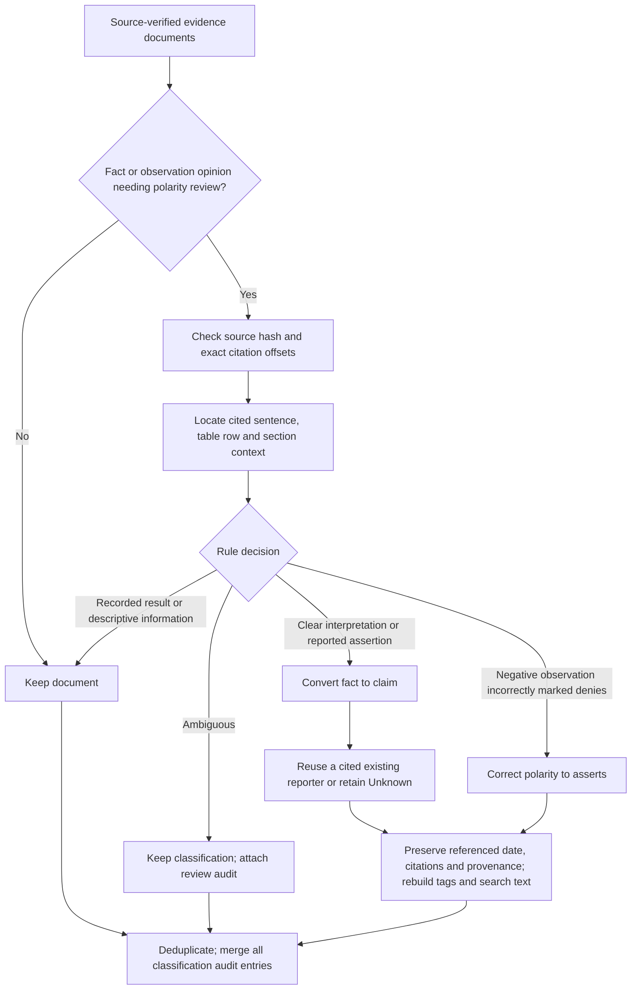

The English-language rules are deliberately conservative:

- Numeric assessment results and table labels remain facts about the recorded
  result. A mixed measurement and interpretation is retained with a review flag.
- Subjective observations such as “did not appear tense” and “seemed comfortable”
  become attributed opinions. Explicit recommendations and hedged interpretations
  require matching cues in the statement and its source sentence.
- An evaluation such as “academic ability was in the high average range” becomes
  an opinion when supported by an interpretation section and sentence, without
  treating a quoted numeric score as an opinion. A section heading alone is
  insufficient.
- Reported assertions remain claims. Attribution reuses one existing reporter
  only when their name is cited; reported speech also requires that name in the
  selected sentence. The guard does not select a nearby author or infer a speaker.
- An opinion asserting “did not appear tense” is corrected from `denies` to
  `asserts` only when the source supports the negative observation and contains
  no denial or additional uncertainty cue. Other ambiguous observation polarities
  are flagged. General polarity disagreements still require contextual review.
- Claims are never promoted to facts by a numeric or lexical rule. Event
  classification is unchanged.

`classificationHistory` stores the rule version, stable trace ID, original
classification/wording/dates/tags/people, exact contextual source passage and
action (`reclassified`, `polarity-corrected` or `flagged`). Both duplicate merge
paths retain every contributing audit entry. Reapplying the same version is
idempotent. The module participates in the extraction checkpoint fingerprint.

For a converted fact, `asOf` becomes the claim's referenced `whenStarted` date
at the same precision; it is not treated as the date the speaker made the claim.
The original date is also retained in the audit. Existing nonempty event/claim
date fields on a fact trigger review instead of being overwritten. Citations,
subjects, reporter fields, participants, provenance and domain facets survive;
kind/type tags and readable `pageContent` are rebuilt before embedding.

#### Offline classification replay

Use a saved extraction and its exact frozen source, without loading appsettings
or invoking a model:

```bash
cd src/DataIngestionService
bun run replay:evidence-classification \
  --input /path/to/combined-result.json \
  --source /path/to/evidence-live.md \
  --output /path/to/classification-replay.json
```

The runner checks the source hash, refuses to overwrite an existing result, and
writes an explicit allowlist of result fields. It copies no configuration or
settings from the input. It preserves record order and does not run duplicate
review, so before/after records can be compared directly.

#### Implementation and validation record (10 October 2026)

The change addresses subjective observations and assessment interpretations
being stored as facts, plus an asserted negative observation being tagged as a
denial. The project maintainer requested a deterministic approach, and the
supplied prerelease review identified concrete regression cases. See
[review contributions](#project-direction-and-review-contributions) for credit.

| Component | Change |
| --- | --- |
| [Classification guard](../src/DataIngestionService/src/processors/evidence/evidenceClassification.ts) | Apply rules against source sentences, sections and table context; preserve uncertain cases with review flags and an original-value audit. |
| [Extractor orchestration](../src/DataIngestionService/src/processors/evidence/evidenceExtractor.ts) | Run the guard before document deduplication, emit decision counts, and include its implementation in checkpoint identity. |
| [Strict deduplication](../src/DataIngestionService/src/processors/evidence/evidenceDeduplication.ts) and [canonicalization](../src/DataIngestionService/src/processors/evidence/evidenceCanonicalization.ts) | Retain classification histories from every merged record. |
| [Offline replay](../src/DataIngestionService/scripts/replay-evidence-classification.mjs) | Compare saved output with the same frozen source, preserving record order and avoiding model calls or copied settings. |
| [Classification tests](../src/DataIngestionService/test/evidenceClassification.test.ts) and [extractor tests](../src/DataIngestionService/test/evidenceExtractor.test.ts) | Cover source context, protected scores, polarity, attribution, date precision, audit retention, and integration through mocked agent invocation. |

The saved 15-page output produced these offline results:

| Evidence kind | Before | After |
| --- | ---: | ---: |
| Events | 162 | 162 |
| Facts | 567 | 554 |
| Claims | 509 | 522 |
| Total records | 1,238 | 1,238 |

The guard converted 13 facts, corrected one negative-observation polarity and
flagged two ambiguous cases, using zero model calls/tokens. The selected
measured-score controls were unchanged. The evaluation checked 28 frozen kind
controls and two polarity controls, citation/date/people/provenance/facet
preservation, and idempotence. TypeScript build, ESLint and all **454 tests** passed
at implementation time; this is a recorded result, not a new live benchmark.

Local review artifacts are in the ignored
`.local/evidence-classification-2026-10-10/` directory:
`replay.json` contains the final output, `classification-review.csv` lists every
change and flag, and `audit-summary.json` records preservation checks. These
private files are not distributed with the source repository.

The initial replay exposed a noun/verb ambiguity in
“use of this report by the agency”; the rule was tightened and a regression case
added before the final replay. This is a targeted developer evaluation on one
document, not an independently measured classification accuracy or recall rate.

Remaining release checks from the prerelease review include human adjudication
of risky canonicalization merges, downstream handling of bounded versus possible
alternative event dates, and extraction-stage recovery after missing structured
output. This guard does not establish those checks or guarantee exhaustive
semantic classification.

### Observation-only consistency review

The maintainer's embedding proposal is implemented as a separate evaluation
command over saved extraction output. It produces a review queue without changing
evidence, assigning labels, merging records, calling chat models, or writing to
Search. The ingestion path and Test/Production appsettings need no changes for
this pilot. Supervised classification and automatic acceptance remain future
experiments.

The detector compares evidence kinds, subtypes, claim polarities and facet sets.
Unlike canonicalization, it intentionally allows comparisons between different
kinds and polarities. It groups repeated primary quotations and finds similar
propositions at overlapping citations. Optional embeddings discover related
passages and retrieve reviewed examples. Deterministic assertion-alignment checks
then organize the review candidates. A disagreement is a review lead: one
quotation can support several propositions, and different facet sets can both be
valid.

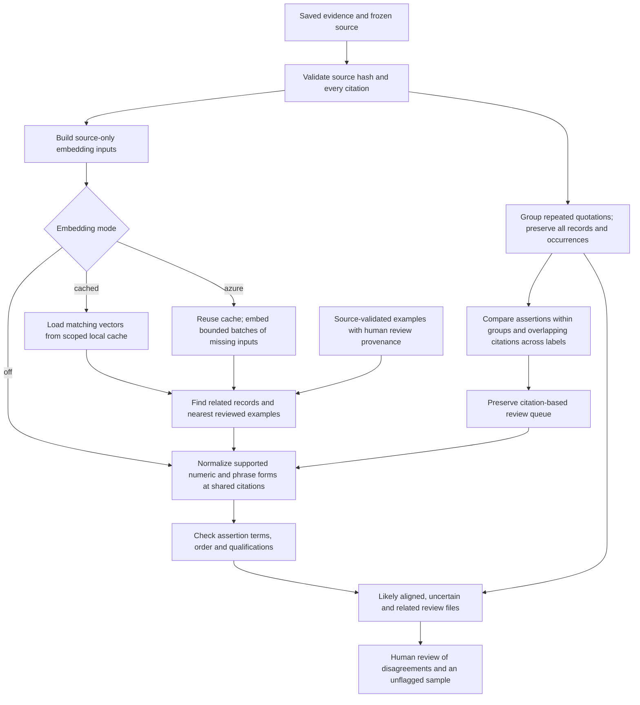

#### Repeated quotations and assertion alignment

Report version `2` includes `quotationGroups`: quotations matching after
whitespace normalization, isolated by source ID and content hash. Case,
punctuation and numbers remain significant. Different occurrences keep their
original pages and offsets; every member retains its statement, label, fields
and supporting citations. Groups are review containers, not merged evidence.
The group pass can surface a likely matching assertion pair without an embedding
request and reports its own comparison-budget exhaustion.

[evidenceAssertionAlignment.ts](../src/DataIngestionService/src/processors/evidence/evidenceAssertionAlignment.ts)
routes each retrieved pair using statement wording and participant metadata.
It uses no LLM calls, embedding scores, taxonomy labels or adjudicated labels to
establish alignment. Participant-name words are discounted for content matching;
different named participants and participant order are checked separately. This
does not establish identity or resolve aliases.

| Status | Meaning and review use |
| --- | --- |
| `likely-aligned` | Identical normalized statement wording, or at least two assertion terms matching completely in order after grammatical normalization, with no detected qualification/number/relation/participant warning. Start here for material label differences. |
| `uncertain` | Unmatched terms, partial or compound assertions, insufficient wording, changed qualifications, numbers, operators, relations, participants or word order. These candidates remain available for review. |
| `related-only` | Both statements have distinct terms and less than 45% coverage on at least one side after name/grammar handling. Source proximity and high cosine similarity alone do not establish a matching assertion. |

Each decision records its reasons, shared and unmatched terms, two-sided term
coverage and ordered coverage. A single changed assertion term cannot be voted
away by high overall overlap: walking and talking may differ in just one word.
Number, negation, modality, relation and participant warnings remain visible.
Alignment work is bounded at 160 content tokens per statement; larger inputs
are retained as uncertain. The rules are conservative review heuristics, not a
semantic parser or calibrated correctness probabilities. They do not establish
whether a statement is supported by the source. Dates and other material fields
remain visible through the existing risk checks.

No pair is removed because of its alignment status. `priorityPairs` retains its
original meaning (all kind/subtype/polarity pairs); `alignedPriorityPairs` is the
narrower starting queue. A smaller starting queue does not demonstrate fewer
extraction errors or improved recall. Human review must also sample uncertain,
related and unflagged records.

Assertion-alignment version `3` includes a source-anchored preprocessing step in
[evidenceAssertionNormalization.ts](../src/DataIngestionService/src/processors/evidence/evidenceAssertionNormalization.ts).
Each rule requires the same source ID, hash, document group, primary quote, page
and offset. The records and source-only embedding inputs are unchanged. Existing
vectors remain reusable. Applied rule IDs and their supporting citations appear
in `alignment.normalizations` and the CSV `assertionNormalizations` column.

| Rule | Required support and safeguards |
| --- | --- |
| `cited-score-percentile` | Both records cite the same assessment row and preceding `Subtest`/`Subscale`/`Measure`, `Score`, `Percentile` header. Their instrument/subject/subtest prefix matches, and both score and percentile match the row in the stated column roles. Valid ordinal notation and score/result presentation are normalized; ranges, other units, changed measures, invalid ordinals and compound statements are not generalized. |
| `anchored-causal-phrase` | A shared quotation supports an explicit passive action (`raised`, `delayed`, `cancelled`/`canceled`, or `postponed`). Both statements contain the corresponding causal patterns, allowing `because of` to match `due to`. Payment obligations, reversed causes and unmatched intervening roles are not rewritten. |
| `anchored-parent-help` | The shared quote supports parent/parental help or help from parents. Only these local phrase variants are normalized. Help **to** parents, different helpers and conflicting possessors remain distinct or uncertain. |
| `cited-examiner-context` | For the narrow “interview and examination session … took place on …” form, both records cite identical client, examiner and examination-date headers. The statements and structured start dates agree on a complete date, and exactly one statement adds the named examiner. A short given/middle name can match the full cited client name only within this shared context. Additional participants, conflicting claimant/examiner names, ambiguous or qualified dates, ranges and extra assertions prevent normalization. |

The examiner rule lives in
[evidenceExaminerContext.ts](../src/DataIngestionService/src/processors/evidence/evidenceExaminerContext.ts).
Both records must cite the same single client and examiner header occurrences on
the date header's page, preceding it by at most 2,048 characters. One statement
must use the full client name. Examiner initials are retained; recognized trailing
degree suffixes are ignored for this comparison. The date header must contain a
plain date list: named dates, ISO dates, or unambiguous month/day slash dates. A
two-digit source year must match the suffix of the full year already shared by
both statements and their metadata. This does not independently verify its
century. Cancelled, planned or otherwise qualified dates are excluded.

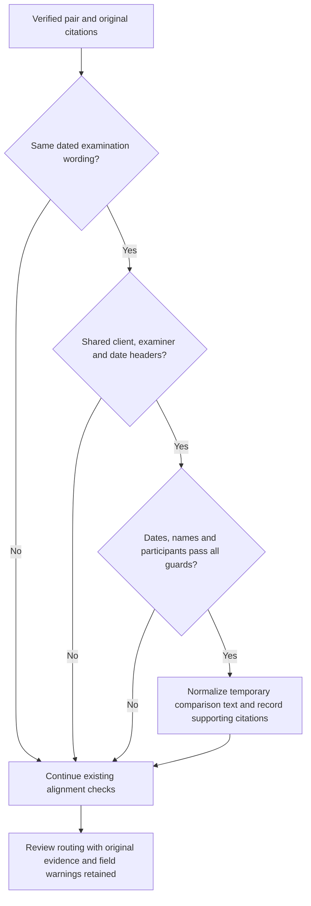

This is a local comparison rule, not a document-wide name alias map. It neither
rewrites stored people/date fields nor resolves attribution differences. Other
event wording continues through the existing checks without this expansion.

After rewriting, the full assertion comparison still checks terms, word order,
qualification, numeric values, comparison operators and participant information.
For transformed pairs, relation/quantifier checks preserve occurrence order and
counts so the new causal connector cannot hide an extra participant relation.
These rules organize review; they do not establish source truth, resolve dates
or attribution, or authorize merging.

#### Source representation and cache

[evidenceConsistency.ts](../src/DataIngestionService/src/processors/evidence/evidenceConsistency.ts)
builds embeddings from the primary quotation, up to 200 source characters before
and after it, and original Markdown section headings. It excludes generated
`pageContent`, proposition wording, claimant fields, type/facet/polarity labels,
and classification history. This avoids feeding the existing prediction back
into its own classifier. Words such as “Claim by” appearing in the actual source
remain source evidence.

Embedding input version `source-context-1` limits the primary quote to 2,400
characters and section context to 400. Full citations remain in review files;
`inputTruncated` identifies limited embedding context. Inputs exceeding 8,000
`cl100k_base` tokens are skipped and counted. Existing Search vectors include
generated evidence labels and are not reused for this experiment.

[evidenceConsistencyEmbeddings.ts](../src/DataIngestionService/src/processors/evidence/evidenceConsistencyEmbeddings.ts)
defaults to `text-embedding-3-small`, with 1,536 dimensions. `text-embedding-3-large`
is available for a later comparison, defaulting to 3,072 dimensions. The client
uses the same Azure deployment route as ingestion embeddings, including the
configured resource, deployment, API version and key. This is independent of
the chat-model endpoint settings. API behavior follows the
[OpenAI embeddings documentation](https://developers.openai.com/api/docs/guides/embeddings).

Cache keys include the explicit account/case scope, endpoint, deployment, model,
dimensions, API version, input-format version and input hash. Cache entries hold
validated vectors and hashes without source text or credentials. Corrupt entries
become cache misses. Requests run sequentially in batches of 16; the default paid
work limit is 2,000 unique uncached inputs. Reviewed examples receive priority
within that input budget. Successful batches survive later failures. A local
cache hit avoids a request; it is distinct from provider prompt-cache tokens.

The similarity search retains bounded neighbor lists, without allocating a full
pairwise matrix. Each pass examines at most 250,000 candidate pairs by default,
and the queue retains at most 1,000 pairs. Neighbor retrieval defaults to five
per target in each comparison category. Budget exhaustion, missing vectors and
queue truncation are explicit report fields. The defaults favor bounded resource
use on long documents and do not establish exhaustive consistency coverage.

#### Run the pilot

The default command makes no model calls and reads no appsettings:

```bash
cd src/DataIngestionService
bun run review:evidence-consistency \
  --input /path/to/saved-result.json \
  --source /path/to/frozen-source.md \
  --output /path/to/new-review-directory
```

To opt into Azure embeddings, supply the existing embedding settings, a scope
and a cache directory. This mode sends source passages to the configured Azure
embedding deployment and incurs embedding input charges:

```bash
bun run review:evidence-consistency \
  --input /path/to/saved-result.json \
  --source /path/to/frozen-source.md \
  --output /path/to/new-embedding-review \
  --embeddings azure --scope ACCOUNT_OR_CASE \
  --cache /path/to/private-vector-cache \
  --settings ../../.vscode/azure-test.appsettings.json \
  --max-new-inputs 2000
```

`--embeddings cached` uses matching cache entries without constructing a provider
or making requests; missing entries are reported as partial coverage. Every run
requires a new output directory, preserving existing review annotations.

| Option | Behavior |
| --- | --- |
| `--settings` | Optional JSON file with `AZURE_OPENAI_CUSTOM_ENDPOINT`, `AZURE_OPENAI_API_KEY`, and `TEXT_EMBEDDING_SMALL_DEPLOYMENT_NAME` / `TEXT_EMBEDDING_LARGE_DEPLOYMENT_NAME`. Without it, embedding modes read the process environment. |
| `--endpoint`, `--deployment`, `--model`, `--dimensions`, `--api-version` | Override embedding configuration. Keys are read from settings/environment and never copied into reports. |
| `--scope`, `--cache` | Required for embedding modes; isolate account/case vectors and identify the private cache directory. |
| `--examples`, `--document-group` | Optional reviewed-example bundle and target document-family identifier. An explicit scope is also required for example bundles. |
| `--first-page` | First source page number, default `1`, for sources with a different numbering convention. |
| `--lexical-threshold`, `--embedding-threshold` | Retrieval cutoffs, default `0.7` and `0.88`. These are uncalibrated similarity thresholds, not classification probabilities. |
| `--top-k`, `--max-pairs`, `--max-comparisons`, `--max-new-inputs` | Bound neighbors, review queue, comparisons per pass, and unique new embedding inputs. |

The output includes:

- `review.json`: exact source citations, both labels and statements, material
  field differences, discovery method, similarity scores, alignment reasons,
  quotation groups, limits and usage.
- `quotation-groups.csv`: one row per repeated quotation group, preserving
  member statements/labels, original occurrences and links to review pair IDs.
- `aligned-priority-review.csv`: likely matching assertions with kind, subtype
  or polarity differences; the focused starting queue.
- `uncertain-review.csv`: ambiguous assertion matches, including changes in
  qualification, numbers, participants or unmatched assertion terms.
- `related-passages.csv`: retrieved pairs whose assertion terms differ strongly.
- `priority-review.csv`: kind, subtype or polarity disagreements, excluding
  pairs differing only in facets, regardless of alignment status.
- `review.csv`: all retained pairs, including facet differences.
- `README.md`: labeling instructions and interpretation limits.

Fill `humanVerdict` with `classification-error`, `legitimate-difference`, or
`uncertain`, and record `incorrectSide`, `correctLabel`, `reviewer` and
`reviewNotes`. CSV cells are quoted and protected against spreadsheet formulas;
JSON retains exact source text. Optional embedding failures preserve the free
citation-based queue and produce an error exit status. Partial cache/budget
coverage is reported without treating missing neighbors as agreement.

#### Reviewed examples and evaluation

An example bundle has `version: 1`, a matching `scope`, a `sources` array and an
`examples` array. Each source supplies `sourceId`, `documentGroup`, `pageContent`
and explicit `pages`. Each example supplies a unique `id`, `sourceId`,
`sourceContentHash`, exact `sourceSpans`, a `label` object (`kind`, `type`,
`polarity`, `facets`) and a `review` object with `status: "human-reviewed"`,
`reviewer`, ISO `reviewedAt`, and `rationale`. This is recorded review provenance;
the software cannot establish whether a person actually performed that review.

Reference quotations are validated against their supplied sources. Examples from
the target's source ID, content hash or document group are excluded, preventing
the same document or a grouped revision from serving as its own reference.
Nearest-example retrieval includes agreeing labels as well as disagreements;
the report retains those neighbors for context. It never searches only for a
dissenting reference and interprets its existence as proof of an error.

The initial free replay processed the same 1,238 saved records before and after
the deterministic classification guard. It produced 595 and 591 review pairs,
respectively; the latter comprises 299 kind/subtype/polarity pairs and 292
facet-only pairs. Neither comparison budget nor queue limit was exhausted.
These are review candidates, not confirmed errors or duplicate counts. Original
observation-kind and denial-polarity disagreements were found, while the remaining
comfortable-observation polarity disagreement remains in the queue. An assessment
interpretation consistently labeled as a fact across records was not detected:
agreement within one document can still be wrong.

Offline artifacts are private under `.local/evidence-consistency-pilot/v1-classified/`
and `v1-original/`. No Azure embedding or chat-model call was made for that replay.
Regression tests use synthetic records, mocked Azure responses and a temporary
vector cache. TypeScript build, ESLint and all 503 service tests passed when the
pilot was implemented.

#### Azure embedding test on the saved 15-page output

The subsequent live embedding test reused the 1,238 records after deterministic
classification and verified the frozen source against the current 15-page
fixture. It used the configured Azure `text-embedding-3-small` deployment with
1,536 dimensions. Evidence extraction was not rerun; labels, citations and Search
records were unchanged. No human-reviewed reference examples were supplied.

| Measure | Live embedding review | Local cache replay |
| --- | ---: | ---: |
| Review processing time | 28.2 seconds | 6.6 seconds |
| Unique source inputs newly embedded | 576 | 0 |
| Unique source inputs loaded from cache | 0 | 576 |
| Repeated source inputs reused within the run | 662 | 662 |
| Embedding HTTP requests | 36 | 0 |
| Provider-reported input tokens | 76,799 | 0 |
| Output tokens / chat-model calls | 0 / 0 | 0 / 0 |
| Review pairs | 3,378 | 3,378 |

Times exclude compilation and final report writes. All records had embeddings,
and the cache replay reproduced every pair and score exactly. Cache hits are
local vector reuse, not provider prompt-cache tokens. The comparison budget was
raised to 1,000,000 and the queue cap to 10,000 for this test; all 765,703 potential
record pairs were examined without hitting either limit. Retrieval still retains
only five neighbors per record above the similarity cutoff; it is not an
exhaustive list of label disagreements.

At cosine cutoff `0.88`, all 591 citation-based pairs were retained and embeddings
added 2,787 pairs: 1,883 with kind/subtype/polarity differences and 904 with
facet-only differences. Of the additions, 370 had identical source inputs and
could also be surfaced by deterministic source grouping. These counts measure
review workload, not confirmed classification errors.

Codex spot checks found useful candidates, including the same examiner observation
represented as a fact and a claim. They also found clear mismatches between
propositions: an observation of compliance and a tentative interpretation of
motivation share a quotation and score almost `1.0`, yet can legitimately have
different labels. Related reading and writing statements scored above `0.95`
without asserting the same thing. These purposive AI checks are not human
adjudication or a precision estimate.

An offline threshold check, preserving all citation-based pairs, reduced the
queue to 1,403 pairs at `0.95` and 1,076 at `0.98`. It made no new embedding calls.
Raising the threshold cannot resolve different propositions with identical source
inputs. Keep the feature observation-only; prioritize grouping repeated source
passages and checking proposition alignment before treating retrieved neighbors
as classification inconsistencies. Calibrate that review process using human
labels before expanding it into automatic decisions.

Private artifacts are under `.local/evidence-consistency-pilot/azure-small-full15/`:
`review.json` contains usage and exact evidence, `new-priority-review.csv` isolates
the 1,883 new material review candidates, and `illustrative-ai-review.json` records
the attributed spot checks separately from blank human-review fields. The sibling
`azure-small-full15-cached/` contains the replay; `live-audit-summary.json` and
`audit-live.mjs` record and reproduce the preservation and comparison checks.

#### Grouped assertion replay on the same 15-page output

The version-2 replay used all 576 cached vectors and made zero API calls, using
zero new input or output tokens. It processed the 1,238 saved records in 6.8
seconds, excluding compilation and final artifact writes. All 3,378 previously
retrieved pairs, their scores, labels and citations were preserved; no comparison
or queue cap was reached.

| Review measure | Result |
| --- | ---: |
| Repeated quotation groups | 357 |
| Records presented in those groups | 1,025 |
| Likely aligned pairs, including facet-only differences | 136 |
| Focused material pairs (`alignedPriorityPairs`) | 93 |
| Uncertain pairs | 1,010 |
| Related-only pairs | 2,232 |
| All material pairs retained (`priorityPairs`) | 2,182 |

The focused queue retains the examiner-compliance fact/claim disagreement. It
does not promote compliance versus motivation, talking versus walking, or an
assessment occurrence versus its definition. The instrument-definition
disagreement remains uncertain because the expanded instrument name introduces
age digits; this illustrates why uncertain matches must remain reviewable.
The free citation/group pass surfaced 592 pairs versus the earlier 591, recovering
one previously embedding-only match without a model call.

These are routing results and selected regression controls, not adjudicated error
counts or a measured accuracy improvement. The initial overlap heuristic allowed
a single changed assertion word to pass; the final rule retains unmatched terms
as uncertain and adds participant, relational and qualification checks. Build,
ESLint and all 526 service tests passed. The private preservation audit also
passed with network access disabled.

Use `.local/evidence-consistency-pilot/grouped-alignment-final-full15/` for the
current review files and `audit-summary.json`. The sibling
`audit-grouped-alignment.mjs` reproduces its checks. Earlier
`grouped-alignment-full15*` folders are intermediate diagnostics. This run changes
only the observation tool; evidence extraction, indexed evidence and appsettings
are unaffected.

#### Small versus large embedding comparison

The next experiment compared the existing small vectors with fresh
`text-embedding-3-large` vectors using the same 15-page source, 1,238 records,
576 unique source inputs and unchanged grouping/alignment rules. It used the
configured Test embedding deployment `pbl-query`, with 3,072 dimensions. The
maintainer elected to use existing regression cases and prepare human review;
no human accuracy labels were available.

| Measure at cosine cutoff `0.88`, top five neighbors | Small | Large |
| --- | ---: | ---: |
| Review pairs | 3,378 | 3,619 |
| Material review pairs | 2,182 | 2,322 |
| Focused material pairs | 93 | 93 |
| Pairs unique to the model | 484 | 725 |

Both focused queues contain exactly the same pairs. Free citation/group checks
already found 92 of those 93 pairs. Large-only matches were routed as 99 uncertain
and 626 related-only pairs; these are heuristic categories, not human error
judgments. No extra focused matches were demonstrated. Meaningful paraphrases
could still be present in the uncertain queue, so these counts do not establish
equal model accuracy.

Both models behave alike on the seven existing regression controls. Identical
source inputs still produce similarity near `1.0` for different assertions, and
large assigns higher similarity to some known distinct assertions. The
assertion-alignment checks, rather than model size, keep those controls outside
the focused queue.

Large used 36 HTTP requests, 76,799 input tokens and zero output tokens; the
live review took 24.6 seconds. Subsequent threshold sweeps loaded all 576 vectors
per model from cache and made no requests. At cutoff `0.50`, cached comparison
times were 7.3 seconds for small and 12.5 seconds for large. Times exclude build
and final report writes; single runs do not establish a latency benchmark.
Using the maintainer's requested OpenAI standard reference prices of
[$0.02 per million small input tokens](https://developers.openai.com/api/docs/models/text-embedding-3-small)
and [$0.13 per million large input tokens](https://developers.openai.com/api/docs/models/text-embedding-3-large),
the input costs are approximately $0.00154 and $0.00998 respectively. Actual
Azure charges were not measured; small was already cached for this experiment.

Cached cutoff sweeps from `0.50` through `0.98` reproduced both default pair sets
and preserved every free citation/group pair. Large at `0.897` gives a similar
workload to small at `0.88` (3,373 versus 3,378 pairs). That is workload matching,
not accuracy calibration or a recommended configuration change. Retain small
as the default pending human review.

Private artifacts are in `.local/evidence-consistency-pilot/embedding-model-comparison/`.
`human-review.csv` contains 80 pairs with model identities, scores and machine
labels hidden: 20 small-only, 20 large-only, 20 common and 20 below both default
cutoffs. Review instructions and the separate score/stratum key accompany it.
The sample is stratified and does not support an unweighted population-precision
estimate. The below-cutoff sample covers broader retrieved candidates, not all
missed evidence pairs. The comparison script preserves existing human labels.
Source/citation preservation, complete cache coverage, model dimensions, identical
focused pair sets and absence of budget truncation were verified offline.

#### Submitted review findings

The maintainer subsequently supplied three completed 80-row CSV reviews. Reviewer
fields identify Claude (AI-assisted), GPT-6 (AI-assisted review) and Gemini. The
maintainer confirmed that the original fourth worksheet remained unrated. Every
review ID and all original statement, citation and participant/date fields were
preserved. These are AI-attributed reviews, not human gold labels.

For comparison only, Claude's `duplicate` was mapped to match and `related` /
`unrelated` to nonmatch; Gemini's `mismatch` was mapped to nonmatch. Raw labels
and notes remain intact. There were 12 unanimous matches, 54 unanimous nonmatches,
12 pairs with two nonmatch votes and one abstention, and two disputed pairs.
Claude and GPT-6 agreed on 79 of 80 normalized judgments. Of Gemini's 80 notes,
49 explicitly mentioned Jaccard overlap; its methodology is not independently
verified. Agreement is a diagnostic signal, not independent expert adjudication.

All seven sampled likely-aligned pairs were unanimously rated matches. Among the
seven sampled common uncertain pairs, five were unanimous matches, one was a
unanimous nonmatch and one was disputed. No sampled large-only pair received a
match vote (20 pairs). The small-only sample also had no unanimous matches; one
of its 20 pairs was a disputed containment case. These stratified counts do not
establish population precision, recall or calibrated thresholds.

The most useful next work is narrow alignment normalization: ordinal percentile
notation and score/result wording within the same assessment row; equivalent
anchored causal/parent-help phrasing; and source-supported examiner/identity
expansions. Preserve metric roles, dates, modality, attribution and actor roles.
Do not relax the general similarity threshold to accommodate these cases.

The two disputes concern an equivalent-looking instrument-domain list and a long
assertion that contains a shorter one. Containment must remain distinct from
full assertion equivalence. Review notes proposing merges were treated as review
data, not instructions to change evidence. Even unanimous matching wording can
retain incompatible claimant or temporal metadata requiring separate resolution.

The consolidated ratings, two-case adjudication worksheet and six proposed
regression cases are private under
`.local/evidence-consistency-pilot/embedding-model-comparison/submitted-review-analysis/`.
The sibling `analyze-submitted-reviews.mjs` script validates IDs, unchanged evidence
fields and file fingerprints without model calls. This analysis changes no
production classification rules or evidence records. Keep small embeddings
pending independent evaluation of the proposed alignment improvements.

#### Numeric and phrase normalization replay

The first implementation following those reviews covers numeric presentation,
anchored causal phrasing and parent-help phrasing. Examiner/contextual additions,
proposal wording and the two disputed cases remain outside this change.

The cached 15-page replay retained all 1,238 records and 3,378 previous review
pairs with identical original statements, labels, citations, material-field
warnings and similarity scores. It reused all 576 small-model vectors with no
API requests or new tokens, completing in 6.4 seconds excluding build and final
report writes. No comparison or queue cap was exhausted.

| Routing measure | Before | After |
| --- | ---: | ---: |
| Likely aligned pairs | 136 | 144 |
| Focused material pairs | 93 | 94 |
| Uncertain pairs | 1,010 | 1,004 |
| Related-only pairs | 2,232 | 2,230 |

Eight pairs moved from uncertain to likely aligned: six score/percentile pairs,
one causal phrase and one parent-help phrase. Seven differ only in facets, which
explains why the focused material queue grows by one. Two further parent-help
pairs moved from related-only to uncertain and still require review.

All three targeted unanimous AI-review matches were promoted. Directly checking
all 80 reviewed pairs, including large-only and below-cutoff examples absent from
the current queue, found no promotion of a unanimous nonmatch or disputed pair.
No previously aligned pair was demoted. The two remaining unanimous matches in
the uncertain queue concern examiner expansion and plan-item wording, which need
their own guarded changes. Five of the additional numeric promotions were outside
the submitted review sample. This is a regression replay, not an independent
accuracy evaluation or human validation.

An initial diagnostic exposed a one-sided causal rewrite that demoted an existing
match with an intervening participant phrase. The final rule requires supported
patterns on both sides; a regression test preserves that case. Build, ESLint and
all 569 service tests passed, including 43 new normalization cases covering column
roles, ordinal syntax, changed instruments/values, source isolation, causality,
negation, help direction and compound statements.

Private artifacts for that iteration are under
`.local/evidence-consistency-pilot/normalized-assertions-final-full15/`.
`promoted-pairs.csv` contains the eight new likely matches;
`routing-changes.json` contains every changed routing decision and its supporting
citations; `audit-summary.json` records the preservation checks. The sibling
`audit-assertion-normalization.mjs` reproduces the audit without network access.
The earlier `normalized-assertions-full15/` is an intermediate diagnostic.

#### Examiner-context replay

The next iteration adds the guarded examiner rule above. On the same cached
15-page source, likely aligned pairs increased from 144 to 147; uncertain pairs
fell from 1,004 to 1,001. All three promotions concern the same client and examiner
on three separately cited examination dates. They differ only in classification
facets, so the focused material queue remains at 94. Original participant-field
warnings remain visible for all three.

The replay retained all 1,238 evidence records and 3,378 review pairs, including
their original statements, labels, citations, field warnings and similarity
scores. It took 6.9 seconds excluding build and final writes, reused 576 cached
small-model vectors and made no API requests or new token usage. No comparison
or queue limit was reached.

The August examination pair was unanimously rated a match in the submitted
Claude, GPT-6 and Gemini reviews. The two analogous date pairs were inspected by
Codex against the shared citations but have no independent ratings. A direct
check of all 80 submitted pairs preserved every unanimous nonmatch and disputed
pair outside the likely-aligned route. No previously aligned pair was demoted.
One unanimous match concerning plan-item wording remains uncertain. These are
development-sample regression results, not independent accuracy measurements.

Build, ESLint and all 618 service tests passed. The 49 examiner tests cover both
argument orders, citation isolation, supported date formats, separate sessions,
unknown/ranged/qualified dates, contradictory participants, examiner initials,
negation and compound assertions.

Latest private artifacts are under
`.local/evidence-consistency-pilot/examiner-context-full15/`: `RESULTS.md`,
`promoted-pairs.csv`, `routing-changes.json` and `audit-summary.json`. The sibling
`audit-examiner-context.mjs` checks preservation and all 80 reviewed pairs without
network access. Earlier audit scripts remain tied to their alignment versions.

#### Adjudication and independent validation

A six-case packet is prepared under
`.local/evidence-consistency-pilot/adjudication-six-cases/`. It contains the three
examination pairs, the unresolved plan-item pair and the two disputed domain-list
and containment pairs. `cases.md` presents original statements, participant/date
fields, exact citations and source context. `adjudication.csv` has blank decision
columns; `provenance.json` keeps previous AI votes and current routing separate
for consultation after an initial judgment.

The worksheet distinguishes full equivalence, compatible identifying enrichment,
directional containment, related but distinct assertions, unrelated assertions
and uncertainty. It asks for source support on each side and participant/date
compatibility separately. Reviewer identity, human/AI-assisted status, rationale
and optional review time remain explicit. These decisions do not authorize merges.

`prepare-six-case-adjudication.mjs` verifies saved evidence and source citations,
records file fingerprints and refuses to overwrite the packet. The sibling
`audit-six-case-adjudication.mjs` checks the worksheet's unchanged evidence columns,
response vocabularies and original input fingerprints; it accepts an optional
path to a completed CSV. Both are private local tools and make no provider calls.

Independent validation still requires a different underlying document, rather
than a revision or page subset of the development report. A separate 5–15-page
psychoeducational, neuropsychological or medical assessment with dated encounters,
named participants, score tables, attributed opinions and recommendations is a
useful first choice. Freeze its source and saved extraction before collecting
judgments. Consistent pseudonyms are suitable if dates, quantities and participant
relationships remain available to the evaluator.

The packet also preserves the existing three-page synthetic participant/payment/
interview document and its 22 saved records as a regression fallback. It was
already used in development and lacks the examiner-header and score-table
patterns, so it cannot establish generalization. No new extraction was run.

For the new document, sample likely aligned, uncertain, related-only and unflagged
pairs, including same-label pairs absent from the classification-disagreement
queue. Also sample individual records without selecting by their flags. Record
stratum sizes and sampling probabilities; evaluate incorrect matches, missed
equivalences and review workload separately. A source-level annotation of omitted
evidence is required to measure extraction recall. The six development cases and
their prior AI votes are not independent validation labels.

#### External validation sources

The maintainer supplied **NTSB RIR-25-08, Union Pacific Railroad Train Collision
and Conductor Fatality**, a separate seven-page source published June 25, 2025.
The [official PDF](https://www.ntsb.gov/investigations/AccidentReports/Reports/RIR2508.pdf)
is retained unchanged. Its package contains 33 provisional ChatGPT-curated
propositions and 15 pair checks; it is not a saved extraction run or an exhaustive
gold inventory. The package's original labels are preserved. Separate provisional
corrections record that the collision occurred beyond the stopping point and
retain approximate times. No reference answers are supplied to the extractor.

The local run uses Azure Document Intelligence `prebuilt-layout`, API
`2024-11-30`, Markdown output with no exclusion zones or high-resolution option,
matching the production PDF conversion settings. It keeps physical page boundaries
and freezes the converted text before extraction. Source offsets address this
Markdown; exact citation validation does not establish OCR semantic accuracy.

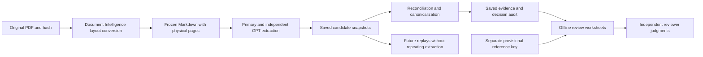

Artifacts are private under `.local/ntsb-rir2508-validation/`. A local copy of the
standard live runner observes candidates before reconciliation, preserves
canonicalization decisions and retains checkpoints. Model prompts and production
rules remain frozen. Wire response usage is reconciled with LangChain telemetry;
cache reads, cache writes and output are reported separately. Reasoning tokens
are already part of output. Published OpenAI prices provide a reference estimate,
excluding Azure-specific rates and Document Intelligence conversion charges.

The October 10, 2026 run completed all seven windows in 621.6 seconds, producing
369 records (95 events, 115 facts, 159 claims) from 425 saved raw candidates.
Document canonicalization reviewed 55 pairs and applied 29 merges. All applicable
technical checks passed. Usage was 293,193 output tokens, including 103,679
reasoning tokens, with a $2.7062 OpenAI reference cost; 93.5% of that estimate was
attributed to the independent/fallback/date-resolution Sol deployment. The local
README and review package contain full usage, blank review worksheets and a
separate AI spot-check note. Those spot checks found repeated radio-message
events and a nested-attribution inconsistency; exact quotations alone do not
establish correct attribution. No independent quality score is available yet.

The maintainer also supplied **Student v. Enfield Board of Education, Final
Decision and Order 23-0152**, a six-page candidate with an 89-row answer key by
**Claude Opus 5.5**. Its support codes identify that model's procedure (A), findings
(B), conclusions (C), targeted verification (V), value scan (S) and initial summary
passes. These are same-model checks; confidence labels reflect the author's
support scheme, not calibrated probabilities or independent human judgments.
The author assigned high confidence to S support or at least two passes, and
medium confidence to single-pass support, garbled text or noted inferences.
The 78 evidence checks, six inconsistency flags and five negative checks require
separate scoring. Source date conflicts, inferred witness identities and garbled
table rows remain explicit in the key. The filename's “fully adjudicated” refers
to the legal matter, not benchmark-label adjudication. Inspection/provenance
notes are in `.local/enfield-23-0152-validation-notes.md`.

The next evaluation needs reviewed examples and a separate sample of unflagged
records from different documents. Measure flag precision, missed inconsistencies,
reviewer workload, per-class errors, latency and cost. The flagged queue alone
cannot establish recall. A confident taxonomy label cannot establish source
support for identity, dates, negation or an alleged occurrence; automatic
acceptance requires its own evidence and evaluation.

## Dates in semantic and vector search

Evidence `pageContent` contains readable text used both as Search `content` and
as the embedding input. The statement appears first, followed by available dates,
attribution, and verbatim source quotations:

```text
Fact: The assessment score was 65.
As of: March 2025
Subject: Casey
Reported by: Parent
Source page: 2
Source quote: Score: 65
```

Facts use their applicable or measurement date (`asOf`). Claims label
`whenStarted` and `whenEnded` as dates referenced by the claim; these do not
represent when the statement was made. Events label their start and end dates.
The formatter preserves year-only, month/year, season, quarter and end-only
dates, omits unknown values, and never fills missing parts with January or day 1.
Approximate wording and claim polarity remain in the text. Impossible calendar
dates are rejected rather than formatted as valid dates.

Date metadata remains structured for exact filters, for example:

```text
tags/any(t: t eq 'factType:assessmentResult') and asOf/year eq '2025' and asOf/month eq '3'
```

Date parts are strings; their lexical ordering is not chronological ordering.
Semantic/vector matching benefits from the readable date context, while exact
date constraints should use filters. This formatting change adds no model calls.
New indexes include `asOf`; ingestion adds missing fields to existing indexes,
preserving their other fields and search configuration with an ETag condition.

### Backfill previously indexed evidence

The backfill rebuilds recognized complete evidence records from stored metadata,
retains their IDs and extraction provenance, and regenerates vectors whenever
the text changes. It also reclassifies undated event records as cited facts and
updates their Search kind, type, tags, and date fields. It does not repeat LLM
extraction. Split fragments or unknown formats are reported as unsupported and
require separate review or re-ingestion.

From `src/DataIngestionService`, preview one source first:

```bash
bun run backfill:evidence-dates --settings ../../.vscode/azure-test.appsettings.json --endpoint https://YOUR-SEARCH.search.windows.net --index YOUR-INDEX --source-id YOUR-SOURCE --limit 100
```

Preview reads Search records without changing the index or requesting embeddings.
Authentication uses `DefaultAzureCredential`, such as a local Azure CLI login.
The report defaults to `.local/evidence-date-backfill-report.json` and includes
counts and errors, without evidence text or quotations.

To apply, pause ingestion/removal for that source and rerun with `--apply`.
Use settings for the same embedding model, deployment, and resource as the
existing index. Apply adds missing `asOf` fields and merges updates by existing
ID. It gathers pending updates before writing, so changed records cannot move
ahead of an unvisited Search results page. It checks for document changes after
embedding and fails on Search write errors. Pausing source updates closes the
remaining race between the last read and the merge, since Search document
writes have no ETag condition.
The content version marker allows a rerun to skip completed records, including
their embedding calls. `--limit` counts pending updates, allowing bounded batches.
Existing records remain unchanged until this command is applied or the source
is re-ingested; updating code alone does not backfill them.

## Reconciliation and failures

### Field support and FEVER-inspired evaluation

The general reviewer and its independent fallback now use a shared field support
check. They assess the occurrence or proposition, participants, original speaker,
negation, modality, location, cause and time separately. A matching quotation is
not sufficient to establish every field. Supporting passages may form a complete
set across pages; a different complete set is also acceptable.

A supported event survives when an incidental date, participant, place or cause
is unknown. The reviewer uses the existing compact corrections to remove an
unsupported value. A recommendation or allegation does not establish that its
underlying occurrence happened; its supported content can survive as a claim.
Opposing attributed claims can both be retained. This checks fidelity to the
uploaded source, not a witness's credibility or truth outside the source.

These instructions adapt ideas from James Thorne, Andreas Vlachos, Christos
Christodoulopoulos and Arpit Mittal's [FEVER: a large-scale dataset for Fact
Extraction and VERification](https://arxiv.org/abs/1803.05355) (2018). FEVER is a claim
verification benchmark, rather than an event extraction model. Its evidence-set
and retrieval-versus-inference evaluation ideas are useful here. We have not
installed an OpenIE parser or added a separate verification model call.

The field judgments remain model judgments. Deterministic code validates the
response schema, calendar values, correction rules and exact source quotations;
it cannot prove semantic support. The response schema is unchanged, and the
reviewer does not return a verbose checklist. Existing safeguards still request
an independent review before clearing a known date or attribution when fallback
is configured. Changes to the shared instructions invalidate cached review
results through the implementation fingerprint.

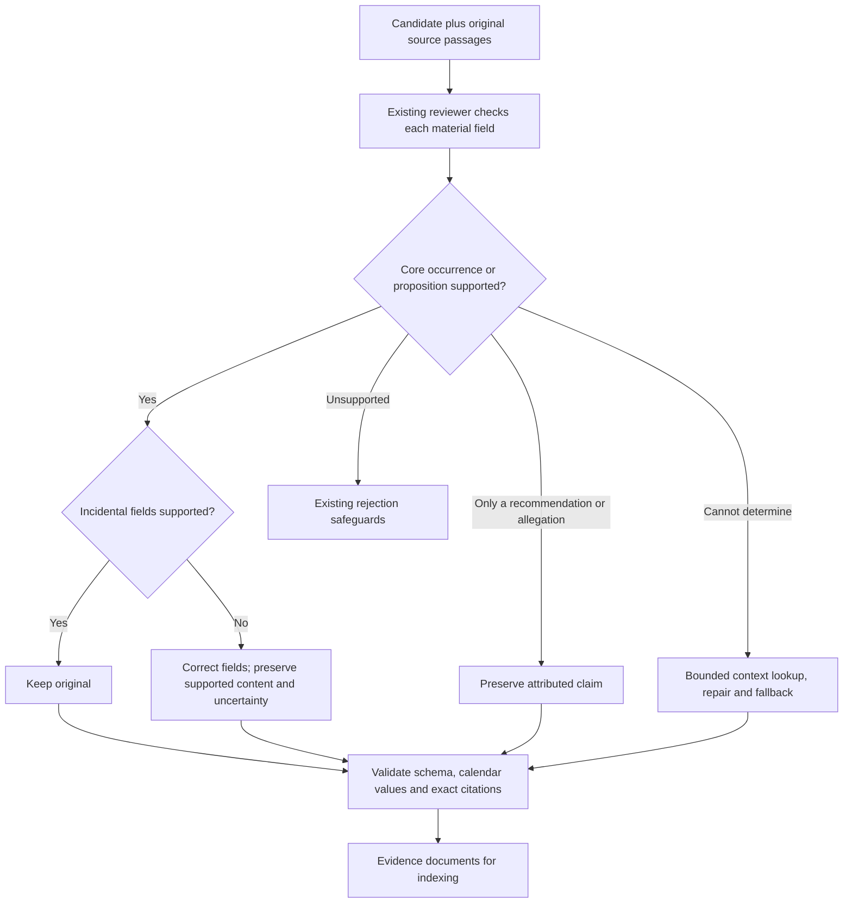

Telemetry separates observable problems:

| Event | Categories / outcomes | Meaning |
| --- | --- | --- |
| `evidenceExtractor.reviewIssue` | `schema`, `citation`, `date-format`, `source-support`, `loop` | A failed response/decision contract, quote match, calendar check, model support judgment, or agent step limit. |
| `evidenceExtractor.sourceContextAccess` | `returned`, `empty`, `invalid-location`, `budget-exhausted` | What a source read/search actually returned, with counts and stage/model. It does not record the query or source text. |

An empty search or exhausted budget does not prove an item is absent or false.
Likewise, a `source-support` issue reports the reviewer's judgment, rather than
an independently confirmed semantic error. Retries can emit multiple issues
for one candidate; these counters are not unique rejected-item counts.

#### Small frozen support benchmark

`test/fixtures/evidence-support.json` contains 14 synthetic challenge cases with
fixed candidates, source passages, field annotations and alternative sufficient
evidence sets. Cases cover speaker attribution, negation, modality, conflicting
claims, recommendations versus occurrences, assessment facts versus hedged
interpretations, unrelated and partial dates, unknown participants, unsupported
causes, cross-page links and an invented occurrence. Labels describe support for
the input candidate's fields; expected records describe the corrected result.
They are authored regression expectations and still need independent human
review before being treated as a quality benchmark.

The runner feeds source text and candidate snapshots through the production
reviewer. Gold annotations never enter the model prompt. It skips extraction,
canonicalization, embedding, indexing and notification. Each short case includes
all gold passages in the actual source prompt, so this is an **oracle-context
interpretation benchmark**. It does not measure retrieval performance on a long
document, extraction recall, deduplication quality or overall cost parity.

The grader requires the expected record count, field checks and a complete set
of citations with valid page offsets. Correct fields without sufficient evidence
fail. Each output can satisfy only one expected record. Missing predictions,
unknown IDs and duplicate IDs cannot silently improve the score. Exact values
and limited wording patterns make this a conservative regression check; manually
review unexpected paraphrases and legitimate alternative citations before
changing annotations. A pass does not establish every untested field's quality.

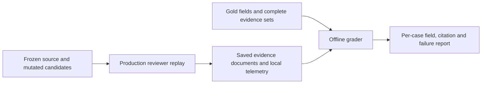

From `src/DataIngestionService`, offline grading makes no model calls:

```bash
bun run benchmark:evidence-support \
  --predictions ../../.local/evidence-support/predictions.json \
  --output ../../.local/evidence-support/graded.json
```

The input can be the runner's saved report or an array of
`{caseId, documents, availableEvidenceIds, failure?}`. `documents` use the
production `pageContent`/`metadata` shape. `availableEvidenceIds` identifies gold
passages actually supplied to the reviewer; use `null` when availability was not
observed. Do not derive availability from the final selected citations. Optional
`failure` is `schema`, `invocation`, `loop` or `pipeline`. The grader distinguishes
schema/invocation failures, bad citations, insufficient selected evidence and
wrong checked fields. If a complete evidence set was unavailable, it reports
`retrieval-limited`; unknown availability is `unclassified-context`. Those are
diagnostic limitations, not causal proof that retrieval caused a wrong result.

To explicitly run the small paid benchmark with a selected settings file:

```bash
bun run benchmark:evidence-support --live \
  --settings ../../.vscode/azure-test.appsettings.json \
  --output ../../.local/evidence-support/predictions.json
```

Use `--case unrelated-date-on-consent` to run or grade one case. The runner saves
progress after each case, including actual token-usage events, model settings
without credentials, durations and the fixture hash. Any failed case produces a
nonzero exit code. Offline regression tests exercise the grader, source access
observations and production agent invocation using mocked responses; those tests
do not measure model accuracy. The event-structure prototype below has a separate
small live evaluation.

### Compact event structure prototype

The opt-in `EVIDENCE_EVENT_STRUCTURE_MODE=annotate` setting adds event triggers
and participant roles to the existing extraction/reconciliation responses.
The default is `off`; its model request schemas omit the extra fields. Both
local benchmark runners accept `--eventStructure annotate` or `off`. This is a
prototype for controlled comparisons; no deployment settings have been enabled.
The approach adapts the trigger/argument definitions, document context and
joint-review ideas in Viet Dac Lai's [Event Extraction: A Survey, sections 2.1,
3.6 and 3.7](https://arxiv.org/abs/2210.03419) (2022).

The additional model response is small:

```json
{
  "eventStructure": {
    "trigger": "paid",
    "roles": [
      { "role": "payer", "participant": 0, "citations": [0] },
      { "role": "payee", "participant": 1, "citations": [0] }
    ]
  }
}
```

For an event with `who: ["Jordan", "Casey"]`, this assigns Jordan as payer and
Casey as payee. Participant indexes address `who`; citation `0` is `sourceQuote`
and citations `1..N` address `supportingQuotes` in their original order. The model
does not repeat quotations or calculate character offsets. Code resolves the
trigger inside the validated primary quotation and converts role references to
stable, document-scoped citation identifiers. Stored `eventStructure.version`
is `1`, with a resolved trigger span and roles containing participant names and
`citationIds`. All referenced quotations remain in `sourceSpans`.

Triggers can be verbs or nouns. An implicit occurrence uses an empty trigger,
which becomes `null` in metadata. If a nonempty trigger cannot be uniquely
matched, code retains the event, sets the trigger to `null`, and records
`triggerIssue: ambiguous|unmatched` plus `eventTriggerUnresolved` telemetry.
Such annotations block duplicate merges. This avoids failing supported evidence
over an incidental annotation. Unknown roles use an empty role list. Invalid
participant/citation indexes and repeated roles enter the existing bounded
repair/fallback path. Source matching proves the span exists; the reviewer still
judges whether the phrase and roles have the intended meaning.

The closed role vocabulary is `actor`, `speaker`, `sender`, `recipient`, `payer`,
`payee`, `observer`, `affectedPerson`, `provider`, `patient`, `subject`,
`applicant`, `decisionMaker`, `signatory` and `witness`. Roles never establish
fault or credibility. Unknown or unsupported relationships should be omitted.
An event recording a witness statement preserves its speaker; it does not
establish the truth of the occurrence being described.

Changing an annotated event's participant array or quotations requires a full
replacement event, including consistent annotations. Compact corrections to
those fields are rejected because their indexes could silently change meaning.
Scalar date corrections still preserve the annotations. Old candidate snapshots
remain readable, so the prototype can annotate a frozen candidate set during
review. Both the implementation fingerprint and the selected mode participate
in checkpoint identity.

In annotation mode, general review also receives ranked original passages for
event participants. Lookup preserves short identifiers such as `W-17` and can
find register entries across pages. These source passages are hints, not assigned
identities; the reviewer must cite the identity and its relationship to the role.

#### Duplicate safeguards and document mention links

Document duplicate retrieval lives in `evidenceDocumentDeduplication.ts`. After
exact deduplication, canonicalization scans event, fact and claim records together
within the same account, source revision and primary page. It combines phrase
overlap with token Jaccard similarity (at least 0.6) and small symmetric token
differences (at most two, with at least two shared terms). Token-only leads require
matching numeric values. Comparison normalizes Unicode, full unambiguous dates,
ordinal numbers and common inflections without rewriting stored assertions.
Names, negation, modality, relationship labels and measure descriptors are kept.
The component records the matching reasons for each candidate.

Ingestion also embeds each assertion's `what` using the existing account/source
embedding cache and `text-embedding-3-large` deployment. It adds cosine neighbors
at similarity 0.82 or greater, up to eight neighbors per record, within the same
primary-page scope. Either record may nominate the pair. Lexical and citation
candidates remain available independently of this neighbor limit. Embedding
input excludes tags and quotation text, because a shared quotation may contain
different assertions. `similarity` remains the phrase-overlap score;
`embeddingSimilarity` and the `embedding` match reason identify semantic leads.
Invalid or oversized vectors do not remove lexical leads. Ordinary provider,
embedding-cache storage, configuration and vector-dimension failures fall back
to lexical/citation review and emit `canonicalizationEmbeddingFallback` with the
error type. Budget stops and cancellation still stop the attempt. Saving or
loading review decisions remains required; those storage errors are propagated.
Normalized vectors use `Float32Array`; bounded neighbor insertion avoids sorting
and reallocating the full neighbor list for every above-threshold pair.
Direct callers of `EvidenceExtractor` can inject the same cached vector provider
as its seventh constructor argument; without one, retrieval remains lexical.

Nested primary quotations at the same source coordinates also earn review.
Within that shared passage, shortened names, omitted middle names and omitted
professional credentials can be reviewed across paraphrases. They are never
automatic identity mappings. Different full names, incompatible specific roles,
dates and polarity remain protected. Reviewed event-role merges keep the original
participant labels and all supporting role citations.
Within a shared primary passage, participant coverage is checked per label. A
shortened name retained through a verified alias can coexist with another role
explicitly named in the surviving statement. All labels still survive in the
merged metadata, and incompatible participants continue to block a merge.
A claim or event can preserve a fact's `subject` through the same person already
identified in its `who` field; absence of a fact-specific field alone does not
prevent fuller wording from surviving. The subject is retained in merged metadata.

When strict participant/annotation checks leave no eligible survivor,
canonicalization now uses `evidenceMetadataReview.ts` to request explicit field
resolutions from the identity reviewer. This path requires the original
`EvidenceSource`; source hashes, primary scope, and every supplied citation are
validated before admission. It can review disagreements in `who`, `subject`,
`reportedBy`, `claimant`, `where`, `asserts` versus `uncertain` polarity, and
overlapping event-role annotations. Exact deduplication and source-less callers
retain the strict behavior. Numeric, qualifier, date, occurrence and directional
role restrictions still apply to candidate eligibility.

Each request includes the differing fields and bounded document passages,
including participant/client headers and family relationships. These support
familiar middle names, named relatives, collective parents, table reporters,
instrument references and contextual participants without a global inferred
alias map. Supporting passages may come from other pages; the two records must
still have the same primary page. Different primary excerpt boundaries no longer
exclude this explicit identity-review path.

A merge requires `same_assertion`, directional semantic coverage, and one
`metadataResolutions` entry for every requested field. Each entry explains all
conflicting values and cites both records, with document-context citations where
needed. Code checks the original pair hash and citation excerpts again when
applying decisions. Missing, duplicate, unsupported or stale resolutions retain
both records. A cited passage grounds the model's judgment; it is not a logical
proof of identity. Distinct people and uncertainty in the statements must remain
distinguished by the reviewer and existing content-preservation checks.

Approved merges preserve original labels, tags, classifications and role
citations. They also store `metadataResolutions` history with original field
values, explanations and independently addressable source spans. Identity-support
citations are added to `sourceSpans`. A resolved `asserts`/`uncertain` annotation
uses `asserts` for the retained qualified proposition while preserving both
original annotations; it does not remove “possible” or other qualifiers from
`what`. A reviewed location equivalence retains the longer existing label.
Patient/affectedPerson and provider/observer can coexist for a reviewed occurrence;
opposing directional roles retain strict checks. Complete-link and direct-survivor
requirements still apply to every member of a merged group.

When both descriptions preserve the same details, candidate survivor order prefers
event > fact > claim. Directional detail coverage can still select a fuller
lower-ranked description while metadata uses the highest primary representation.

Candidate similarity cannot remove evidence. The existing semantic reviewer must
establish the same atomic assertion and directional preservation of its details.
Every pair in a merged group needs direct approval, and the final retained wording
must be approved to cover every member. Connected similarity chains and the longest
statement alone cannot establish a duplicate group. Tags and citations are unioned;
the primary representation follows event > fact > claim. Supporting citations on
another page never widen the primary-page boundary.
An illustrative example also remains distinct from an assertion requiring that
specific action when the qualification appears on only one side.
Identity procedure version 14 includes explicit semantic relationships:
`equivalent`, `left_entails_right`, `right_entails_left`, `contradictory`, `related`,
`unrelated` and `uncertain`. The relationship must agree with directional detail
inventories. One-way entailment only permits merging when atomic identity also
holds; a compound assertion that entails a component does not replace it.

A structured contextual assessment can justify additional attribution,
participant references, occasion, instrument or purpose for that same assertion.
It must identify an exact inventory detail, its side, an exact supporting excerpt
from that side's citations and an explanation. These assessments survive in the
pair checkpoint and are revalidated when applying merges. They do not override
participant compatibility, causal scope, separate-clause, alternative-action,
illustrative-scope or survivor-detail checks. Without this assessment, the
existing conservative enrichment rules apply. Citation matching verifies that
the excerpt exists; semantic identity and relevance remain model judgments.

Measurement qualifiers are interpreted within the complete assertion. A short
detail such as `scaled` or `scaled score` can qualify the same numeric score;
the adjective alone is not a new result. An age comparison such as `compared
with children his age` can qualify the same result when its primary citation
explicitly supports that population. Table and narrative citations may have
different offsets on the same primary page. Both paths still require reviewed
assertion identity and preserve the fuller existing wording. Directional
coverage also checks explicit score types and comparison populations when the
reviewer omits them from its inventories, preventing their loss or replacement
by conflicting measurement qualifiers. Other enrichment remains subject to the
existing conservative rules.

The identity procedure also permits two forms of directional context
after semantic review: a source-defined instrument identifier for the same
assessment result, and an explicit source-supported goal of the same
recommendation. The surviving assertion must retain that context. Goals cannot
be treated as achieved outcomes, and a second action remains separate. In a
shared primary passage, Who lists may differ by a claimant/reporter label;
review compares substantive participants and merges all original labels.

The same shared-passage review can reconcile unnamed role labels such as
`Unknown doctor` and `The doctor`, and possessive references such as `his mother`
and `Elliot's mother` when both assertions and the primary passage establish the
same antecedent without competing named participants. These changes earn
semantic review; they never automatically assign an unnamed role to a named
person or equate different relatives. Original labels survive the merge.
Source-supported qualified references also recognize possessive forms such as
`Elliot's evaluating doctor` as `Doctor who evaluated Elliot`. The same cited
action must support the role and its named target on both records; another patient
or a different action does not qualify.

Observer and provider can be compatible annotations for the same person in one
event. Shared-passage review must verify the person's participation; both roles
and their citations survive. Different people and reversed roles remain blocked.
For claims, `asserts` versus `denies` can be an annotation error when both
statements and the shared primary quote assert a negative finding, such as no
complications, without an explicit act of denial. Semantic review must establish
the same proposition. The merged primary polarity becomes `asserts`; original
tags, classifications and a `claimPolarityResolutions` audit retain the earlier
labels and source evidence. Explicit denial, uncertainty and contrary meanings
remain separate.

This generalizes the exploratory `scan.py`/`classify.py` method without importing
its document-specific ignored names, removed negation/score terms, positional
manual decisions or unconditional union-find merges. The existing
`replay:evidence-canonicalization` command runs the same component on saved
extraction output. See the 15-page deeper-dedup evaluation (operational record retained privately).

Strict deduplication and canonicalization now compare resolved roles and trigger
spans. They retain role reversals, differing triggers, and annotated versus
unannotated records separately. Compatible merges union every role citation.
Canonicalization receives readable role assignments and the passages required
to support them. Existing date, polarity, identity and source-occurrence guards
continue to apply.

Date enrichment appends new supporting quotations without reordering or
collapsing the original array. This preserves the numeric citation references
used by event roles until they are resolved to stable citation IDs.

After deduplication, a document-local map assigns stable `eventMentionId` values
and may add `possibleRelatedEventMentionIds`. It considers compatible named role
sets, event types, date meanings, numbers, qualifiers and similar descriptions.
Comparisons examine at most 32 previous members of each candidate bucket; each
mention receives at most eight links. This bounds work on large files, but can
miss relationships in a large cluster. Unknown roles and generic `other` types
do not produce links.

These links are retrieval/review leads. They never assert that two mentions are
the same occurrence, merge separate attestations, or change extracted evidence.
Separate page occurrences retain their own records and quotations. Linking uses
in-memory maps and requires no additional model request or database. The extra
response fields and occasional full replacements can increase output tokens;
any net cost reduction must be measured.

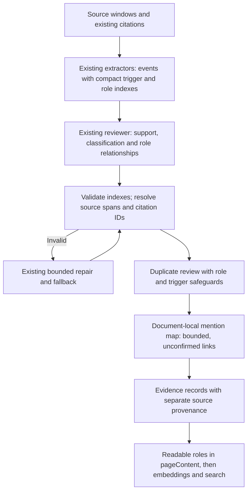

Roles appear as readable lines such as `Payer: Jordan` in `pageContent`, so they
participate in semantic and vector search. Content version `3` identifies this
formatter; version `2` remains supported by backfill. Existing records are not
re-extracted or re-embedded automatically. Structured roles and mention links
are stored inside serialized metadata; dedicated Azure Search role filters would
require a later index-field addition. Internal citation and mention IDs do not
appear in `pageContent`.

#### Event structure evaluation

`test/fixtures/evidence-event-structure.json` adds eight cases: reversed payment
roles, sender/recipient assignment, repeated mentions, recurring payments on
different dates, separate witness attestations, a participant identity twelve
pages away, a nominal trigger and an implicit state change. The document-context
case allows source tools to find distant evidence. Its retrieved coverage is
reported as unknown rather than assumed complete. Other cases supply complete
oracle context. Fixed-candidate replay still does not measure extraction recall.

An explicit small live comparison can be run with:

```bash
bun run benchmark:evidence-support --live \
  --fixture test/fixtures/evidence-event-structure.json \
  --settings ../../.vscode/azure-test.appsettings.json \
  --eventStructure annotate \
  --output ../../.local/evidence-event-structure/annotate.json
```

Use the same fixture/settings with `--eventStructure off` and a separate output
file for a baseline. Missing annotation fields will fail the new role-specific
checks in that baseline; inspect preservation, citations and the existing support
suite as well before concluding quality improved. The runner reports passes by
dimension, durations and token usage by model/stage. It sums `llm.call.token_usage`
only; request aggregates and reasoning tokens are not added to output tokens.
Unavailable usage remains `null`, and partial cache reporting includes a count
of calls with cache details. API calls without usage telemetry may still incur
unreported cost.

The new regression tests cover actual agent invocation with controlled model
responses, both provider schema conversions without `$ref`, citation indexing,
role reversals, merge provenance, bounded linking across 100+ pages and content
version compatibility. These are application tests. A small live comparison and
targeted follow-ups are recorded below; no 15-page live extraction was performed.

#### Synthetic live comparison, 9 October 2026

Eight cases per mode used `recon-test-gpt-6-luna` at `xhigh` with Sol as fallback.
The initial runs produced the following reported usage:

| Measure | Off | Annotate |
| --- | ---: | ---: |
| Luna output tokens | 2,491 | 4,301 |
| Sol fallback output tokens | 1,694 | 1,540 |
| Total output tokens | 4,185 | 5,841 |
| Input tokens | 163,002 | 124,609 |
| Cached input tokens | 123,557 | 84,959 |
| Sum of case durations | 63.6 seconds | 64.8 seconds |

These single sequential trials do not isolate cache or latency effects. Total
output increased 39.6%, while Sol output decreased 9.1%; prices differ by model,
so total tokens alone do not determine the cost difference.

The initial annotated run passed five cases. A repeated trigger caused one
supported event case to fail indexing, and a distant participant identity was
left unresolved. Both issues were corrected as described above, and both
targeted live reruns passed. Another failure was a valid alternative nominal
trigger, `dismissal took effect`, which the original annotation had excluded.
After source inspection, the annotation was broadened to accept it alongside
`dismissal`.

The reviewed composite passes eight cases and retains all eleven expected
records, using six original cases and two reruns. This is not a fresh full-suite
run. The off run's annotation-specific failures are expected and do not show
inferior overall extraction quality. The two targeted follow-ups consumed 1,738
additional output tokens; the complete experiment consumed 11,764 output tokens
and 248,094 cached input tokens. Reasoning tokens are included in output totals.

Original fixtures/reports, the revised annotation, per-case evidence and the
reviewed composite are under
`.local/evidence-event-structure-2026-10-09/`; see `README.md` and
`reviewed-comparison.json`. The prototype remains disabled by default pending
broader quality and cost evaluation.

The reviewer receives candidates in batches of 16. Every candidate must receive
exactly one decision. It can preserve or minimally correct supported evidence,
split compound items, or reclassify a table result as a fact or an alleged event
as a claim. Disagreement between models, duplicates, and perceived importance
are not rejection grounds.
Source-unsupported candidates are rejected. Candidates still unresolved after
final rescue are omitted with a recorded reason rather than indexed as verified.
For an unchanged supported candidate, the reviewer returns a compact verdict;
the application keeps the original, fully validated evidence object. Small
corrections to an item of the same evidence kind return only named field
replacements. The application applies them to the original object, preserving
all omitted fields and citations, then validates the full result. Splits, changes
between event/fact/claim, and substantial rewrites return complete replacement
objects. Corrections and full replacements cannot appear in the same decision.
The application rejects inconsistent verdicts and missing candidate decisions.

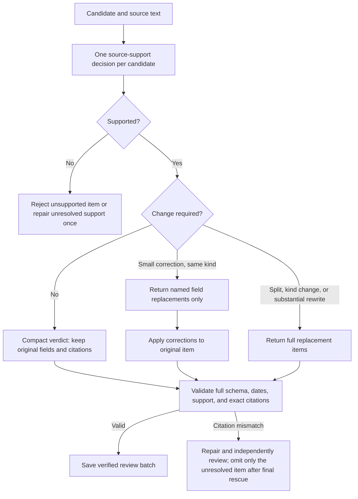

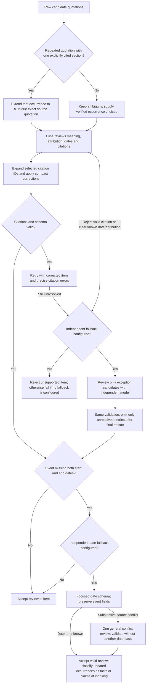

The missing-date check also applies to events accepted or created by the
independent exception reviewer. Permission to escalate source-support review
and permission to resolve dates are separate: preventing recursive fallback
does not skip the dedicated date resolver. Classification review defers date
resolution to its caller; a substantive date conflict receives one general
review without starting another date-resolution cycle. Without an independent
fallback configured, supported undated occurrences are still retained as facts
or claims at final indexing.

The date resolver preserves partial dates, uncertain bounds and unknown dates.
Bounded dates describe possible occurrence limits, not continuous activity.
Invalid date decisions receive at most two attempts per reviewer, with
successful stage results eligible for checkpoint reuse. After model failover,
an unresolved decision retains a cited occurrence with an explicit unknown
date; if its original citations are invalid, only that entry is omitted. API
and storage failures still fail the document. An unsuccessful date search does
not borrow a nearby date.

Each correction names a permitted field and supplies its replacement text or
array. Unused payload slots must be null or empty arrays. Array corrections
replace the whole array, including supporting quotations, so the reviewer must
retain every still-needed citation. Corrections cannot change evidence kind,
repeat a field, use a field from another kind, or bypass enum, date-part, and
citation validation. A null scalar is permitted only to clear a date part.
For a single corrected item of the same kind, a citation retry retains the
corrected fields, rather than restarting from the original candidate. Rejection
and repair telemetry includes the reviewer's explanation and model; citation
repair telemetry also records the validation errors.

Missing or ambiguous citations and unresolved support receive repair and an
independent fallback. If an individual entry still cannot be validated after
the final rescue reviewer, that entry is omitted with a `candidateRejected`
reason and verified peers continue. This applies to queued and inline review.
Model invocation failures, storage failures, exhausted agent limits, and
document-wide failures still reject the job.
The specific OpenAI Responses error `400 No tool output found for function call`
receives one fresh-agent retry with a fresh source-page read budget; a second
failure rejects the document job. Other 400 responses are not retried.
Active invocations are awaited and their semaphore permits released before the
job returns; workers stop scheduling new windows after a failure.

Up to four review batches per window can run concurrently within the shared
four-invocation process limit. Batches retain candidate order when their results
are merged. On a review failure, already active batches finish before the
document job rejects.

### Retry checkpoints

In deployed ingestion, extraction runs in the separate `evidence-extraction`
service. It consumes `EvidenceExtraction` through `evidence-extraction-group`.
The ingestion worker retains both raw input and converted Markdown until a
`FileIngestionCleanup` event finishes deletion and notification. The full process
and event ordering are documented in [the repository README](../README.md#data-ingestion-api).
The .NET ingestion worker uses Notification Service NuGet client version 1.0.0
to send `INGESTION` notices: `PRELIMINARY` after source-chunk indexing and before
evidence handoff, `EVIDENCE_EXTRACTION` after successful evidence indexing when
cleanup is received, and final `SUCCESS` after deleting the temporary blobs.
Acknowledged intermediate notices are saved in ingestion progress; failed jobs
send `FAILED` while retaining inputs, and superseded jobs send no completion
notice. Delivery and progress persistence are not atomic, so a crash or partial
recipient delivery can still repeat a notice.

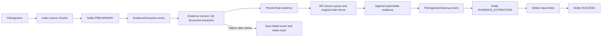

Each schema-valid extraction pass is saved independently in the private
`file-operations-evidence-checkpoints` Blob container. When a sibling pass fails,
a retry can reuse the completed passes without giving any pass another pass's
answers. Each completed reconciliation batch is also saved after source-support
review and citation validation. A later batch failure retries the unfinished
batches; completed batches remain available. No partial window is indexed.

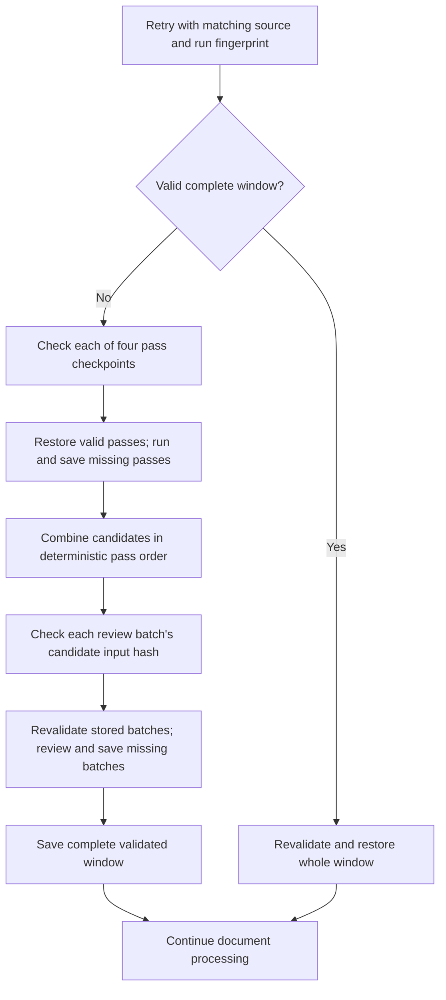

A complete window is saved once all its batches pass validation. This also
allows reuse when extraction finishes but Search indexing fails. Stage records
match the source window and stage input hash, check a stored output checksum,
and pass the stage's schema validation. Review batches and completed windows
also revalidate citations and document rendering. If regenerated passes change
the candidates or their order, the affected review batches are regenerated.
Invalid records are regenerated; storage failures reject the ingestion job.
Checkpoint stores that implement only the original window methods retain
window-level reuse.

Checkpoint names hash the account and source IDs. The run fingerprint includes
the entire source content, page metadata, selected deployments and reasoning
settings, and the extractor implementation, so a changed document or extraction
configuration starts fresh. Set `EVIDENCE_CHECKPOINT_EPOCH` to a new value to
invalidate checkpoints after a deployment changes behavior without a code or
configuration change. Synchronous extraction clears checkpoints after indexing.
The separate evidence service keeps its pass, batch, and window checkpoints until expiry so retries
cannot race with checkpoint removal for a newer job. Its persisted final output
is removed after successful indexing and cleanup publication, while the completed
job marker remains for broker replay. Explicit
source removal and account purge clear theirs. Abandoned records are deleted
after 30 days. The container holds evidence text and quotations, so
its storage account should have the same access controls and retention policy
as other source data. `STORAGE_ACCOUNT_NAME` selects its storage account;
`DefaultAzureCredential` authenticates with the workload identity and Azure RBAC.

Deduplication conservatively merges identical structured items on the same
source page and combines citations and provenance. It preserves
different speakers, polarity, dates, qualifiers, and conflicting claims.
Before embedding and indexing, `evidenceDeduplication.ts` merges identical
statements (allowing whitespace differences) when their material metadata is
compatible. This handles duplicate records whose quotations or formatting differ.
It retains every citation and extraction provenance entry, combines classification
tags, and rebuilds `pageContent` before the embedding is generated.
Different named participants, subjects, reporters, claimants, polarity, dates,
known locations, or causes remain separate. Missing participant/location/cause
details may be enriched by the matching record. For identical statements with
the same primary quotation and offset, subset `who` and `subject` annotations
can merge automatically when both fields are contained in the same fuller
record. Additional labels must be explicit in the assertion or supported by
the existing attribution rules, or have a shared cited participant and explicit
wording in that primary quotation. The latter also permits a possessive
description such as "Petitioner's personal property" when the quotation says
"personal property listed as Petitioner's". It does not combine disconnected
words into names or relationships. The merge retains all labels and extraction
provenance and rechecks earlier candidates after absorbing a fuller record.
Crossed or competing participant lists, unsupported labels, and unsupported
reporter additions still require review. Unknown annotations count as missing,
not support for enrichment. The new citation-based label support requires an
identical primary occurrence; matching supporting spans do not qualify.
Paraphrased duplicates can remain; semantic deduplication must be evaluated
before allowing it to discard distinct evidence.

## Cost and measurement

There are four extraction invocations per window, followed by one review per
16 candidates, plus repairs and context/tool rounds when needed. Empty candidate
sets need no reconciliation. At most three windows run per document and four
agent invocations share the process semaphore. Each agent has a recursion limit
of 24; model requests have a 180-second timeout and up to two SDK retries.
Parallel review, compact unchanged verdicts, and field-only corrections aim to
reduce elapsed time and review output tokens. Pass and batch checkpoints reduce
repeat model work after interrupted or failed ingestion, with additional storage
reads and writes; they do not reduce the model work of a source's first successful
extraction. Actual token savings from field-only corrections require a live
comparison on the same saved candidates; no savings percentage is assumed.

Telemetry records deployment and stage token usage, window completion, candidate
counts, accepted counts, conservative duplicate merges, final document duplicate
merges, independent-only output
counts, repair attempts, rejections, unresolved failures, restored windows,
review-batch duration, GPT tool-output retries, and per-invocation queue wait
and duration. Independent-only
counts are operational diagnostics, not measured additional recall: paraphrases
can remain and model judgments can be wrong.

TOON was evaluated for the reconciliation candidate input. A representative
16-item sample of the synthetic document's nested event and claim objects
round-tripped correctly, but used about 2,814 tokens in TOON versus 2,493 in
JSON with a `cl100k_base` tokenizer proxy. JSON remains the input format for
this mixed, nested payload. Reconsider TOON if candidate data becomes more
uniform, and measure with the deployed model's actual token usage.

Compare final indexed evidence with the prior extractor on adjudicated legal
documents. Measure event/fact/claim recall, attribution, citation support, unsupported
items, duplicates, per-document omissions, latency, and actual token costs.
Include a same-model independent-pass control to distinguish model diversity
from an additional extraction opportunity. No recall improvement or exhaustive
coverage is established until that evaluation is performed. Fixed context
budgets, OCR quality, model omissions, and mistaken review decisions can still
limit coverage.

### Benchmark artifacts and credentials

Benchmark directories may contain private settings alongside evidence. Export
only explicitly selected result/review files; never archive a whole run directory.
Exclude `settings.private.json`, appsettings, environment files and credentials.
Review selected logs and checkpoints before sharing them. The offline
classification runner avoids copying input configuration, but its evidence and
quotations remain confidential source material.

The prerelease review reported credentials in a shared benchmark archive. Remove
that archive from distribution and provide a replacement with reviewed files.
If it left the intended trusted environment, rotate the affected credentials;
removing the file from a later archive does not invalidate exposed keys.

## Run the local integration test

From `src/DataIngestionService`, run:

```bash
bun run test
bun run test:live:evidence
```

The live command loads the ignored `.vscode/azure-test.appsettings.json` and
uses the actual Luna and Sol deployments. It processes the current contents of
`test/fixtures/evidence-live.md`, deriving page numbers from its page breaks.
General checks verify source offsets, source identity/content hash, completion
of every window, calls to both deployments, and inclusion of available metadata
dates in the generated evidence text. Artifacts record the selected deployments
and requested GPT reasoning settings; Claude does not use those GPT settings.
Counts of events, static facts,
claims, undated items, and items with cross-page citations are reported separately.
It does not index results, use Blob checkpoints, or send application telemetry.

### Compare reconciliation models on the same candidates

The live runner can save the exact candidates entering source-support review and
replay them without invoking the three primary workers or independent worker.
Keep the source frozen between runs. From `src/DataIngestionService`:

```bash
umask 077
mkdir -p ../../.local/reconciliation-benchmark/candidates
cp test/fixtures/evidence-live.md ../../.local/reconciliation-benchmark/input.md
bun run test:live:evidence --input ../../.local/reconciliation-benchmark/input.md \
  --candidateMode captureOnly --candidateDirectory ../../.local/reconciliation-benchmark/candidates \
  --output ../../.local/reconciliation-benchmark/capture.json
bun run test:live:evidence --input ../../.local/reconciliation-benchmark/input.md \
  --candidateMode replay --candidateDirectory ../../.local/reconciliation-benchmark/candidates \
  --reconciliationModel sol --output ../../.local/reconciliation-benchmark/sol.json
bun run test:live:evidence --input ../../.local/reconciliation-benchmark/input.md \
  --candidateMode replay --candidateDirectory ../../.local/reconciliation-benchmark/candidates \
  --reconciliationModel luna --output ../../.local/reconciliation-benchmark/luna.json
bun run test:live:evidence --input ../../.local/reconciliation-benchmark/input.md \
  --candidateMode replay --candidateDirectory ../../.local/reconciliation-benchmark/candidates \
  --reconciliationModel sol --reconciliationTier priority \
  --output ../../.local/reconciliation-benchmark/sol-priority.json
```

For a Mistral trial, replay the same captured candidates with
`--reconciliationModel mistral`. The live runner accepts `--concurrency 1` to
limit active agent invocations. `--requestIntervalMs` with concurrency 1 spaces
agent starts; the model setting `EVIDENCE_RECONCILIATION_REQUEST_INTERVAL_MS`
also spaces individual HTTP requests within each agent. Use a separate output
path and a private settings copy for experimental output limits and pacing.
Reconciliation configuration in each result records the Mistral output cap and
HTTP request interval.

The first run captures candidates without review. The model-comparison replays
use Sol `low` and Luna `xhigh` on those same candidates; the final command also
requests Azure priority processing for Sol. An interrupted capture-only run reuses
existing source-matched snapshots and fills in missing windows. Each saved window
contains the source hash, window location and text hash, and the structured
candidates. Replay rejects a mismatched source, window, or duplicate candidate
ID. Keep this directory private because it contains document evidence. The
result artifacts report requested model roles, actual model calls and tokens,
window completion, citation validation, and whether extraction was skipped.
Use source review to adjudicate disagreements; matching Sol's output alone is
not a quality measure. The reconciler judges each candidate's source support
and classification. Semantic duplicate review is a separate task; the existing
deterministic deduplication runs after reconciliation.
Model calls incur normal Azure usage.

To compare batch packing while retaining every candidate and Sol as reviewer,
replay the same snapshot directory twice with `--reconciliationModel sol` and
`--verbosity default`. Set `--batchMode fixed` for the current 16-candidate
batches and `--batchMode tokenAware` for batches capped at 24 candidates and an
estimated 5,000 candidate tokens. The estimate uses `o200k_base` and is only a
packing limit; actual input, output, cache, and page-read usage comes from model
telemetry. `EVIDENCE_RECONCILIATION_BATCH_MODE=tokenAware` enables this mode for
ingestion, while the default remains `fixed` until a quality and cost comparison
supports changing it.

On the 16-page frozen-candidate pilot, fixed/default-verbosity review used 103
batches, 222 model calls, 1,809,305 input tokens, 231,868 output tokens, and
677 seconds. Token-aware/default-verbosity review used 71 batches, 167 calls,
1,559,036 input tokens, 239,658 output tokens, and 640 seconds. Both completed
and passed citation and formatting checks. The larger batches used 3.4% more
output tokens and produced more repeated statements; primary-quote coverage was
slightly lower. The second run also received cache hits that the first did not,
so their cache-adjusted costs are not a controlled comparison. Keep fixed as
the default and use source-reviewed samples from multiple documents before
changing it.

Before embedding, exact duplicate assertions are merged across extraction passes
within the same account, source revision and primary page. Classification is not
always an identity boundary: event, fact and unattributed claim tags can coexist
on one record. Claims with a known claimant remain separate from event/fact
records through both exact and reviewed deduplication, preserving allegation
and report attribution. Conflicting specific fact types require review. The
primary representation follows **event > fact > claim**, regardless of input
order. Merges remove superseded `*:other` tags and keep the active `factType:`
tag consistent with `metadata.factType`, retaining original types in
`evidenceClassifications`. They retain citations, compatible details, extractor
provenance and contributing `evidenceClassifications`. Different amounts, dates,
participants, known claimants, polarity and event roles remain protected. New
records carry `accountId`; legacy records without it must be processed from a
single account index. Supporting citations on another page do not expand the
identity scope. Extraction and review instructions distinguish directly recorded
attributes, identities, reference numbers and measurements from attributed
assertions; `factualAssertion` is not a catch-all for document statements.
Generic `subject` roles may be refined by a specific role for the same participant,
and nested trigger excerpts at one occurrence may merge. All role citations are
retained; conflicting specific roles and separate trigger occurrences remain distinct.
For an identical assertion with an identical primary citation, shortened proper-name
prefixes and omitted professional credentials may reach semantic review. They never
authorize automatic merging. Both label sets survive a reviewed merge; different
full names and indirect matches through a shared short label stay separate.
When review selects fuller wording from a lower-ranked representation, that
wording's quote, offset and primary source span remain together. Other citations
are retained as supporting spans. Participant context reserves actual identity
headers; ordinary email/memo `Subject:` topics cannot displace them. Live repeat
checks include representation, claimant, polarity, participants, timing and
primary citation coordinates so separate occurrences and attributions are not
counted as failed deduplication.

`EVIDENCE_CANONICALIZATION_MODE=review` enables a document-level duplicate
review after citation validation and the existing exact deduplication, before
embeddings. The live benchmark accepts `--canonicalizationMode review` for an
isolated trial. The local Test settings and Test example enable it; the default
for other environments is `off`. The pass compares evidence only within the
same account, source revision and primary page, including different quotation
offsets and event/fact/claim classifications. Structured guards protect
dates, named people, claimant, polarity, numbers, qualifiers, and source identity.
Unambiguous full calendar dates are compared across numeric and written formats;
ambiguous dates retain their original interpretation. Month names in full dates
do not create uncertainty qualifiers. Lexical similarity or an identical primary
citation proposes review pairs; neither removes evidence. This allows different
representations with little shared wording to reach semantic review. The reconciliation model then selects a
surviving source-grounded statement only for a clear duplicate. The primary
representation still follows event > fact > claim. Merges preserve
all verified citation spans and extractor provenance, rebuild `pageContent`,
and require pairwise approval throughout a cluster. A failed review is retried
once in smaller batches; remaining failures leave every affected record in
place. Review runs in batches of 16 pairs with at most four concurrent calls
and does not request additional page reads.

Different type and facet tags can propose a review pair when the other guards pass.
Tag differences alone neither block review nor authorize a merge: the model
must determine whether they describe one proposition or distinct supported
content. Approved merges union all contributing tags. Distinct conditions,
interpretations, actions and assessment results remain separate.

The reviewer returns assertion identity, semantic coverage and a detail inventory
for every pair. Code derives the `duplicate`, `distinct` or `uncertain` verdict
and an allowed survivor. Missing, repeated or invalid decisions trigger
the bounded review retry and otherwise retain the affected records. The merge keeps
one existing statement; it does not combine two statements. A shared citation
containing both details is insufficient when the surviving statement loses one.
Canonicalization replay results include `reviewDecisions` for auditing retained
pairs as well as the approved merges and applied changes.

Occurrence review compares the statement together with its structured dates.
A date absent from `what` is not unknown when `whenStarted` identifies it.
Equivalent records supported by the same citation set, or a subset, may merge
with the fuller wording and all citations retained. Source overlap alone does
not establish equal meaning. The clause-expansion guard ignores punctuation
inside unambiguous calendar dates while checking commas and conjunctions outside
them. Different dated sessions remain distinct even when they share one source
sentence. See the interview occurrence evaluation (operational record retained privately).

Metadata resolution is required for competing known labels, not for an omitted
annotation, an unknown placeholder or a participant list contained in the other
record's list. Those annotations can enrich a semantically approved merge;
all original labels survive. Structured event roles retain their separate
compatibility checks. Exact matching does not assign an unknown claimant to
a named claimant without semantic review.

A recommendation adjective can identify an item already established in the
source: "the recommended training will focus on X" can express the same
assertion as "training will focus on X." When this modifier and an optional
article are the only wording difference, the records may reach semantic review
if their validated citations share recommendation context. The explicit modifier
must survive; a modern semantic assessment is required. This does not erase
recommendation predicates or equate recommended actions with completed actions.
See the recommendation-reference evaluation (operational record retained privately).

Supporting metadata citations are validated against the original source and
pair. An explicit ellipsis may be expanded to the full supplied passage when
its fragments occur unambiguously in order and omit no recognized negation or
qualification. A misplaced citation index may be corrected only to a unique
matching passage on the same declared side. The merge history retains both the
original citation and its correction. Unmatched or ambiguous citations on an
otherwise mergeable pair trigger a focused retry with validation feedback;
they no longer become a `distinct` verdict. Valid sibling decisions are reused,
and exhausted retries leave both records in place with the pair marked failed.
See the 15-page metadata citation evaluation (operational record retained privately).

A focused 10 October replay used four saved events and eight disjoint duplicate
pairs from the 15-page result. Three assessment events recovered uncertain
18 July–21 August 2018 bounds; consent remained undated. An initial duplicate
review incorrectly merged distinct relationship descriptions despite explaining
that neither survivor preserved both. After adding explicit verdicts and
clarifying statement preservation, the same eight pairs produced five expected
merges and retained all three distinct pairs. All citations, role references,
tags, provenance and generated content passed checks. The final duplicate call
used 696 output tokens; all focused calls, including the initial attempt, used
2,776. Details are in `.local/evidence-date-dedup-2026-10-10/README.md`.

These cases guided the change and are not a held-out quality evaluation. The
offline facet change generated 70 additional review leads in the full saved
result, not 70 confirmed duplicates. Full-document duplicate reduction and
additional review cost have not been measured for this revision.

Applying this pass to the saved fixed-batch result reduced 1,528 evidence
records to 1,353 using 22 additional Sol calls, 208,092 input tokens, 10,372
output tokens, and 46 seconds. Applying it to the saved token-aware result
reduced 1,551 to 1,338 using 27 calls, 259,421 input tokens, 13,360 output
tokens, and 59 seconds. The small synthetic result fell from 24 to 16 records.
All source citations and extractor roles survived; the current-format live
results retained valid generated page content. The reviewer left the sampled
distinct reading/writing results, diagnoses, and intervention goals separate.
These figures measure a pilot, not validated duplicate precision across legal
documents. The pass remains opt-in while a human-reviewed sample and a larger
document establish its false-merge rate and total cost.

To prepare a source-linked review queue from saved extraction and complete
canonicalization artifacts, run this from `src/DataIngestionService`:

```sh
bun run replay:evidence-canonicalization \
  --input BEFORE_FIXED.json --output AFTER_FIXED.json
bun run replay:evidence-canonicalization \
  --input BEFORE_TOKEN_AWARE.json --output AFTER_TOKEN_AWARE.json
bun run prepare:canonicalization-review \
  --run fixed BEFORE_FIXED.json AFTER_FIXED.json \
  --run token-aware BEFORE_TOKEN_AWARE.json AFTER_TOKEN_AWARE.json \
  --output-dir ../../.local/canonicalization-review
```

Each `BEFORE` file is a saved live extraction result. Each `AFTER` file is its
complete canonicalization result containing the reviewed pairs, decisions, and
applied merges. Replays make Azure model calls and record their token use. A
replay writes its artifact but exits nonzero if any review batch remains
unresolved; the review preparation command rejects that incomplete artifact and
mismatched sources.
The private output contains a complete CSV queue, a 100-row exploratory sample,
and instructions for labeling each pair as the same proposition, distinct, or
uncertain. It includes applied merges, exact-statement leftovers, and similar
wording at the same source anchor and date. Field differences are review clues,
not proof that a guard blocked a merge. No false-merge rate is claimed until a
person checks the source and labels the rows. The live benchmark now fails its
canonicalization check if any review batch remains unresolved; ingestion still
keeps the affected evidence records.
After labeling the CSV, run
`bun run summarize:canonicalization-review REVIEWED_CSV` to calculate the
observed false-merge and remaining-duplicate rates among reviewed rows. These
single-document sample rates should not be generalized to production files.

In one 16-page live-document pilot, Sol `low` completed review of 1,536 frozen
candidates in 674 seconds using 241,000 output tokens with `medium` verbosity. Luna `xhigh` failed after
one completed window, with 21 repair attempts. A guarded split of review work
between the models passed technical checks but took 800 seconds and used 320,000
output tokens; a faster split misclassified subjective observations as static
facts. Keep Sol as the default reviewer. This pilot has no human gold standard
and does not establish performance on 100-page documents.

The complete output and local telemetry are written to the ignored
`.local/evidence-live-result.json`. Optional `--input`, `--settings`, and `--output`
arguments select other files; model settings from the selected file override the shell
for this isolated process. A failed extraction or assertion exits nonzero and
records the error. These general checks establish processing and citation
integrity; source-support accuracy and recall require comparison with reviewed
annotations.

Live results also record local CPU seconds, average CPU usage as a percentage of
one core, and resident memory sampled each second. On Linux, `/proc/self/status`
supplies RSS and the process's peak resident memory, including startup and imports.
CPU measurements cover extraction and validation, excluding final result-file
serialization. These measure the local worker; Azure model CPU and memory are
outside the process. Earlier results without `resources` cannot be compared
retroactively. Heap statistics from different JavaScript runtimes are not used
as a substitute for resident memory.

For a long local run, add `--resume` and keep the same `--output` path on retries.
Completed passes, verified review batches, and completed windows are saved beside
that output as private local JSON files and validated again before reuse. Results
include `restoredStages`, `savedStages`, and `restoredWindows` counts. The runner
deletes those local checkpoints after all checks pass. GPT and Claude runs should
use separate output paths.
Candidate replays also support `--resume`: the runner hashes every snapshot into
the checkpoint identity, so a changed candidate set cannot restore an older
review. Captures cannot combine with `--resume`; finish capturing candidates,
then replay them with checkpoints when comparing reconcilers.

The original fictional example remains available with its specific assertions:

```bash
bun run test:live:evidence --input test/fixtures/evidence-synthetic.md --checks synthetic
```

Those assertions additionally check the payment, attributed affirmative and
denied claims, undated static fact, and identities supported by another page.

To check event/fact/claim classification on a fictional assessment table, run:

```bash
bun run test:live:evidence --input test/fixtures/evidence-categories-synthetic.md --checks categories --output ../../.local/evidence-categories-gpt.json
```

This checks that three scores are static facts without event tags, the
checklist completion remains an event, and a reported symptom remains a claim.
Run the same fictional document through both Claude deployments while keeping
the Test appsettings' GPT defaults intact:

```bash
bun run test:live:evidence --models claude --input test/fixtures/evidence-synthetic.md --checks synthetic --output ../../.local/evidence-claude-result.json
```

The Claude option requires the Test appsettings' Foundry host and LLM resource
key. It makes real Messages API calls and writes the result to the ignored local
artifact. Microsoft documents this API at
<https://learn.microsoft.com/en-us/azure/foundry/foundry-models/how-to/use-foundry-models-claude>.

## References and acknowledgements

### Research sources

The project maintainer supplied the OpenIE collection and the FEVER and event
extraction papers during design review. Credit for the underlying research
belongs to their authors; the table records how it relates to this pipeline.

| Source | Contribution to the design |
| --- | --- |
| **James Thorne, Andreas Vlachos, Christos Christodoulopoulos and Arpit Mittal (2018).** [FEVER: a large-scale dataset for Fact Extraction and VERification](https://arxiv.org/abs/1803.05355). | Informed sufficient evidence sets, supported/contradicted/not-established judgments, and evaluation that distinguishes retrieval failures from interpretation failures. FEVER is a claim verification benchmark. |
| **Viet Dac Lai (2022).** [Event Extraction: A Survey](https://arxiv.org/abs/2210.03419), especially sections 2.1, 3.6 and 3.7. | Informed event triggers, arguments and roles, use of document context, and joint review of event structure. These ideas underpin the optional event annotations and their citation checks. |
| **Kiril Gashteovski, Rainer Gemulla and Luciano del Corro (2017).** [MinIE: Minimizing Facts in Open Information Extraction](https://aclanthology.org/D17-1278/). | A relevant conceptual source, surfaced through the shared OpenIE collection, for preserving polarity, modality, attribution and quantities alongside propositions. This project uses its own schemas and rules; it does not run MinIE. |
| **`heathersherry` and contributors.** [Topic 07: Open Information Extraction, Knowledge-Graph-Tutorials-and-Papers](https://github.com/heathersherry/Knowledge-Graph-Tutorials-and-Papers/wiki/Topic-07:-Open-Information-Extraction). | Curated the resources used to explore clause extraction, semantic annotations and canonicalization. Individual research contributions remain attributed to their paper authors. |

These are conceptual influences on project-specific prompts, schemas, guards and
evaluation. Their published results do not establish this implementation's
accuracy, recall or suitability for legal decisions. The deterministic
classification rules and thresholds are local engineering choices.

### Project direction and review contributions

| Contributor or supplied review | Contribution |
| --- | --- |
| **Project maintainer** | Defined the evidence-preservation goals, supplied the live and synthetic examples and research links, requested model comparisons, prioritized cost and attribution, and proposed deterministic classification and embedding-assisted review. |
| **User-supplied ChatGPT and Claude.ai analyses** | Compared extraction coverage, usefulness, attribution and redundancy; highlighted interpretations and hedged observations being stored as facts. These reviews helped select concrete regression cases and focus attention on meaning preservation. |
| **Submitted Claude, GPT-6 and Gemini CSV reviews** | Rated all 80 sampled assertion pairs; supplied evidence for narrow paraphrase normalization and cited examiner-context comparison, and exposed the distinction between containment and full assertion equivalence. Reviewer identities are taken from the files; these AI-attributed ratings are not human gold labels. |
| **User-supplied Claude Code diagnosis** | Traced the Claude/Azure structured-output path and identified concerns with the JSON-string envelope, schema constraints, token truncation and repair context. This informed provider debugging and validation work. |
| **Other user-supplied model-cost analyses (reviewers unspecified)** | Contributed alternative-reconciler and cost considerations during model experimentation. A model discussed in a review is not assumed to be that review's author. |
| **“Prerelease review — legal evidence extraction pipeline” (supplied by the maintainer; reviewer unspecified)** | Identified the remaining subjective-observation, assessment-interpretation and polarity inconsistencies; called for human merge adjudication, downstream date checks, extraction recovery checks and credential-safe benchmark exports. It directly informed the latest classification regression work. |
| **Embedding proposal beginning “Text embeddings could be very useful for your evidence pipeline” (supplied by the maintainer; reviewer unspecified)** | Informed observation-only consistency checking, label-leakage prevention, retrieval of reviewed examples, document-disjoint evaluation, and keeping semantic similarity separate from evidentiary judgments. |
| **Codex (OpenAI)** | Assisted with implementation, regression tests, offline and cached replay, investigation of false positives, quotation grouping, assertion-alignment heuristics, and documentation in this workspace. Its spot checks are identified as AI observations rather than human adjudication. |

AI review findings are inputs to engineering decisions. Reported review metrics
remain attributed to those reviews unless reproduced locally; they are not human
gold labels or independent release approval. The latest prerelease review's
author/model was not identified, so no more specific authorship is assigned.
Project maintainers retain responsibility for review and release decisions.
